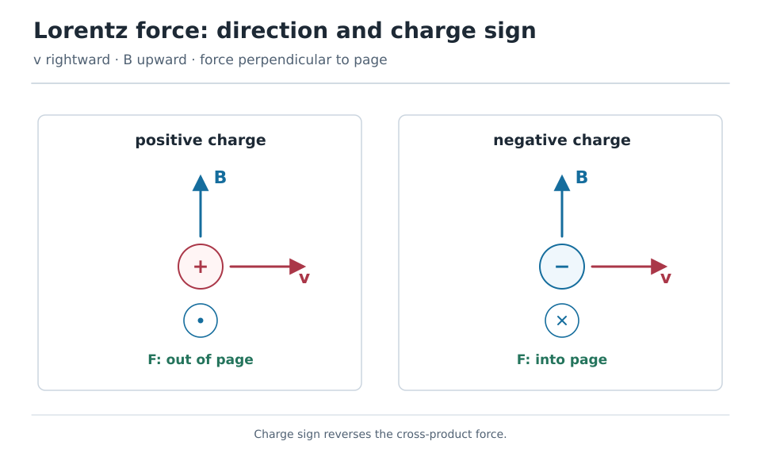

# M17-L2 – Magnetic Lorentz force and direction rules {#L2}

**Course area:** M17 – Magnetic fields and charged-particle motion. **Level:** qualification phase, advanced material marked. **Prerequisite:** [M17-L1](M17-L1.md). **Learning objective:** Determine the magnitude and direction of the magnetic force on a moving charge in a uniform field.

## Starting question {#S1}

A positive charge travels to the right while the magnetic field points upward. Where is the deflection, and how does the answer change for an electron?

## Concepts and relationships {#S2}

A moving charge $q$ in a magnetic field experiences the magnetic force $\vec F_{\mathrm B}=q\,\vec v\times\vec B$. Its **magnitude** is $F_{\mathrm B}=|q|vB\sin\alpha$, where $\alpha$ is the angle between velocity $\vec v$ and flux density $\vec B$. The force is largest for $\alpha=90^\circ$ and zero for motion parallel or antiparallel to the field. A stationary charge experiences no magnetic Lorentz force, although an electric force might still exist.

The **right-hand cross-product rule** gives, for a **positive** charge moving along +x in a field along +y, a force along +z (out of the page). For a **negative** charge the force is reversed (−z, into the page). Conventional current direction must not be confused with actual electron motion.

Because $\vec F_{\mathrm B}$ is always perpendicular to $\vec v$, a purely magnetic field does no work on a point charge: it changes direction but not speed. Qualitative forces and paths are part of the shared KMK Abitur core. Computing force magnitudes is a useful teaching step; exactly which algebraic depth is compulsory depends on the federal state.

*Charge sign reverses the direction of q·(v×B).*

## Worked example {#S3}

A particle of positive charge $q=3.2\cdot10^{-19}\,\mathrm C$ moves at $v=4.0\cdot10^5\,\mathrm{m/s}$ perpendicular to $B=0.25\,\mathrm T$. The magnitude is $F=3.2\cdot10^{-19}\cdot4.0\cdot10^5\cdot0.25=3.2\cdot10^{-14}\,\mathrm N$. At 30° the force is half as large because $\sin30^\circ=0.5$.

## Investigation and practice {#S4}

**Paper direction exercise:** Define x, y and z. First draw $\vec v$ along +x and $\vec B$ along +y; find the force for a proton and then for an electron. A dot ⊙ indicates out of the page, and a cross ⊗ indicates into the page.

## Check your learning {#S5}

### Questions

1. When does the magnetic Lorentz force vanish?
2. For $\vec v$ along +x and $\vec B$ along +y, what is the force direction for positive charge?
3. What is the example force at $\alpha=30^\circ$?
4. Why does a magnetic field alone not alter kinetic energy?

### Answers

1. When the particle is stationary or the velocity is parallel/antiparallel to B.
2. Along +z, out of the page.
3. $1.6\cdot10^{-14}\,\mathrm N$.
4. Magnetic force is perpendicular to velocity and therefore does no work.

## Model limitations {#S6}

The vector equation is a classical point-charge model. At very high speed or with additional electric fields, a broader description is required.

## Further reading (internal) {#S7}

- [M17-L1](M17-L1.md) · Review prerequisite
- [M17-L3](M17-L3.md) · Next lesson

## Sources (external) {#S8}

- [KMK – Physics standards for the Abitur (2020)](https://www.kmk.org/fileadmin/Dateien/veroeffentlichungen_beschluesse/2020/2020_06_18-BildungsstandardsAHR_Physik.pdf) · p. 20, §2.6.1: magnetic flux density and qualitative paths in the common core; quantitative trajectories as an advanced addition · Last accessed: 2026-11-21 · Content verified: 2026-11-21
- [OpenStax – University Physics 2, 11.2 Magnetic Fields and Lines](https://openstax.org/books/university-physics-volume-2/pages/11-2-magnetic-fields-and-lines) · Section 11.2: magnetic field, Lorentz force, tesla and direction conventions · Last accessed: 2026-11-21 · Content verified: 2026-11-21
- [OpenStax – University Physics 2, 11.3 Motion of a Charged Particle in a Magnetic Field](https://openstax.org/books/university-physics-volume-2/pages/11-3-motion-of-a-charged-particle-in-a-magnetic-field) · Section 11.3: circular motion, helical paths, radius and period in a uniform B field · Last accessed: 2026-11-21 · Content verified: 2026-11-21

## Evidence {#S9}

