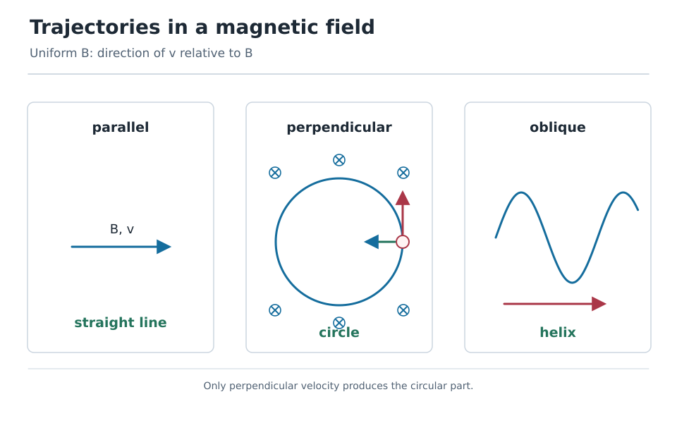

# M17-L3 – Paths of charged particles {#L3}

**Course area:** M17 – Magnetic fields and charged-particle motion. **Level:** qualification phase, advanced material marked. **Prerequisite:** [M17-L2](M17-L2.md). **Learning objective:** Explain straight, circular and helical paths in uniform magnetic fields qualitatively.

## Starting question {#S1}

How can a particle move in a circle inside a magnetic field if the force never acts tangentially to its velocity?

## Concepts and relationships {#S2}

In a uniform, time-independent magnetic field, the path depends on the angle between $\vec v$ and $\vec B$. If the particle starts **parallel** to the field, then $\vec F_{\mathrm B}=0$ and it continues in uniform straight-line motion in the ideal model. If velocity is **perpendicular** to the field, the magnetic force is perpendicular to velocity and provides the **centripetal force** required for circular motion. Speed remains constant in a constant magnetic field, although the direction of velocity continually changes.

For an **oblique entry angle**, split velocity into parallel $v_{\parallel}$ and perpendicular $v_{\perp}$ components. The parallel component persists, whereas the perpendicular component generates circular motion. The result is a **helical trajectory**. Reversing the charge sign reverses curvature direction for otherwise identical starting conditions.

A field line is not a particle's circular path. In a uniform field, field lines run parallel to B; circular orbits lie in planes perpendicular to B. The qualitative distinction among paths belongs to the common KMK Abitur core. Calculating the orbital radius is deferred to M17-L6 as additional advanced-level material.

*Perpendicular velocity produces circular motion; parallel velocity produces helix advance.*

## Worked example {#S3}

A positive particle initially travels rightward (+x) into a field directed **into the page** (−z). Its initial force is upward (+y), so its trajectory curves anticlockwise. A negative particle at the same initial velocity curves the other way.

## Investigation and practice {#S4}

**Schematic matching task:** For B along +z, draw three cases: (A) velocity +z, (B) velocity +x, (C) velocity with both x and z components. Match straight line, circle and helix. Label every drawing “ideal uniform B field”.

## Check your learning {#S5}

### Questions

1. What path occurs if velocity is parallel to B?
2. What force provides the centripetal acceleration?
3. Which path results if both parallel and perpendicular velocity components are nonzero?
4. Why are magnetic field lines not the circular particle trajectories?

### Answers

1. Uniform straight-line motion if no other forces act.
2. The magnetic Lorentz force.
3. A helix.
4. Field lines show the direction of B; the orbit lies in a plane perpendicular to B.

## Model limitations {#S6}

Collisions, nonuniform fields, electric forces and energy losses are omitted. Actual tracks are not always perfect circles or helices.

## Further reading (internal) {#S7}

- [M17-L2](M17-L2.md) · Review prerequisite
- [M17-L4](M17-L4.md) · Next lesson

## Sources (external) {#S8}

- [KMK – Physics standards for the Abitur (2020)](https://www.kmk.org/fileadmin/Dateien/veroeffentlichungen_beschluesse/2020/2020_06_18-BildungsstandardsAHR_Physik.pdf) · p. 20, §2.6.1: magnetic flux density and qualitative paths in the common core; quantitative trajectories as an advanced addition · Last accessed: 2026-11-21 · Content verified: 2026-11-21
- [OpenStax – University Physics 2, 11.3 Motion of a Charged Particle in a Magnetic Field](https://openstax.org/books/university-physics-volume-2/pages/11-3-motion-of-a-charged-particle-in-a-magnetic-field) · Section 11.3: circular motion, helical paths, radius and period in a uniform B field · Last accessed: 2026-11-21 · Content verified: 2026-11-21

## Evidence {#S9}

