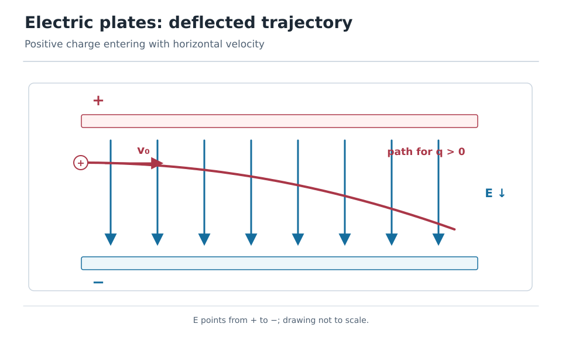

# M17-L4 – Energy and deflection in an electric field {#L4}

**Course area:** M17 – Magnetic fields and charged-particle motion. **Level:** qualification phase, advanced material marked. **Prerequisite:** [M17-L3](M17-L3.md). **Learning objective:** Determine energy changes from potential differences and explain deflection in a parallel-plate field.

## Starting question {#S1}

A positively charged particle moves from a higher-potential plate toward a lower-potential plate. Does it gain speed, and why is this unlike a purely magnetic force?

## Concepts and relationships {#S2}

In an **electric field**, a charge q experiences $\vec F_{\mathrm E}=q\vec E$. This force can act even on a stationary charge and, unlike a purely magnetic force, can have a component along the motion. Between points A and B the change in electric potential energy is $\Delta E_{\mathrm{pot}}=q(\varphi_B-\varphi_A)$. If no other work or losses occur, energy conservation gives $\Delta E_{\mathrm{kin}}=q(\varphi_A-\varphi_B)=qU_{AB}$, where $U_{AB}=\varphi_A-\varphi_B$.

For a **positive** charge, travelling from high to low potential increases kinetic energy. A **negative** charge accelerates against the field direction and gains speed toward higher potential. The magnitude of the energy change depends on charge and potential difference, not directly on mass. An electron-volt is an energy unit: $1\,\mathrm{eV}=1.602\cdot10^{-19}\,\mathrm J$.

If a particle enters horizontally between large horizontal plates, while the uniform electric field points vertically, its vertical acceleration is approximately constant and its trajectory is **parabolic** within the field in a classical approximation. Fringing fields modify the motion near plate edges. Under the KMK standards, energy changes in uniform electric fields are shared core material; quantitative path analysis is an advanced-level addition.

*Electric force can change kinetic energy; the plotted trajectory is idealised.*

## Worked example {#S3}

A positive charge $q=2.0\,\mathrm{nC}$ traverses a potential drop $U_{AB}=50\,\mathrm V$. Electric work is $W_{\mathrm E}=qU_{AB}=2.0\cdot10^{-9}\cdot50=1.0\cdot10^{-7}\,\mathrm J=0.10\,\mathrm{\mu J}$. Without losses, the particle gains this amount of kinetic energy.

## Investigation and practice {#S4}

**Drawing and energy accounting:** Label horizontal plates + on top and − below, draw the field downward, and determine the initial force on a positive particle entering horizontally. Keep any quantitative parabola equation clearly marked advanced. Do not construct a high-voltage deflection apparatus.

## Check your learning {#S5}

### Questions

1. How do electric and purely magnetic forces differ in their ability to do work?
2. What is the SI unit of $qU$?
3. Find the energy gain for positive $q=1\,\mathrm{nC}$ across $U_{AB}=20\,\mathrm V$.
4. How does an electron accelerate relative to the electric field?

### Answers

1. Electric forces may do work; magnetic force on a point charge cannot do work by itself.
2. Joules (J), since C · V = J.
3. $2.0\cdot10^{-8}\,\mathrm J=20\,\mathrm{nJ}$.
4. Opposite to the electric-field direction if no other force dominates.

## Model limitations {#S6}

Uniform field, ignored fringe effects and nonrelativistic motion. Collisions, radiation and other forces may change energy transfer.

## Further reading (internal) {#S7}

- [M17-L3](M17-L3.md) · Review prerequisite
- [M17-L5](M17-L5.md) · Next lesson

## Sources (external) {#S8}

- [KMK – Physics standards for the Abitur (2020)](https://www.kmk.org/fileadmin/Dateien/veroeffentlichungen_beschluesse/2020/2020_06_18-BildungsstandardsAHR_Physik.pdf) · p. 20, §2.6.1: magnetic flux density and qualitative paths in the common core; quantitative trajectories as an advanced addition · Last accessed: 2026-11-21 · Content verified: 2026-11-21
- [OpenStax – University Physics 2, 7.2 Electric Potential and Potential Difference](https://openstax.org/books/university-physics-volume-2/pages/7-2-electric-potential-and-potential-difference) · Section 7.2: electric potential energy, potential difference and electron-volt · Last accessed: 2026-11-21 · Content verified: 2026-11-21
- [OpenStax – University Physics 2, 11.3 Motion of a Charged Particle in a Magnetic Field](https://openstax.org/books/university-physics-volume-2/pages/11-3-motion-of-a-charged-particle-in-a-magnetic-field) · Section 11.3: circular motion, helical paths, radius and period in a uniform B field · Last accessed: 2026-11-21 · Content verified: 2026-11-21
- [DGUV – Safe Schools, physics: working with electricity](https://www.sichere-schule.de/physik/praktisches-arbeiten/elektrik) · Electromagnetic field precautions, medical implants and supervised electrical experiments · Last accessed: 2026-11-21 · Content verified: 2026-11-21

## Evidence {#S9}

