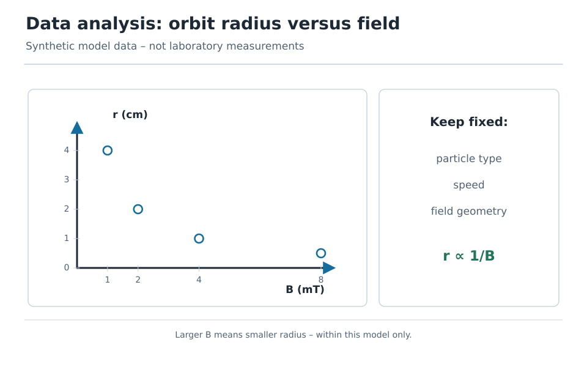

# M17-L5 – Experiments with charged particles {#L5}

**Course area:** M17 – Magnetic fields and charged-particle motion. **Level:** qualification phase, advanced material marked. **Prerequisite:** [M17-L4](M17-L4.md). **Learning objective:** Plan a controlled analysis of particle deflection, separate variables and assess model limitations.

## Starting question {#S1}

A teaching simulation displays a glowing ring whose radius changes when magnetic flux density is varied. What must remain constant to make the comparison meaningful?

## Concepts and relationships {#S2}

Start with a **testable question**: How does orbit radius r depend on magnetic field B? With particle species and speed unchanged, a plausible hypothesis is that stronger B produces a smaller orbit radius. A fair test keeps particle identity, charge magnitude, initial speed, field orientation and geometry as constant as possible. B is the independent variable; r is measured.

A traditional classroom demonstration is the **fine-beam electron tube**: electrons move inside a low-pressure gas tube; the visible glowing trace results from gas excitation and collisions, not from electrons being directly visible. Actual equipment may involve high voltage, glass and magnetic fields. **This course does not provide assembly or operating instructions.** For independent study, use supplied data or an approved simulation instead.

In an analysis, record at least five points where available, give r in metres, estimate uncertainty if warranted and plot r versus B. In the quantitative model at fixed speed, $r\propto1/B$, not $r\propto B$. If acceleration voltage U is changed instead, both v and r generally change, requiring a different comparison. Charge sign affects the direction of curvature, not the magnitude of the orbit radius. Equipment approval remains a teacher responsibility.

*At fixed m, q and v, r is inversely proportional to B; values are simulated.*

## Worked example {#S3}

A synthetic simulation series uses $(B,r)$ pairs $(1.0\,\mathrm{mT},4.0\,\mathrm{cm})$, $(2.0\,\mathrm{mT},2.0\,\mathrm{cm})$ and $(4.0\,\mathrm{mT},1.0\,\mathrm{cm})$ with constant $m$, $|q|$ and $v$. In each case $Br=4.0\,\mathrm{mT\,cm}$. This is **model-generated data**, not an actual laboratory record.

## Investigation and practice {#S4}

**Data analysis without apparatus:** Tabulate B and r from the example, plot the points and discuss why plotting r against 1/B would yield a straight line. List two real sources of uncertainty, such as nonuniform fields and imprecise reading of the ring diameter.

## Check your learning {#S5}

### Questions

1. Which variable is deliberately changed?
2. What must be held fixed when investigating $r(B)$?
3. What radius does the model predict at $B=8\,\mathrm{mT}$?
4. Why is the glowing track not a direct picture of individual electrons?

### Answers

1. Magnetic flux density B.
2. At least particle species, charge magnitude, speed and geometry.
3. $r=0.5\,\mathrm{cm}$ in the stated model.
4. The light comes from interactions of electrons with the gas in the tube.

## Model limitations {#S6}

The data are synthetic and idealized. Real experiments involve scatter, fringe fields, finite resolution and supervised safety assessment. No unsupervised high-voltage work.

## Further reading (internal) {#S7}

- [M17-L4](M17-L4.md) · Review prerequisite
- [M17-L6](M17-L6.md) · Next lesson

## Sources (external) {#S8}

- [KMK – Physics standards for the Abitur (2020)](https://www.kmk.org/fileadmin/Dateien/veroeffentlichungen_beschluesse/2020/2020_06_18-BildungsstandardsAHR_Physik.pdf) · p. 20, §2.6.1: magnetic flux density and qualitative paths in the common core; quantitative trajectories as an advanced addition · Last accessed: 2026-11-21 · Content verified: 2026-11-21
- [OpenStax – University Physics 2, 11.3 Motion of a Charged Particle in a Magnetic Field](https://openstax.org/books/university-physics-volume-2/pages/11-3-motion-of-a-charged-particle-in-a-magnetic-field) · Section 11.3: circular motion, helical paths, radius and period in a uniform B field · Last accessed: 2026-11-21 · Content verified: 2026-11-21
- [DGUV – Safe Schools, physics: working with electricity](https://www.sichere-schule.de/physik/praktisches-arbeiten/elektrik) · Electromagnetic field precautions, medical implants and supervised electrical experiments · Last accessed: 2026-11-21 · Content verified: 2026-11-21

## Evidence {#S9}

