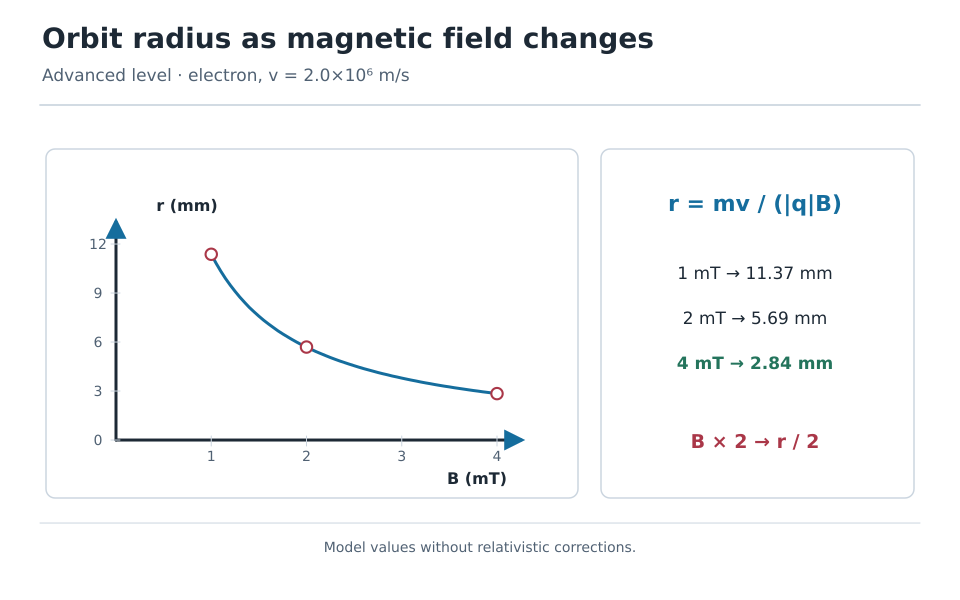

# M17-L6 – Advanced level: quantitative orbit analysis {#L6}

**Course area:** M17 – Magnetic fields and charged-particle motion. **Level:** qualification phase, advanced material marked. **Prerequisite:** [M17-L5](M17-L5.md). **Learning objective:** Calculate orbital radius and period in a uniform magnetic field and analyse parameter dependence.

## Starting question {#S1}

How does an electron orbit change if magnetic flux density is doubled? We now derive a quantitative result from the qualitative pattern of M17-L5.

## Concepts and relationships {#S2}

**Additional advanced-level content:** A particle of mass $m$, charge magnitude $|q|$ and speed $v$ enters perpendicular to a uniform magnetic field B. Magnetic force has magnitude $|q|vB$ and the required centripetal force is $mv^2/r$. Equating them yields

$$|q|vB=\frac{mv^2}{r}\quad\Rightarrow\quad r=\frac{mv}{|q|B}.$$

The angular frequency is $\omega=|q|B/m$ and the period is $T=2\pi m/(|q|B)$. For fixed particle properties and speed, doubling B halves the radius, but does not change speed. If a particle is accelerated from rest through a potential difference with the appropriate sign, the classical energy equation $\tfrac12 mv^2=|q|\,|U|$ gives $v=\sqrt{2|q|\,|U|/m}$. Therefore, for perpendicular entry, $r\propto\sqrt{|U|}/B$. Doubling acceleration voltage multiplies r by $\sqrt2$, not by two.

These are not universal orbit equations. They assume a uniform magnetic field only, perpendicular entry, nonrelativistic motion and negligible collisions. For oblique entry, only $v_\perp$ sets the helix radius; the parallel part produces axial travel. Under KMK Abitur standards, **quantitative path analysis** is expressly additional advanced-level content.

*With m, q and speed fixed, doubling B halves orbital radius.*

## Worked example {#S3}

For an electron with $m_e=9.11\cdot10^{-31}\,\mathrm{kg}$, $|e|=1.602\cdot10^{-19}\,\mathrm C$, $v=2.0\cdot10^6\,\mathrm{m/s}$ and $B=2.0\,\mathrm{mT}=2.0\cdot10^{-3}\,\mathrm T$, $r=mv/(|q|B)\approx5.69\cdot10^{-3}\,\mathrm m=5.69\,\mathrm{mm}$. The period is $T=2\pi m/(|q|B)\approx1.79\cdot10^{-8}\,\mathrm s=17.9\,\mathrm{ns}$. Doubling B reduces the radius to about 2.84 mm.

## Investigation and practice {#S4}

**Calculation and graph:** Compute model radii for B = 1, 2 and 4 mT at constant particle type and speed. Plot r against 1/B and explain the straight line through the origin. Identify why the formula needs revision at very high energy (relativistic effects).

## Check your learning {#S5}

### Questions

1. Derive the radius equation from two force expressions.
2. How does r change when B doubles, all else constant?
3. How does r depend on acceleration voltage $|U|$ from rest?
4. Find the example radius at $B=4.0\,\mathrm{mT}$.

### Answers

1. Set $|q|vB=mv^2/r$ and solve for r.
2. The radius halves.
3. $r\propto\sqrt{|U|}$ at fixed B, m and charge magnitude.
4. $r\approx2.84\,\mathrm{mm}$.

## Model limitations {#S6}

Classical nonrelativistic motion, uniform B and no electric-field contribution inside the orbit. Radiation, collisions, space charge and material interactions are omitted.

## Further reading (internal) {#S7}

- [M17-L5](M17-L5.md) · Review prerequisite
**Looking ahead:** The next module begins with [M18-L1 – Magnetic Flux and the Induction Principle](M18-L1.md).

## Sources (external) {#S8}

- [KMK – Physics standards for the Abitur (2020)](https://www.kmk.org/fileadmin/Dateien/veroeffentlichungen_beschluesse/2020/2020_06_18-BildungsstandardsAHR_Physik.pdf) · p. 20, §2.6.1: magnetic flux density and qualitative paths in the common core; quantitative trajectories as an advanced addition · Last accessed: 2026-11-21 · Content verified: 2026-11-21
- [OpenStax – University Physics 2, 11.3 Motion of a Charged Particle in a Magnetic Field](https://openstax.org/books/university-physics-volume-2/pages/11-3-motion-of-a-charged-particle-in-a-magnetic-field) · Section 11.3: circular motion, helical paths, radius and period in a uniform B field · Last accessed: 2026-11-21 · Content verified: 2026-11-21
- [OpenStax – University Physics 2, 11.2 Magnetic Fields and Lines](https://openstax.org/books/university-physics-volume-2/pages/11-2-magnetic-fields-and-lines) · Section 11.2: magnetic field, Lorentz force, tesla and direction conventions · Last accessed: 2026-11-21 · Content verified: 2026-11-21

## Evidence {#S9}

