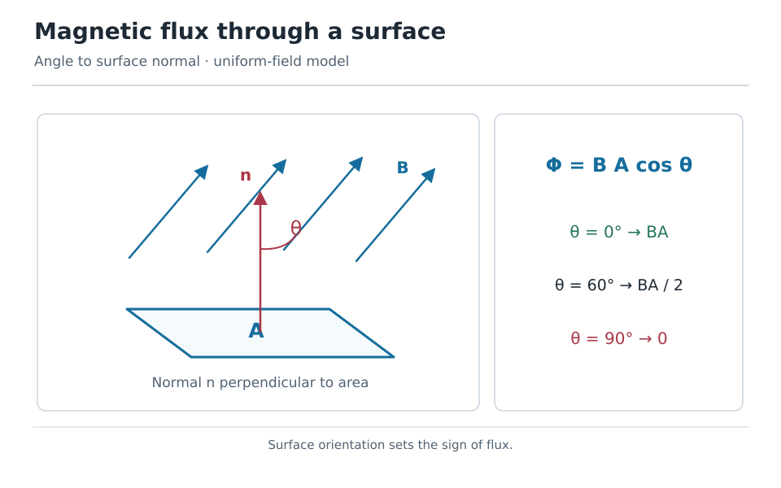

# M18-L1 – Magnetic Flux and the Induction Principle {#L1}

**Course area:** M18 – Electrodynamics, induction and time-varying fields. **Level:** qualification phase; advanced content explicitly marked. **Prerequisite:** [M17-L6](M17-L6.md). **Learning objective:** Calculate magnetic flux through an oriented surface and explain induction caused by changing flux.

## Starting question {#S1}

Why does a meter register a signal while a magnet moves relative to a coil, but not when the field remains unchanged?

## Concepts and relationships {#S2}

**Magnetic flux** $\Phi$ describes the component of the magnetic field $\vec B$ passing through an oriented surface. For a plane area $A$ in a uniform field,

$$\Phi=B A\cos\theta.$$

The angle $\theta$ is between the **field direction and the surface normal**, not between field and surface plane. Flux may be positive, negative or zero according to orientation. Its SI unit is the weber: $1\,\mathrm{Wb}=1\,\mathrm{T\,m^2}$. The magnitude is maximal at $0^\circ$ and zero at $90^\circ$. Reversing the chosen surface normal reverses the sign, not the physical device.

**Electromagnetic induction** occurs when the magnetic flux linked with a circuit changes over time, generating an electromotive force. Flux may change because the field, area or angle changes. For $N$ equivalent turns with the same change of flux, the **average** induced emf over a time interval is approximately $\overline U_{\mathrm{ind}}=-N\Delta\Phi/\Delta t$ under a chosen loop orientation. The minus sign expresses Lenz’s law (M18-L2). The differential law is treated later as a specifically advanced topic. An emf may exist in an open circuit; a sustained current requires a closed conducting path.

Under the KMK Abitur standards, induction caused by changing magnetic flux belongs to the common general/advanced core.

*The angle is defined between the surface normal and magnetic-field direction.*

## Worked example {#S3}

One loop has $A=0.015\,\mathrm{m^2}$ in $B=0.20\,\mathrm T$ at $\theta=60^\circ$. Hence $\Phi=0.20\cdot0.015\cdot\cos60^\circ=0.0015\,\mathrm{Wb}$. If the flux rises from zero to that value within $0.10\,\mathrm s$, a similar 50-turn coil has an average emf magnitude of $50\cdot0.0015/0.10=0.75\,\mathrm V$. Assign the sign only after choosing an orientation.

## Investigation and practice {#S4}

**Safe investigation:** Sketch a loop with its surface normal relative to parallel magnetic-field arrows. Calculate flux for $0^\circ$, $60^\circ$ and $90^\circ$. Use a table or simulation for time variation; physical coil demonstrations require supervised low-voltage equipment.

## Check your learning {#S5}

### Questions

1. Why is the angle measured relative to the surface normal rather than the plane?
2. Find $\Phi$ when $B=0.40\,\mathrm T$, $A=0.020\,\mathrm{m^2}$ and $\theta=0^\circ$.
3. Flux falls from $4\,\mathrm{mWb}$ to $1\,\mathrm{mWb}$ in $0.20\,\mathrm s$. Find $|\overline U|$ for $N=20$.
4. Does an open circuit necessarily prevent induction?

### Answers

1. Flux is the dot product $\vec B\cdot\vec A$; the area vector is normal to the surface.
2. $0.0080\,\mathrm{Wb}=8.0\,\mathrm{mWb}$.
3. $20\cdot0.003/0.20=0.30\,\mathrm V$.
4. No. Induced emf can exist even when no sustained circuit current can flow.

## Model limitations {#S6}

The simple $BA\cos\theta$ formula assumes a plane surface and uniform field. Nonuniform fields require $\Phi=\int\vec B\cdot\mathrm d\vec A$. Idealised field-line drawings are not field-strength measurements.

## Further reading (internal) {#S7}

- [M17-L6](M17-L6.md) · Review prerequisite
- [M18-L2](M18-L2.md) · Next lesson

## Sources (external) {#S8}

- [KMK – Physics standards for the Abitur (2020)](https://www.kmk.org/fileadmin/Dateien/veroeffentlichungen_beschluesse/2020/2020_06_18-BildungsstandardsAHR_Physik.pdf) · pp. 19–20, mathematical modelling and §2.6.1: induction core; differential law and inductance advanced additions · Last accessed: 2026-11-21 · Content verified: 2026-11-21
- [LEIFIphysik – Magnetic flux and Faraday’s law](https://www.leifiphysik.de/elektrizitaetslehre/elektromagnetische-induktion/grundwissen/magnetischer-fluss-und-induktionsgesetz) · Reference: flux, its time change and product rule · Last accessed: 2026-11-21 · Content verified: 2026-11-21

## Evidence {#S9}

