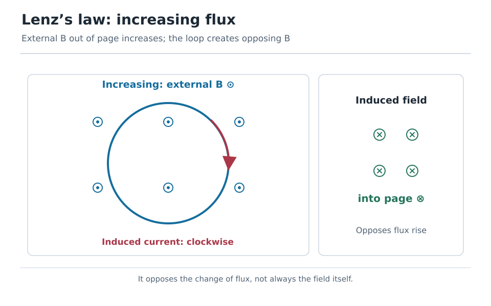

# M18-L2 – Lenz’s Law and Conservation of Energy {#L2}

**Course area:** M18 – Electrodynamics, induction and time-varying fields. **Level:** qualification phase; advanced content explicitly marked. **Prerequisite:** [M18-L1](M18-L1.md). **Learning objective:** Predict induced-current direction from changing flux and account for the energy transfer.

## Starting question {#S1}

Why do you feel resistance while pushing a magnet into a conducting coil, and why must work be done?

## Concepts and relationships {#S2}

**Lenz’s law** fixes the direction of an induced current: the magnetic field generated by that current **opposes the change in magnetic flux** responsible for induction. It need not oppose the original magnetic field. If an outward-pointing field through a loop becomes stronger, the loop produces an inward field. Using the right-hand rule, the **conventional current flows clockwise** when viewed from the front of the page. When the external flux decreases, the induced current direction reverses.

No electrical power source is needed: with a closed circuit and moving magnet, mechanical work can become electrical energy and eventually heat. If induced current instead amplified the original flux change, the apparatus could accelerate without matching energy input. The opposing response is consistent with conservation of energy.

**Four-step method:** (1) determine the external field direction through the loop; (2) decide whether its flux rises or falls; (3) choose an induced field that resists that change; (4) use the right-hand rule to find conventional current direction. An open circuit can still have an induced emf but not a circulating induction current.

*Increasing outward external flux causes the loop to create a field into the page.*

## Worked example {#S3}

The flux per turn of a 10-turn coil decreases from $0.012$ to $0.004\,\mathrm{Wb}$ in $0.40\,\mathrm s$. Thus $\Delta\Phi=-0.008\,\mathrm{Wb}$ and $\overline U=-10(-0.008)/0.40=+0.20\,\mathrm V$ for the chosen positive loop orientation. The sign makes sense only after specifying the area and meter-terminal convention.

## Investigation and practice {#S4}

**Safe practice:** Compare diagrams where flux out of the page is increasing or decreasing. Mark $B_{\mathrm{ind}}$ and the conventional current direction for each case. Physical demonstrations require supervised low-voltage apparatus; do not construct braking setups on rotating equipment.

## Check your learning {#S5}

### Questions

1. Does the induced field always oppose the external field?
2. An outward field is increasing: what is the induced conventional-current direction as viewed from the front?
3. An outward field is decreasing: which field direction does the loop produce?
4. Why is Lenz’s law consistent with energy conservation?

### Answers

1. No, it opposes the **change in linked flux**; for decreasing flux the induced field supports the existing flux.
2. Clockwise, producing a field into the page.
3. Out of the page; conventional current flows counterclockwise.
4. The reaction requires mechanical or other energy input to supply electrical output and losses.

## Model limitations {#S6}

The cases assume a single planar loop and a defined viewing direction. In real conducting bodies, distributed eddy currents and material losses complicate the field; the classroom rule is not a complete field simulation.

## Further reading (internal) {#S7}

- [M18-L1](M18-L1.md) · Review prerequisite
- [M18-L3](M18-L3.md) · Next lesson

## Sources (external) {#S8}

- [KMK – Physics standards for the Abitur (2020)](https://www.kmk.org/fileadmin/Dateien/veroeffentlichungen_beschluesse/2020/2020_06_18-BildungsstandardsAHR_Physik.pdf) · pp. 19–20, mathematical modelling and §2.6.1: induction core; differential law and inductance advanced additions · Last accessed: 2026-11-21 · Content verified: 2026-11-21
- [LEIFIphysik – Lenz’s law](https://www.leifiphysik.de/elektrizitaetslehre/elektromagnetische-induktion/grundwissen/lenzsche-regel) · Reference: induced-current direction and energy conservation · Last accessed: 2026-11-21 · Content verified: 2026-11-21
- [OpenStax – University Physics 2, 13.2 Lenz’s Law](https://openstax.org/books/university-physics-volume-2/pages/13-2-lenzs-law) · Section 13.2: Lenz’s law and induced response · Last accessed: 2026-11-21 · Content verified: 2026-11-21

## Evidence {#S9}

