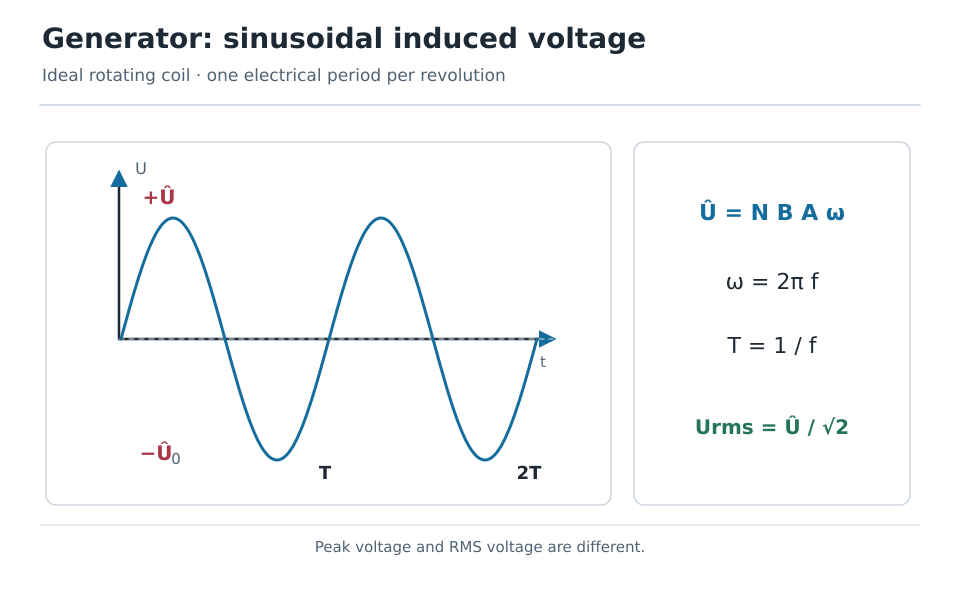

# M18-L3 – Generator and Alternating Voltage {#L3}

**Course area:** M18 – Electrodynamics, induction and time-varying fields. **Level:** qualification phase; advanced content explicitly marked. **Prerequisite:** [M18-L2](M18-L2.md). **Learning objective:** Calculate sinusoidal induced voltage, frequency and RMS value for an idealised generator.

## Starting question {#S1}

How can steady rotation produce a time-varying emf even though the field strength stays constant?

## Concepts and relationships {#S2}

An ideal generator has a loop or coil rotating at constant angular speed $\omega$ in a uniform magnetic field. Flux changes because the angle between the surface normal and field varies: $\Phi(t)=BA\cos(\omega t)$. For $N$ turns this gives a sinusoidal **open-circuit emf**

$$U_{\mathrm{ind}}(t)=N B A\omega\sin(\omega t).$$

The peak emf is $\hat U=NBA\omega$. For this **single-pole-pair model coil**, frequency is $f=\omega/(2\pi)$ and period is $T=1/f$. In real multi-pole generators, electrical frequency need not equal mechanical revolutions per second. For a pure sinusoid, $U_{\mathrm{rms}}=\hat U/\sqrt2$. Across a resistive load, this RMS voltage produces the same average heating power as the corresponding DC voltage.

A suitable **commutator** can rectify the external voltage, whereas slip rings supply alternating voltage. Real machines have internal resistance, friction, leakage fields and load effects. A small classroom generator model must not be confused with a real mains generator.

*An ideal rotating coil produces sinusoidal open-circuit induced voltage.*

## Worked example {#S3}

A model coil has $N=100$, $B=0.10\,\mathrm T$, $A=0.010\,\mathrm{m^2}$ and $f=25\,\mathrm{Hz}$. Thus $\omega=2\pi f\approx157.08\,\mathrm{s^{-1}}$ and $\hat U=100\cdot0.10\cdot0.010\cdot157.08\approx15.7\,\mathrm V$. For a sine wave, $U_{\mathrm{rms}}\approx11.1\,\mathrm V$ and $T=0.040\,\mathrm s$. These are no-load model results.

## Investigation and practice {#S4}

**Safe investigation:** Draw $U(t)$ across two whole periods and mark zeros, peak value and period. Compare a simulation; do not connect anything to mains or build a mains generator.

## Check your learning {#S5}

### Questions

1. Why does induction occur if $B$ has constant magnitude?
2. What is the period for $f=50\,\mathrm{Hz}$?
3. An ideal sinusoidal voltage has $\hat U=12\,\mathrm V$. Find its RMS value.
4. Why can loaded terminal voltage differ from open-circuit emf?

### Answers

1. The coil normal rotates, changing the magnetic flux.
2. $T=1/50\,\mathrm s=0.020\,\mathrm s$.
3. $12/\sqrt2\approx8.49\,\mathrm V$.
4. Internal resistance, losses and the reaction of load current cause a difference.

## Model limitations {#S6}

This model uses uniform field, a single pole-pair cycle, steady rotation and an ideal coil. $U_{\mathrm{rms}}=\hat U/\sqrt2$ holds only for pure sine waves, not all AC waveforms.

## Further reading (internal) {#S7}

- [M18-L2](M18-L2.md) · Review prerequisite
- [M18-L4](M18-L4.md) · Next lesson

## Sources (external) {#S8}

- [KMK – Physics standards for the Abitur (2020)](https://www.kmk.org/fileadmin/Dateien/veroeffentlichungen_beschluesse/2020/2020_06_18-BildungsstandardsAHR_Physik.pdf) · pp. 19–20, mathematical modelling and §2.6.1: induction core; differential law and inductance advanced additions · Last accessed: 2026-11-21 · Content verified: 2026-11-21
- [LEIFIphysik – Generator](https://www.leifiphysik.de/elektrizitaetslehre/induktion-und-transformator/versuche/generator) · Experiment: rotating loop and alternating voltage · Last accessed: 2026-11-21 · Content verified: 2026-11-21
- [OpenStax – University Physics 2, 13.6 Electric Generators and Back Emf](https://openstax.org/books/university-physics-volume-2/pages/13-6-electric-generators-and-back-emf) · Section 13.6: generator, changing flux and induced emf · Last accessed: 2026-11-21 · Content verified: 2026-11-21

## Evidence {#S9}

