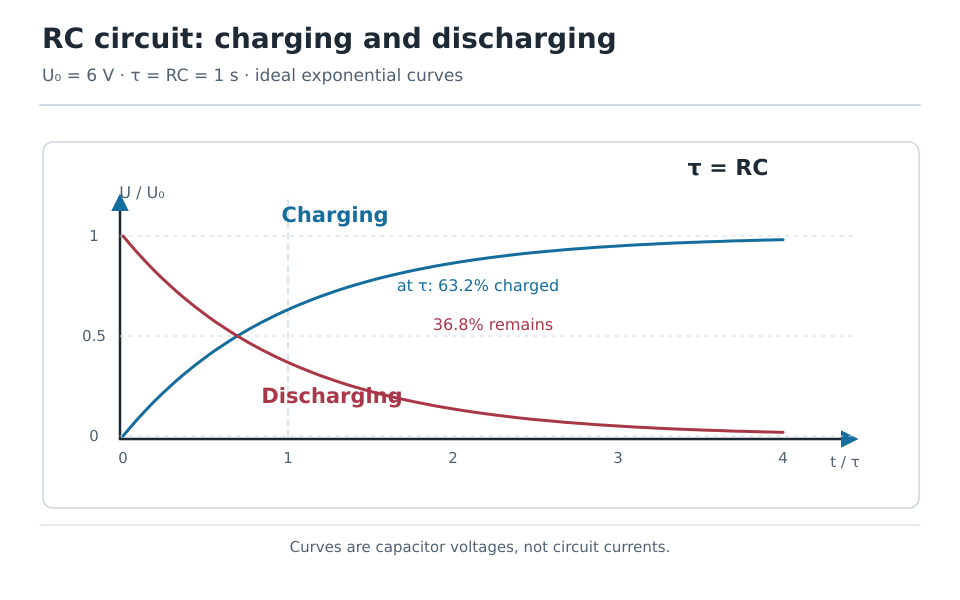

# M18-L4 – Capacitor Charging and Discharging {#L4}

**Course area:** M18 – Electrodynamics, induction and time-varying fields. **Level:** qualification phase; advanced content explicitly marked. **Prerequisite:** [M18-L3](M18-L3.md). **Learning objective:** Define the RC time constant and quantitatively interpret charging and discharging curves.

## Starting question {#S1}

Why does capacitor voltage change rapidly at first, then progressively more slowly?

## Concepts and relationships {#S2}

A capacitor stores electric energy in its field. During charging through an ohmic resistor $R$ from a constant ideal source $U_0$, capacitor voltage does not jump to its final value. For an initially uncharged capacitor,

$$U_C(t)=U_0\left(1-\mathrm e^{-t/(RC)}\right).$$

When a capacitor initially charged to $U_0$ **discharges without a source** through $R$, $U_C(t)=U_0\mathrm e^{-t/(RC)}$. The **time constant** $\tau=RC$ has units of seconds. After one time constant, charging has covered $1-\mathrm e^{-1}\approx63.2\%$ of the total rise, while discharging retains $\mathrm e^{-1}\approx36.8\%$ of the original voltage. Charge and voltage satisfy $Q=CU_C$. Current also changes exponentially, with a sign depending on the selected reference direction.

In the KMK Abitur standards the capacitor as an energy store belongs to the common core. Graph derivatives and integrals for charging/discharging are examples of mathematical modelling, while this specific RC circuit is a didactic supplement rather than a separately listed nationwide mandatory topic.

*After one time constant, charging reaches about 63.2% and discharging retains 36.8%.*

## Worked example {#S3}

For $R=10\,\mathrm{k\Omega}$, $C=100\,\mathrm{\mu F}$ and $U_0=6.0\,\mathrm V$, $\tau=10\,000\cdot100\cdot10^{-6}\,\mathrm s=1.0\,\mathrm s$. After one $\tau$, charging gives $U_C=6(1-\mathrm e^{-1})\approx3.79\,\mathrm V$; discharging from $6\,\mathrm V$ leaves $U_C=6\mathrm e^{-1}\approx2.21\,\mathrm V$.

## Investigation and practice {#S4}

**Safe investigation:** Make a spreadsheet for $t/\tau=0,1,2,3$ and calculate both curves. Real capacitor experiments should use only supervised low-voltage equipment; avoid mains power supplies or large energy-storage capacitors.

## Check your learning {#S5}

### Questions

1. What does $\tau=RC$ tell us?
2. Find $\tau$ when $R=2.0\,\mathrm{k\Omega}$ and $C=50\,\mathrm{\mu F}$.
3. What fraction of initial voltage remains after discharging for $2\tau$?
4. Is charging linear in time?

### Answers

1. It sets a characteristic timescale; after $\tau$ the voltage rise is about $63.2\%$ complete.
2. $0.10\,\mathrm s$.
3. $\mathrm e^{-2}\approx0.135=13.5\%$.
4. No, it follows an exponential curve with decreasing slope.

## Model limitations {#S6}

The formulas assume ideal constant $R$ and $C$ and the specified initial conditions. Leakage, lead resistance, variable capacitance and meter loading change real measurements.

## Further reading (internal) {#S7}

- [M18-L3](M18-L3.md) · Review prerequisite
- [M18-L5](M18-L5.md) · Next lesson

## Sources (external) {#S8}

- [KMK – Physics standards for the Abitur (2020)](https://www.kmk.org/fileadmin/Dateien/veroeffentlichungen_beschluesse/2020/2020_06_18-BildungsstandardsAHR_Physik.pdf) · pp. 19–20, mathematical modelling and §2.6.1: induction core; differential law and inductance advanced additions · Last accessed: 2026-11-21 · Content verified: 2026-11-21
- [OpenStax – University Physics 2, 10.5 RC Circuits](https://openstax.org/books/university-physics-volume-2/pages/10-5-rc-circuits) · Section 10.5: charging, discharging and RC time constant · Last accessed: 2026-11-21 · Content verified: 2026-11-21

## Evidence {#S9}

