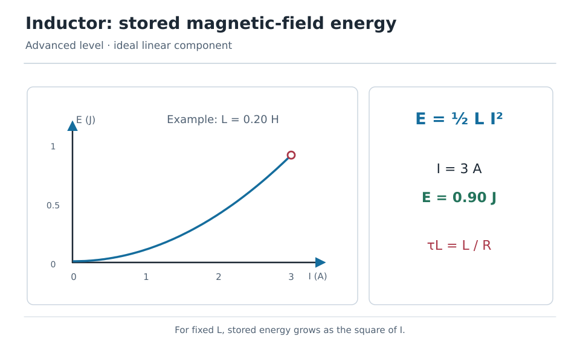

# M18-L5 – Inductor: Self-Induction and Magnetic Energy {#L5}

**Course area:** M18 – Electrodynamics, induction and time-varying fields. **Level:** qualification phase; advanced content explicitly marked. **Prerequisite:** [M18-L4](M18-L4.md). **Learning objective:** Calculate and explain self-induction and magnetic energy as advanced-level extensions.

## Starting question {#S1}

Why does an inductor resist abrupt current change, and how can its magnetic field store energy?

## Concepts and relationships {#S2}

Changing the current $I$ through an inductor changes the magnetic flux created by its own field. The resulting **self-induced emf** opposes the change in current. For constant inductance $L$, under a defined sign convention,

$$U_{\mathrm{ind}}=-L\frac{\mathrm d I}{\mathrm d t}.$$

Inductance $L$ is measured in henrys, $1\,\mathrm H=1\,\mathrm{V\,s/A}$. For an ideal linear inductor, stored field energy is $E_{\mathrm{mag}}=\tfrac12 L I^2$. Doubling current at fixed $L$ increases the energy fourfold. During switch-off, the field can return energy to the circuit; real circuits require appropriate means of limiting high transient voltages.

For an ideal series RL circuit with ohmic resistance, $\tau_L=L/R$. Current changes exponentially, rather than jumping instantaneously under a finite voltage and nonzero inductance. The KMK Abitur standards list **the inductor, its properties and inductance specifically as additional advanced-level (eA) material**. It is not automatically compulsory in the general-level track.

*At fixed inductance, magnetic stored energy scales with the square of current.*

## Worked example {#S3}

An ideal inductor with $L=0.20\,\mathrm H$ carries $I=3.0\,\mathrm A$. Stored field energy is $\tfrac12\cdot0.20\cdot3.0^2=0.90\,\mathrm J$. For a current increase of $15\,\mathrm{A/s}$, self-induced emf magnitude is $L\cdot15=3.0\,\mathrm V$. If $R=4.0\,\Omega$, then $\tau_L=L/R=0.050\,\mathrm s$.

## Investigation and practice {#S4}

**Safe investigation:** Use calculations or a simulation to compare $E_{\mathrm{mag}}$ at different currents. Real inductor switching should occur only in checked low-voltage setups with appropriate transient suppression under teacher supervision.

## Check your learning {#S5}

### Questions

1. Why does an inductor oppose rapid switching?
2. Calculate $E_{\mathrm{mag}}$ for $L=0.50\,\mathrm H$ and $I=2.0\,\mathrm A$.
3. What happens to stored energy if current doubles at fixed $L$?
4. Find the RL time constant for $L=0.30\,\mathrm H$ and $R=6.0\,\Omega$.

### Answers

1. Self-induced emf acts against the change in current.
2. $\tfrac12\cdot0.50\cdot4=1.0\,\mathrm J$.
3. It increases fourfold.
4. $\tau_L=0.050\,\mathrm s$.

## Model limitations {#S6}

Constant inductance is a linear approximation. Ferromagnetic saturation, eddy currents and winding resistance can change behaviour. Real inductors may generate hazardous transient voltages when disconnected.

## Further reading (internal) {#S7}

- [M18-L4](M18-L4.md) · Review prerequisite
- [M18-L6](M18-L6.md) · Next lesson

## Sources (external) {#S8}

- [KMK – Physics standards for the Abitur (2020)](https://www.kmk.org/fileadmin/Dateien/veroeffentlichungen_beschluesse/2020/2020_06_18-BildungsstandardsAHR_Physik.pdf) · pp. 19–20, mathematical modelling and §2.6.1: induction core; differential law and inductance advanced additions · Last accessed: 2026-11-21 · Content verified: 2026-11-21
- [OpenStax – University Physics 2, 14 Summary](https://openstax.org/books/university-physics-volume-2/pages/14-summary) · Chapter 14: self-induction, RL time constant, magnetic-field energy · Last accessed: 2026-11-21 · Content verified: 2026-11-21
- [OpenStax – University Physics 2, Chapter 14 Key Equations](https://openstax.org/books/university-physics-volume-2/pages/14-key-equations) · Chapter 14: inductor energy and RL time constant · Last accessed: 2026-11-21 · Content verified: 2026-11-21

## Evidence {#S9}

