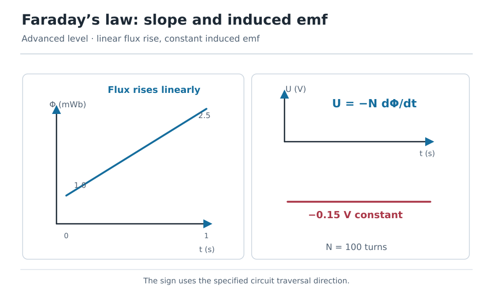

# M18-L6 – Advanced Level: Differential Faraday’s Law {#L6}

**Course area:** M18 – Electrodynamics, induction and time-varying fields. **Level:** qualification phase; advanced content explicitly marked. **Prerequisite:** [M18-L5](M18-L5.md). **Learning objective:** Use differential Faraday’s law under a clear sign convention and analyse time-dependent magnetic flux.

## Starting question {#S1}

What if flux does not change uniformly? How can instantaneous induced voltage be read from a flux–time graph?

## Concepts and relationships {#S2}

For a time-varying flux $\Phi(t)$ through each turn, **differential Faraday’s law** states, with a fixed surface normal and positive traversal direction,

$$U_{\mathrm{ind}}(t)=-N\frac{\mathrm d\Phi}{\mathrm d t}.$$

The derivative is the **instantaneous slope** of the flux–time curve. A linearly increasing flux produces constant negative emf; constant flux gives zero emf. A nonlinear flux curve produces time-dependent voltage. The sign depends on the agreed orientation of area vector and loop traversal; without such a convention it is meaningless to assign a definite positive or negative sign.

For a rigid plane loop in a spatially uniform time-varying field, $\Phi(t)=B(t)A\cos\theta$ if $A$ and $\theta$ are fixed. Therefore $U=-NA\cos\theta\,\mathrm dB/\mathrm dt$. If $A(t)$ or $\theta(t)$ also varies, the **entire product** $B(t)A(t)\cos\theta(t)$ must be differentiated. More general loops require the surface-integral definition of flux.

The KMK standards specify **the differential form as additional advanced-level material**. The qualitative principle belongs to the common core; calculus deepens it but does not replace a physical explanation.

*The constant flux derivative gives constant negative emf under the selected orientation.*

## Worked example {#S3}

A 100-turn coil encloses $A=0.0050\,\mathrm{m^2}$ at $\theta=0^\circ$. For $0\leq t\leq1\,\mathrm s$, $B(t)=0.20\,\mathrm T+(0.30\,\mathrm{T/s})t$. Thus $\Phi(t)=0.0010\,\mathrm{Wb}+(0.0015\,\mathrm{Wb/s})t$ and $\mathrm d\Phi/\mathrm dt=0.0015\,\mathrm{Wb/s}$. Consequently $U_{\mathrm{ind}}=-100\cdot0.0015=-0.15\,\mathrm V$, under the defined orientation.

## Investigation and practice {#S4}

**Safe investigation:** Plot the linear $\Phi(t)$ and another piecewise constant/linear curve. Determine slopes of smooth segments and the corresponding emf. At a sharp corner, compare one-sided slopes instead of claiming a unique derivative.

## Check your learning {#S5}

### Questions

1. What does $\mathrm d\Phi/\mathrm dt$ represent graphically?
2. For $N=40$ and $\mathrm d\Phi/\mathrm dt=-0.0050\,\mathrm{Wb/s}$, calculate emf.
3. What happens with constant flux even if $B$ is nonzero?
4. Why is the product rule needed if $A$ changes with time?

### Answers

1. It is the instantaneous slope of the flux–time curve.
2. $U=-40(-0.0050)=+0.20\,\mathrm V$ for the chosen traversal direction.
3. Emf is zero in this model because there is no flux change.
4. Because $\Phi=B A\cos\theta$ is a product of time-dependent factors, all of which may contribute to its derivative.

## Model limitations {#S6}

At a mathematical corner, the derivative may be undefined at that instant. Real switching is finite and nonideal coils have resistance and leakage flux.

## Further reading (internal) {#S7}

- [M18-L5](M18-L5.md) · Review prerequisite
**Looking ahead:** The next module begins with [M19-L1 – Periodic Motion and Its Quantities](M19-L1.md).

## Sources (external) {#S8}

- [KMK – Physics standards for the Abitur (2020)](https://www.kmk.org/fileadmin/Dateien/veroeffentlichungen_beschluesse/2020/2020_06_18-BildungsstandardsAHR_Physik.pdf) · pp. 19–20, mathematical modelling and §2.6.1: induction core; differential law and inductance advanced additions · Last accessed: 2026-11-21 · Content verified: 2026-11-21
- [LEIFIphysik – Magnetic flux and Faraday’s law](https://www.leifiphysik.de/elektrizitaetslehre/elektromagnetische-induktion/grundwissen/magnetischer-fluss-und-induktionsgesetz) · Reference: flux, its time change and product rule · Last accessed: 2026-11-21 · Content verified: 2026-11-21
- [OpenStax – University Physics 2, 13.1 Faraday’s Law](https://openstax.org/books/university-physics-volume-2/pages/13-1-faradays-law) · Section 13.1: flux changes and Faraday’s law · Last accessed: 2026-11-21 · Content verified: 2026-11-21

## Evidence {#S9}

