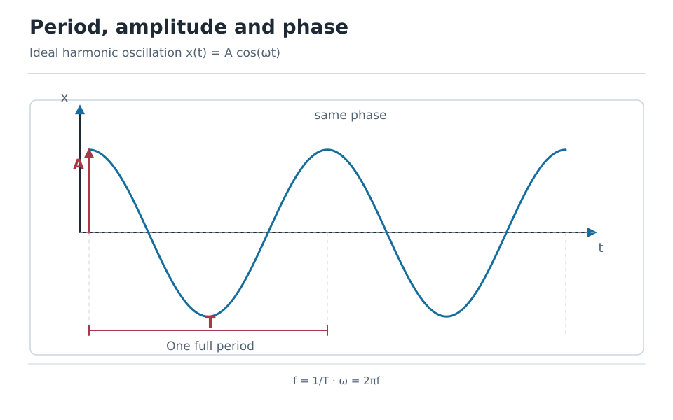

# M19-L1 – Periodic Motion and Its Quantities {#L1}

**Course area:** M19 – Oscillations and resonance. **Level:** qualification phase; advanced topics marked. **Prerequisite:** [M18-L6](M18-L6.md). **Learning objective:** Read amplitude, period, frequency and phase from a time graph and identify ideal harmonic motion.

## Starting question {#S1}

A swing repeatedly returns to the same position. How can we describe how fast and how far it oscillates?

## Concepts and relationships {#S2}

An **oscillation** repeatedly moves about an equilibrium position. Displacement $x(t)$ has a sign, while the **amplitude** $A$ is its greatest magnitude. The **period** $T$ is the time between equivalent states, for example successive positive maxima. The **frequency** $f=1/T$ is measured in hertz ($\mathrm{Hz}=\mathrm{s^{-1}}$). Angular frequency is $\omega=2\pi f$, measured in $\mathrm{rad/s}$. Ideal *simple harmonic motion* is described by

$$x(t)=A\cos(\omega t+\varphi_0).$$

The phase $\omega t+\varphi_0$ is an angle; $\varphi_0$ determines the initial point in the cycle. Angular frequency does not mean the object's speed along its path. A periodic process need not be sinusoidal. A properly scaled displacement–time graph reveals $A$, $T$ and, if two traces are present, their phase shift. Harmonic motion also obeys $a(t)=-\omega^2x(t)$: acceleration always points toward equilibrium.

*Amplitude measures displacement; period measures the interval between equivalent states.*

## Worked example {#S3}

A sensor records $+4.0\,\mathrm{cm}$ at $t=0$, $0.80\,\mathrm s$ and $1.60\,\mathrm s$. Therefore $A=0.040\,\mathrm m$, $T=0.80\,\mathrm s$, $f=1.25\,\mathrm{Hz}$ and $\omega=2\pi/0.80\approx7.85\,\mathrm{rad/s}$. Starting at positive maximum implies $\varphi_0=0$. The model gives $x(0.20\,\mathrm s)=A\cos(\pi/2)=0$.

## Investigation and practice {#S4}

Draw four cycles of a cosine curve on graph paper. Keep the vertical scale fixed and halve the period; explain how the graph and frequency change.

## Check your learning {#S5}

### Questions

1. How does periodic motion differ from harmonic motion?
2. One period takes $0.25\,\mathrm s$. Find $f$.
3. Find $\omega$ when $f=2\,\mathrm{Hz}$.
4. Can two oscillations have identical frequencies but different phases?

### Answers

1. Harmonic motion is sinusoidal; periodic motion merely repeats after $T$.
2. $f=1/0.25=4\,\mathrm{Hz}$.
3. $\omega=4\pi\,\mathrm{rad/s}\approx12.57\,\mathrm{rad/s}$.
4. Yes. A time offset produces a phase difference even at the same frequency.

## Model limitations {#S6}

Real oscillations may be damped, nonlinear or only approximately periodic. The harmonic law does not fit every repeating process.

## Further reading (internal) {#S7}

- [M18-L6](M18-L6.md) · Review prerequisite
- [M19-L2](M19-L2.md) · Next lesson

## Sources (external) {#S8}

- [KMK – Physics standards for the Abitur (2020)](https://www.kmk.org/fileadmin/Dateien/veroeffentlichungen_beschluesse/2020/2020_06_18-BildungsstandardsAHR_Physik.pdf) · p. 21, §2.6.2 oscillations; harmonic motion in general/advanced core, damping and resonance advanced · Last accessed: 2026-11-21
- [LEIFIphysik – Harmonic oscillations](https://www.leifiphysik.de/mechanik/mechanische-schwingungen/grundwissen/harmonische-schwingungen) · Basics: sinusoidal model, quantities and restoring force · Last accessed: 2026-11-21

## Evidence {#S9}

