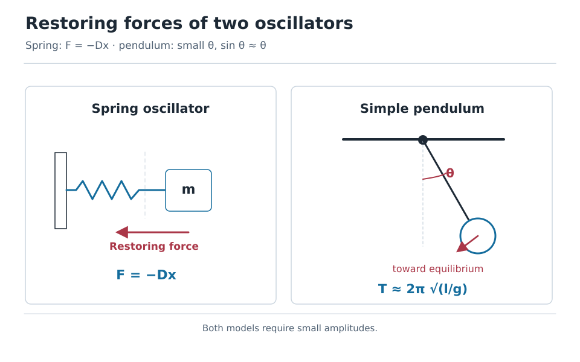

# M19-L2 – Spring Oscillator and Simple Pendulum {#L2}

**Course area:** M19 – Oscillations and resonance. **Level:** qualification phase; advanced topics marked. **Prerequisite:** [M19-L1](M19-L1.md). **Learning objective:** Compare restoring forces and calculate ideal periods for a spring oscillator and a small-angle pendulum.

## Starting question {#S1}

Why does adding mass change a spring oscillator’s period but not that of an ideal simple pendulum?

## Concepts and relationships {#S2}

For a linear **spring oscillator**, the restoring force is $F=-Dx$, with spring constant $D$ measured in $\mathrm{N/m}$. Substituting into Newton's law gives $\ddot x+(D/m)x=0$ and therefore

$$T_\mathrm{spring}=2\pi\sqrt{\frac{m}{D}}.$$

A larger mass increases the period; a stiffer spring decreases it. For a vertical spring, constant gravity shifts the equilibrium position but does not change the period in the ideal linear model.

For a **simple pendulum**, the tangential component of weight gives $F_\mathrm{tangential}=-mg\sin\theta$. At small angles in radians, $\sin\theta\approx\theta$ and arc displacement $s\approx l\theta$, yielding $\ddot\theta+(g/l)\theta\approx0$. Hence

$$T_\mathrm{pendulum}=2\pi\sqrt{\frac{l}{g}}.$$

Mass cancels. Both models assume negligible damping; the simple-pendulum formula also assumes a small swing angle, light inextensible string and point-like bob.

*A linear spring and small-angle pendulum produce different period formulas.*

## Worked example {#S3}

For $m=0.20\,\mathrm{kg}$ and $D=20\,\mathrm{N/m}$, $T_\mathrm{spring}=2\pi\sqrt{0.20/20}\approx0.628\,\mathrm s$. A pendulum of length $l=1.00\,\mathrm m$ at $g=9.81\,\mathrm{m/s^2}$ has $T_\mathrm{pendulum}\approx2.006\,\mathrm s$. Doubling length increases the period by $\sqrt2$, not by 2.

## Investigation and practice {#S4}

Compare oscillation periods at two small initial angles using a simulation. Change only one variable at a time: spring mass or pendulum length. Do not suspend heavy weights without suitable mounting.

## Check your learning {#S5}

### Questions

1. Why does a linear spring produce harmonic motion?
2. How does $T_\mathrm{spring}$ change if $m$ is quadrupled?
3. How does $T_\mathrm{pendulum}$ change if $l$ is quadrupled?
4. Which approximation is used for a simple pendulum?

### Answers

1. Restoring force is opposite and proportional to displacement in the linear range.
2. Period doubles ($\sqrt4=2$).
3. Period doubles ($\sqrt4=2$).
4. $\sin\theta\approx\theta$ for small angles in radians.

## Model limitations {#S6}

Large-angle pendulums have longer periods. Friction, spring mass and string mass have been neglected; these formulas do not directly apply to nonlinear or coupled oscillators.

## Further reading (internal) {#S7}

- [M19-L1](M19-L1.md) · Review prerequisite
- [M19-L3](M19-L3.md) · Next lesson

## Sources (external) {#S8}

- [KMK – Physics standards for the Abitur (2020)](https://www.kmk.org/fileadmin/Dateien/veroeffentlichungen_beschluesse/2020/2020_06_18-BildungsstandardsAHR_Physik.pdf) · p. 21, §2.6.2 oscillations; harmonic motion in general/advanced core, damping and resonance advanced · Last accessed: 2026-11-21
- [LEIFIphysik – Spring oscillator](https://www.leifiphysik.de/mechanik/mechanische-schwingungen/grundwissen/federpendel) · Basics: Hooke’s law and oscillation period · Last accessed: 2026-11-21
- [LEIFIphysik – Simple pendulum](https://www.leifiphysik.de/mechanik/mechanische-schwingungen/grundwissen/fadenpendel) · Basics: restoring force, small-angle approximation and period · Last accessed: 2026-11-21

## Evidence {#S9}

