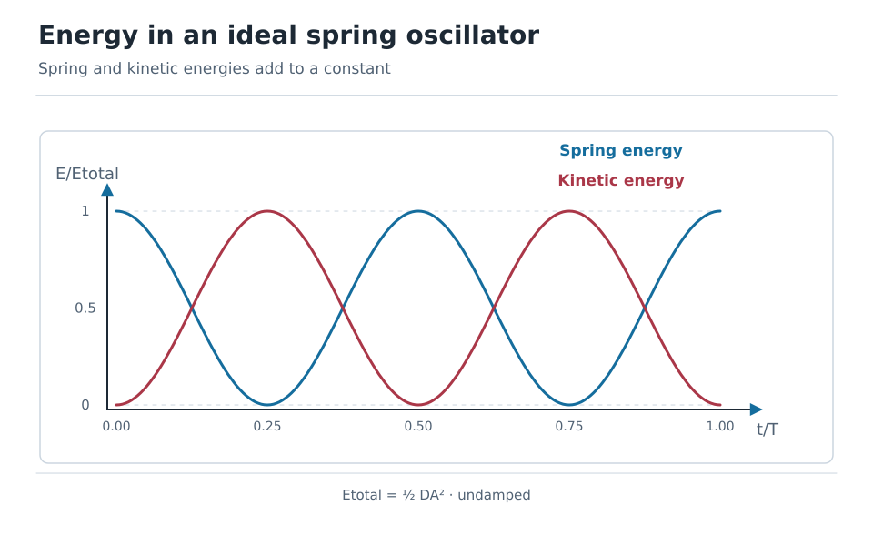

# M19-L3 – Energy Exchange in Harmonic Motion {#L3}

**Course area:** M19 – Oscillations and resonance. **Level:** qualification phase; advanced topics marked. **Prerequisite:** [M19-L2](M19-L2.md). **Learning objective:** Calculate spring and kinetic energies in an ideal harmonic oscillator and apply energy conservation.

## Starting question {#S1}

Why is a mass moving fastest through equilibrium when the spring stores the least energy?

## Concepts and relationships {#S2}

An ideal horizontal spring oscillator continuously exchanges energy between two forms. At maximum displacement $|x|=A$ the speed vanishes and spring energy is greatest; at equilibrium $x=0$ spring energy is zero and speed is greatest. For a linear frictionless oscillator,

$$E_\mathrm{spring}=\tfrac12Dx^2,\qquad E_\mathrm{kin}=\tfrac12mv^2.$$

Their sum is constant, $E_\mathrm{total}=\tfrac12DA^2$. Using $x=A\cos(\omega t)$, $v=-A\omega\sin(\omega t)$ and $m\omega^2=D$ yields

$$E_\mathrm{spring}(t)=E_\mathrm{total}\cos^2(\omega t),\quad E_\mathrm{kin}(t)=E_\mathrm{total}\sin^2(\omega t).$$

Each component oscillates between zero and its maximum twice per displacement cycle. In the KMK standards, the specific energy comparison of mechanical and electromagnetic oscillations is an advanced-level extension; the mechanical analysis here prepares for it.

*In ideal oscillation spring and kinetic energy exchange periodically.*

## Worked example {#S3}

For $D=50\,\mathrm{N/m}$ and $A=0.10\,\mathrm m$, $E_\mathrm{total}=\tfrac12\cdot50\cdot(0.10)^2=0.25\,\mathrm J$. At $x=0.060\,\mathrm m$, $E_\mathrm{spring}=0.090\,\mathrm J$, so $E_\mathrm{kin}=0.160\,\mathrm J$. For $m=0.50\,\mathrm{kg}$, the speed is $|v|=\sqrt{2E_\mathrm{kin}/m}=0.80\,\mathrm{m/s}$.

## Investigation and practice {#S4}

Create an energy table for displacements $0$, $A/2$ and $A$, then plot the two energy components on shared time axes. The ideal total must remain constant.

## Check your learning {#S5}

### Questions

1. Where is the speed greatest in an ideal spring oscillator?
2. Find total energy for $D=40\,\mathrm{N/m}$, $A=0.050\,\mathrm m$.
3. What fraction of total energy is in the spring at $|x|=A/2$?
4. Why does the mechanical energy of a real oscillator often decrease?

### Answers

1. At equilibrium, where all ideal energy is kinetic.
2. $E_\mathrm{total}=0.5\cdot40\cdot0.050^2=0.050\,\mathrm J$.
3. One quarter; three quarters is kinetic.
4. Friction and drag transfer mechanical energy into internal energy and sound.

## Model limitations {#S6}

With real damping, mechanical energy is not constant; total energy including surroundings remains conserved. The chosen zero of potential energy must be consistent.

## Further reading (internal) {#S7}

- [M19-L2](M19-L2.md) · Review prerequisite
- [M19-L4](M19-L4.md) · Next lesson

## Sources (external) {#S8}

- [KMK – Physics standards for the Abitur (2020)](https://www.kmk.org/fileadmin/Dateien/veroeffentlichungen_beschluesse/2020/2020_06_18-BildungsstandardsAHR_Physik.pdf) · p. 21, §2.6.2 oscillations; harmonic motion in general/advanced core, damping and resonance advanced · Last accessed: 2026-11-21
- [OpenStax – University Physics 1, §15.2 Energy in Simple Harmonic Motion](https://openstax.org/books/university-physics-volume-1/pages/15-2-energy-in-simple-harmonic-motion) · §15.2: spring energy, kinetic energy and conservation · Last accessed: 2026-11-21
- [LEIFIphysik – Spring oscillator](https://www.leifiphysik.de/mechanik/mechanische-schwingungen/grundwissen/federpendel) · Basics: Hooke’s law and oscillation period · Last accessed: 2026-11-21

## Evidence {#S9}

