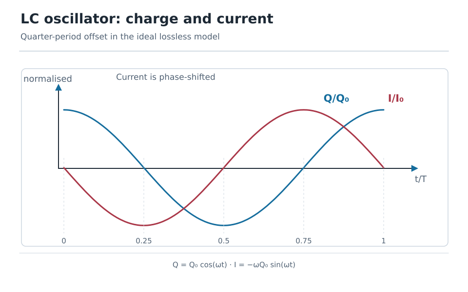

# M19-L4 – Electromagnetic LC Oscillator {#L4}

**Course area:** M19 – Oscillations and resonance. **Level:** qualification phase; advanced topics marked. **Prerequisite:** [M19-L3](M19-L3.md). **Learning objective:** Relate charge, current, natural frequency and energy forms in an ideal LC circuit.

## Starting question {#S1}

A charged capacitor discharges through an inductor. Why does current continue even when the capacitor charge first reaches zero?

## Concepts and relationships {#S2}

An ideal **LC circuit** consists of a capacitor $C$ and inductor $L$, without resistance or an external source. Initially the capacitor carries charge $Q_0$. During discharge, magnetic-field energy in the inductor grows. Self-induction allows the current to keep flowing when capacitor charge first passes through zero, charging the capacitor with reversed polarity. With a chosen sign convention, $I=\mathrm dQ/\mathrm dt$.

The oscillator satisfies $L\ddot Q+Q/C=0$, and hence

$$\omega_0=\frac{1}{\sqrt{LC}},\qquad T=2\pi\sqrt{LC},\qquad f_0=\frac{1}{2\pi\sqrt{LC}}.$$

Starting from maximum charge gives $Q(t)=Q_0\cos(\omega_0t)$ and $I(t)=-\omega_0Q_0\sin(\omega_0t)$. The ideal field energies are $E_C=Q^2/(2C)$ and $E_L=LI^2/2$; their sum remains constant. Inductance $L$ is measured in henries and capacitance $C$ in farads. Ideal harmonic LC oscillations belong to the common KMK Abitur core, while detailed energy comparison with mechanical oscillators is advanced-level material.

*In an ideal LC oscillator current magnitude peaks when capacitor charge passes through zero.*

## Worked example {#S3}

For $L=0.10\,\mathrm H$ and $C=100\,\mathrm{\mu F}=1.0\cdot10^{-4}\,\mathrm F$, $\sqrt{LC}=\sqrt{10^{-5}}\,\mathrm s\approx0.003162\,\mathrm s$. Thus $T\approx0.01987\,\mathrm s$ and $f_0\approx50.33\,\mathrm{Hz}$. At an initial capacitor voltage $U_0=10\,\mathrm V$, the initial energy is $E_0=\tfrac12CU_0^2=0.0050\,\mathrm J$.

## Investigation and practice {#S4}

Sketch snapshots at $t=0$, $T/4$, $T/2$ and $3T/4$, indicating capacitor polarity and chosen current direction. Use simulation rather than assembling a high-voltage or high-energy capacitor circuit.

## Check your learning {#S5}

### Questions

1. When does the current magnitude peak in the ideal model?
2. How does $T$ change when $L$ is quadrupled?
3. Find $E_C$ for $C=200\,\mathrm{\mu F}$ and $U=5\,\mathrm V$.
4. Why is a real RLC circuit not loss-free?

### Answers

1. At $Q=0$, initially one quarter period after maximum charge.
2. The period doubles.
3. $E_C=\tfrac12\cdot200\cdot10^{-6}\cdot25=0.0025\,\mathrm J$.
4. Resistance and other losses convert field energy, for example, into thermal energy.

## Model limitations {#S6}

The undamped LC model neglects resistive and radiation losses, stray capacitance and nonlinear components. Current direction is conventional; it is not a direct picture of electron movement.

## Further reading (internal) {#S7}

- [M19-L3](M19-L3.md) · Review prerequisite
- [M19-L5](M19-L5.md) · Next lesson

## Sources (external) {#S8}

- [KMK – Physics standards for the Abitur (2020)](https://www.kmk.org/fileadmin/Dateien/veroeffentlichungen_beschluesse/2020/2020_06_18-BildungsstandardsAHR_Physik.pdf) · p. 21, §2.6.2 oscillations; harmonic motion in general/advanced core, damping and resonance advanced · Last accessed: 2026-11-21
- [LEIFIphysik – Undamped electromagnetic LC oscillator](https://www.leifiphysik.de/elektrizitaetslehre/elektromagnetische-schwingungen/grundwissen/elektromagnetischer-schwingkreis-ungedaempft) · Basics: charge, current, period and energy in an LC circuit · Last accessed: 2026-11-21

## Evidence {#S9}

