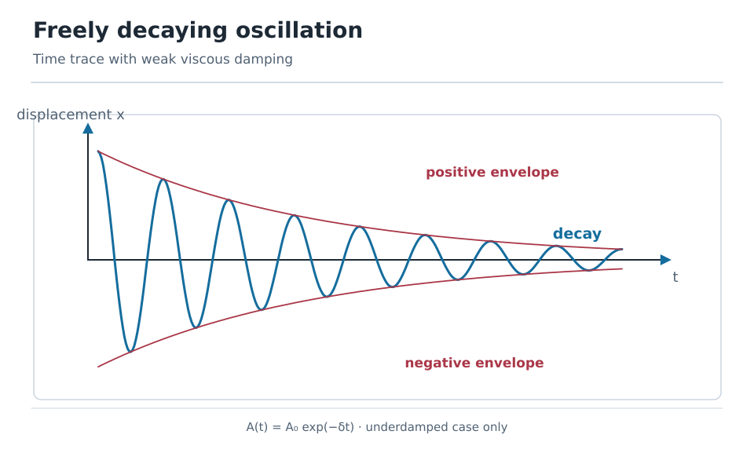

# M19-L5 – Damped and Driven Oscillations {#L5}

**Course area:** M19 – Oscillations and resonance. **Level:** qualification phase; advanced topics marked. **Prerequisite:** [M19-L4](M19-L4.md). **Learning objective:** Distinguish freely decaying oscillations from steady forced motion and read amplitude envelopes.

## Starting question {#S1}

Why does a struck bell fade away while a periodically driven system can continue oscillating?

## Concepts and relationships {#S2}

A **free damped oscillation** loses mechanical energy to its surroundings. With velocity-proportional drag $F_\mathrm{d}=-b\dot x$, the model is

$$m\ddot x+b\dot x+Dx=0.$$

In the underdamped case, $x(t)=A_0\mathrm e^{-\delta t}\cos(\omega_\mathrm d t+\varphi_0)$, where $\delta=b/(2m)$ and $\omega_\mathrm d=\sqrt{D/m-\delta^2}$. The envelopes $\pm A_0\mathrm e^{-\delta t}$ bound the decaying motion. A strongly damped system may cease to cross equilibrium altogether.

A **driven oscillation** receives energy from an applied periodic force $F_0\cos(\Omega t)$. After the transient dies out, its steady linear response is at the **driving angular frequency** $\Omega$, not necessarily the oscillator's undriven natural frequency. Amplitude depends on driving frequency and damping. Damping and forced-oscillation resonance are **advanced-level additions** in the KMK standards.

*In an underdamped viscous model the amplitude decreases exponentially.*

## Worked example {#S3}

An oscillator has $A_0=8.0\,\mathrm{cm}$ and $\delta=0.50\,\mathrm{s^{-1}}$. After $2.0\,\mathrm s$ the envelope amplitude is $A(2.0)=8.0\exp(-1)\,\mathrm{cm}\approx2.94\,\mathrm{cm}$. This is not the instantaneous displacement, which also depends on cosine phase.

## Investigation and practice {#S4}

Plot a sine-like trace inside positive and negative exponential envelopes. Compare free decay with sustained periodic forcing, using simulation or safe tabletop demonstrations only.

## Check your learning {#S5}

### Questions

1. What identifies a free damped oscillation?
2. What is $A/A_0$ at $t=1/\delta$?
3. What frequency governs the steady driven oscillation?
4. Does increasing damping always preserve oscillatory motion?

### Answers

1. Its amplitude decreases without continued energy supply.
2. $\mathrm e^{-1}\approx0.368$.
3. The driving frequency, after the free transient has decayed.
4. No. Critical and overdamping do not yield repeated equilibrium crossings in this model.

## Model limitations {#S6}

The exponential envelope assumes linear velocity-proportional damping in the underdamped regime. Real friction may behave differently; driving and transient response require separate modelling.

## Further reading (internal) {#S7}

- [M19-L4](M19-L4.md) · Review prerequisite
- [M19-L6](M19-L6.md) · Next lesson

## Sources (external) {#S8}

- [KMK – Physics standards for the Abitur (2020)](https://www.kmk.org/fileadmin/Dateien/veroeffentlichungen_beschluesse/2020/2020_06_18-BildungsstandardsAHR_Physik.pdf) · p. 21, §2.6.2 oscillations; harmonic motion in general/advanced core, damping and resonance advanced · Last accessed: 2026-11-21
- [LEIFIphysik – Damped spring oscillator](https://www.leifiphysik.de/mechanik/mechanische-schwingungen/grundwissen/federpendel-gedaempft) · Basics: viscous damping and equation of motion · Last accessed: 2026-11-21
- [LEIFIphysik – Driven oscillation](https://www.leifiphysik.de/mechanik/kopplung-von-schwingungen/grundwissen/erzwungene-schwingung) · Basics: forcing frequency, resonance and phase relation · Last accessed: 2026-11-21

## Evidence {#S9}

