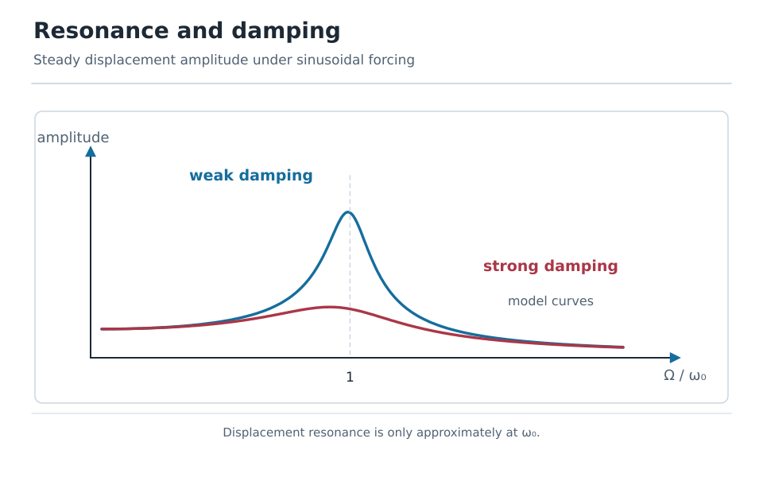

# M19-L6 – Resonance in Engineering and Everyday Life {#L6}

**Course area:** M19 – Oscillations and resonance. **Level:** qualification phase; advanced topics marked. **Prerequisite:** [M19-L5](M19-L5.md). **Learning objective:** Interpret resonance curves, compare damping levels and explain limits of the natural-frequency approximation.

## Starting question {#S1}

How can a weak but well-timed drive create large motion—and why does damping prevent unlimited growth?

## Concepts and relationships {#S2}

At **resonance**, an oscillating system responds particularly strongly to periodic forcing within a frequency range. For the linear damped oscillator $m\ddot x+b\dot x+Dx=F_0\cos(\Omega t)$, the steady-state displacement amplitude is

$$A(\Omega)=\frac{F_0}{\sqrt{(D-m\Omega^2)^2+(b\Omega)^2}}.$$

The undamped natural angular frequency is $\omega_0=\sqrt{D/m}$. With small but nonzero damping, the **displacement-amplitude** peak lies near $\omega_0$; more precisely at $\Omega_\mathrm{max}=\sqrt{\omega_0^2-b^2/(2m^2)}$ where a positive maximum exists. Greater damping broadens and lowers the peak; weaker damping makes it narrower and higher. Maximum absorbed power must not be confused with every kind of amplitude maximum.

Examples include tuned mass dampers in buildings, resonant musical instruments and mechanical test rigs. Resonance is not inherently dangerous; forcing, damping and allowable loads matter. The KMK Abitur standards place resonance in forced oscillations in the **advanced-level** category.

*Lower damping usually gives a taller and narrower resonance peak in this linear model.*

## Worked example {#S3}

A driven-system measurement gives steady amplitudes of $1$, $3$, $6$ and $2\,\mathrm{mm}$ at $1.0$, $1.5$, $2.0$ and $2.5\,\mathrm{Hz}$. Within the measured grid, the maximum occurs at $2.0\,\mathrm{Hz}$. This is the observed peak frequency—not automatically an exact undamped natural frequency. Repeat at finer frequency intervals near the peak.

## Investigation and practice {#S4}

Plot these frequency/amplitude pairs and add two resonance curves with different damping, explicitly labelled schematic. Avoid overloading components or using unsafe rotating and heavy-mass demonstration rigs.

## Check your learning {#S5}

### Questions

1. What does a resonance curve describe?
2. How does smaller damping commonly change its peak under similar forcing?
3. A test peaks at $8\,\mathrm{Hz}$. Does this prove $\omega_0=8\,\mathrm{rad/s}$?
4. Why is resonance not always at one precisely identical frequency?

### Answers

1. Steady response amplitude versus driving frequency.
2. Typically a taller and narrower peak.
3. No. $8\,\mathrm{Hz}=16\pi\,\mathrm{rad/s}$ is only the observed peak; $\omega_0$ may differ.
4. The peak depends on damping, the measured response quantity, coupling and model assumptions.

## Model limitations {#S6}

This expression describes linear steady sinusoidal forcing with viscous damping, not automatically the dynamics of arbitrary bridges, real buildings or other complex structures.

## Further reading (internal) {#S7}

- [M19-L5](M19-L5.md) · Review prerequisite
**Looking ahead:** The next module begins with [M20-L1 – Wavelength, Frequency and Propagation](M20-L1.md).

## Sources (external) {#S8}

- [KMK – Physics standards for the Abitur (2020)](https://www.kmk.org/fileadmin/Dateien/veroeffentlichungen_beschluesse/2020/2020_06_18-BildungsstandardsAHR_Physik.pdf) · p. 21, §2.6.2 oscillations; harmonic motion in general/advanced core, damping and resonance advanced · Last accessed: 2026-11-21
- [LEIFIphysik – Driven oscillation](https://www.leifiphysik.de/mechanik/kopplung-von-schwingungen/grundwissen/erzwungene-schwingung) · Basics: forcing frequency, resonance and phase relation · Last accessed: 2026-11-21
- [OpenStax – University Physics 1, Ch. 15 Summary](https://openstax.org/books/university-physics-volume-1/pages/15-summary) · Chapter 15: driven oscillations, damping and resonance · Last accessed: 2026-11-21

## Evidence {#S9}

