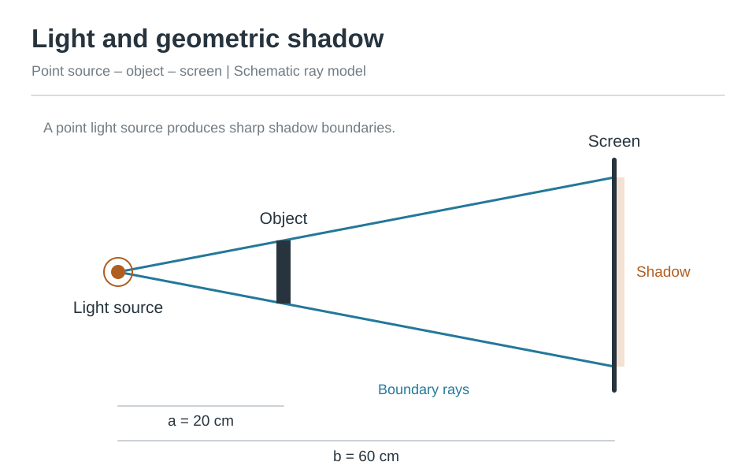

# M2-L1 – Light sources, propagation and shadows {#L1}

**Course area:** M2 – Light, shadows and geometrical optics. **Level:** Lower secondary education. **Prior knowledge:** [M1-L6](M1-L6.md). **Learning objective:** Use the ray model to construct shadows and explain umbra, penumbra and geometric enlargement.

## Introduction {#S1}

Why does the shadow of a hand grow when the hand moves towards a torch? First distinguish a **light source** (such as a lamp) from an **illuminated object** that sends back incident light. We see an object when light from it reaches our eyes. In the simple setting, light propagates approximately in straight lines through a uniform transparent medium.

## Straight-line propagation and shadows {#S2}

In the **ray model**, lines with arrows indicate the direction of propagation. A light ray is not a thin glowing thread; it is a geometric aid. An opaque object blocks light paths behind it. An ideal **point source** produces a sharply bounded **shadow region**; its cross-section on a screen is the **shadow image**. An extended source also produces a **penumbra** because an obstacle blocks some, but not all, parts of the source.

**Original teaching diagram:** Two boundary rays define the shadow region from a point source to a screen. The drawing is schematic.

*Point source shadow: similar triangles enlarge the projection.*

## Worked example {#S3}

A point source, a centred object of height $h=2\,\mathrm{cm}$ and a parallel screen share an axis. The object is $a=20\,\mathrm{cm}$ from the source, and the screen is $b=60\,\mathrm{cm}$ from it. Similar triangles give the height $H$ of the shadow:

$$\frac{H}{h}=\frac{b}{a},\qquad H=2\,\mathrm{cm}\cdot\frac{60\,\mathrm{cm}}{20\,\mathrm{cm}}=6\,\mathrm{cm}.$$

The ratio $b/a$ has no units. If the screen moves to $b=40\,\mathrm{cm}$ while the other positions stay fixed, the shadow becomes $4\,\mathrm{cm}$ tall. These results apply to the simplified point-source model, not automatically to every real lamp.

## Safe investigation {#S4}

Shine an ordinary LED torch on a piece of cardboard in front of a wall. Keep the lamp fixed, move the wall, and describe changes in shadow size and edge sharpness. Do not use lasers or focused beams, and never shine powerful lights towards the eyes.

## Check your understanding {#S5}

### Questions

1. Distinguish a light source from an illuminated object.
2. Find $H$ for $h=3\,\mathrm{cm}$, $a=25\,\mathrm{cm}$ and $b=100\,\mathrm{cm}$.
3. Why does a large lamp often make the shadow edge fuzzy?
4. What does a drawn ray represent physically?

### Answers

1. A source emits light; an illuminated object reflects or scatters incident light.
2. $H=3\,\mathrm{cm}\cdot100/25=12\,\mathrm{cm}$.
3. Different parts of the source illuminate different regions, producing a penumbra.
4. It represents a propagation direction, not a visible material line.

## Limits of the model and next step {#S6}

The simple model ignores diffraction and, in the point-source case, the physical size of lamps. Next we investigate [reflection](M2-L2.md) from a smooth surface.

## Sources {#S7}

- [Ministry of Education NRW – Lower secondary physics curriculum (2019)](https://www.schulentwicklung.nrw.de/lehrplaene/lehrplan/208/g9_ph_klp_%203411_2019_06_23.pdf) · Content areas 4/5, reflection, refraction, lenses, eye and instruments · Last accessed: 2026-11-21 · Content verified: 2026-11-21
- [Sichere Schule – Optics: Safety in physics lessons](https://www.sichere-schule.de/physik/praktisches-arbeiten/optik) · Light sources, lasers and optical radiation; precautions · Last accessed: 2026-11-21 · Content verified: 2026-11-21
