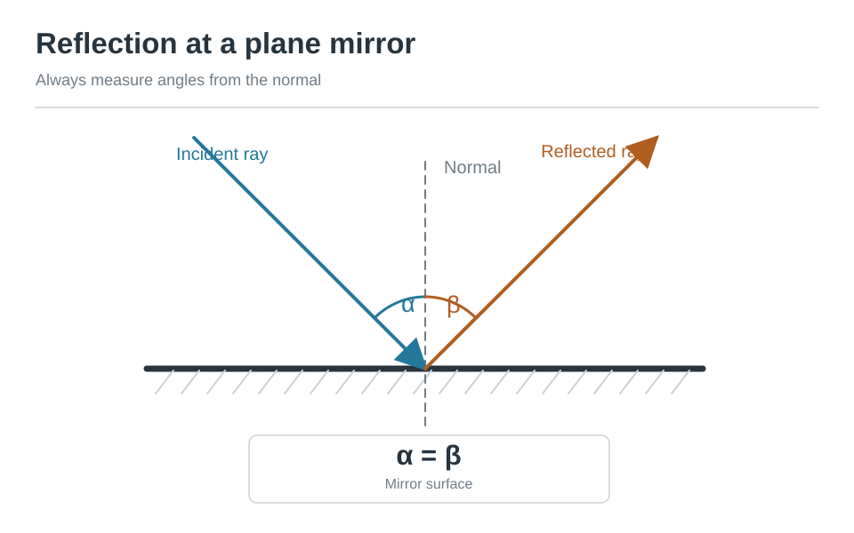

# M2-L2 – Reflection at plane mirrors {#L2}

**Course area:** M2 – Light, shadows and geometrical optics. **Level:** Lower secondary education. **Prior knowledge:** [M2-L1](M2-L1.md). **Learning objective:** Measure angles of incidence and reflection from the normal and explain virtual mirror images geometrically.

## Introduction {#S1}

A smooth mirror sends incident light in a well-defined reflected direction. A matte wall usually scatters light across many directions. Both surfaces can reflect light, but the geometry of a **plane mirror** is particularly easy to predict.

## The law of reflection and the normal {#S2}

At the point of incidence, draw the **normal**, a line perpendicular to the reflecting surface. Both the angle of incidence $\alpha$ and the angle of reflection $\beta$ are measured **from the normal**, not from the mirror surface. For an ideal plane mirror:

$$\boxed{\alpha=\beta}.$$

The incident ray, reflected ray and normal lie in one plane. This directional change can be demonstrated with a mirror and weak, spread-out illumination; no laser is needed.

**Original teaching diagram:** An incoming and outgoing ray are symmetric about the dashed normal; arcs indicate the angles.

*At a plane mirror the angles of incidence and reflection, measured to the normal, are equal.*

## Virtual image and worked example {#S3}

An object $30\,\mathrm{cm}$ in front of a plane mirror appears the same distance **behind** it. This is a **virtual image**: light from the front of the mirror does not actually pass through and converge behind it. The eye traces the reflected rays backwards. The image is upright and the same size; the reflection reverses the direction perpendicular to the plane of the mirror.

A ray incident at $35^\circ$ **to the normal** is reflected at $35^\circ$ to the normal. If the incident angle is instead given as $55^\circ$ **to the mirror surface**, the corresponding angle to the normal is $90^\circ-55^\circ=35^\circ$.

## Investigation idea {#S4}

Place a hand mirror on a table, mark a perpendicular normal on paper, and compare input and output directions using two paper markers. Use indirect low-intensity illumination; laser investigations require the teacher's separate safety assessment.

## Check your understanding {#S5}

### Questions

1. If the incidence angle is $20^\circ$, what is the reflected angle?
2. A ray arrives at $70^\circ$ to the surface. Find the incidence angle to the normal.
3. Why can a virtual image not be captured on a screen behind the mirror?
4. Give one difference between a plane mirror and white paper.

### Answers

1. $20^\circ$.
2. $20^\circ$ to the normal.
3. No real rays converge there through the mirror; they only appear to originate behind it.
4. A plane mirror reflects directionally, whereas paper scatters light diffusely.

## Limits and next step {#S6}

Surface roughness affects the distribution of reflected light. When light crosses into another transparent material, [refraction](M2-L3.md) usually occurs alongside reflection.

## Sources {#S7}

- [Ministry of Education NRW – Lower secondary physics curriculum (2019)](https://www.schulentwicklung.nrw.de/lehrplaene/lehrplan/208/g9_ph_klp_%203411_2019_06_23.pdf) · Content areas 4/5, reflection, refraction, lenses, eye and instruments · Last accessed: 2026-11-21 · Content verified: 2026-11-21
- [Sichere Schule – Optics: Safety in physics lessons](https://www.sichere-schule.de/physik/praktisches-arbeiten/optik) · Light sources, lasers and optical radiation; precautions · Last accessed: 2026-11-21 · Content verified: 2026-11-21
