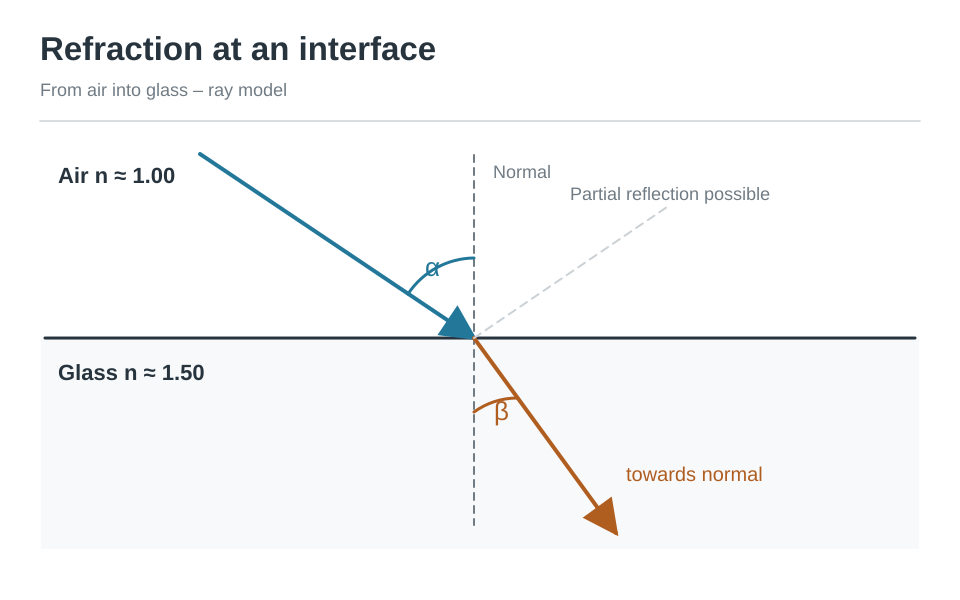

# M2-L3 – Refraction and total internal reflection {#L3}

**Course area:** M2 – Light, shadows and geometrical optics. **Level:** Lower secondary education. **Prior knowledge:** [M2-L2](M2-L2.md). **Learning objective:** Explain refraction using the normal and distinguish conditions for total internal reflection.

## Introduction {#S1}

A drinking straw seems bent at the water surface. The straw is unchanged; the light changes direction at the boundary between water and air. This directional change is called **refraction**.

## Ray model at a boundary {#S2}

Light travels at different speeds in different transparent materials. We describe the effect using the **refractive index** $n$. When light enters glass or water obliquely from air, it normally bends **towards the normal**. Going from glass into air, it bends **away from the normal**. At normal incidence there is no directional change. Some light can also be reflected.

For an exact calculation in suitable conditions, **Snell's law** states:

$$n_1\sin\alpha=n_2\sin\beta.$$

Both angles are measured from the normal. This equation is an **extension**; lower-secondary learning begins with qualitative explanation.

**Original teaching diagram:** A horizontal air–glass boundary shows the incoming and refracted rays and the normal. The drawing is not to scale.

*At an air-to-glass boundary an oblique ray refracts towards the normal.*

## Total internal reflection and optional calculation {#S3}

When light travels from a medium with a higher refractive index to one with a lower index, then above a **critical angle** no refracted ray can emerge: **total internal reflection** occurs. This cannot happen for a ray travelling from air into glass.

Using approximate values $n_{\mathrm{air}}\approx1.00$ and $n_{\mathrm{glass}}\approx1.50$ for light travelling **from glass to air**:

$$\sin\alpha_{\mathrm{c}}=\frac{1.00}{1.50}\approx0.667,\qquad \alpha_{\mathrm{c}}\approx41.8^\circ.$$

At the critical angle the limiting refracted direction lies along the interface. Above it, reflection can guide light along optical fibres. The numerical result depends on the assumed indices.

## Safe investigation {#S4}

Put a drinking straw in a glass of water, view it from the side at different positions, and identify what looks different and what remains the same. Use ordinary room light, not focused sunlight or lasers.

## Check your understanding {#S5}

### Questions

1. How does an oblique ray bend when entering glass from air?
2. Why is there no direction change at normal incidence?
3. Can total internal reflection occur for a ray travelling from air into water?
4. Extension: for glass-to-air, with $n_{\mathrm{glass}}=1.5$ and $\alpha=50^\circ$, is total internal reflection expected?

### Answers

1. Towards the normal.
2. The direction already follows the normal; both angles are zero.
3. No, not when entering the material with the higher index.
4. Yes, since $50^\circ>41.8^\circ$.

## Limits and next step {#S6}

Refractive index can depend on wavelength, leading to colour separation. Ray paths are an approximation. Curved transparent surfaces lead us to [lenses](M2-L4.md).

## Sources {#S7}

- [Ministry of Education NRW – Lower secondary physics curriculum (2019)](https://www.schulentwicklung.nrw.de/lehrplaene/lehrplan/208/g9_ph_klp_%203411_2019_06_23.pdf) · Content areas 4/5, reflection, refraction, lenses, eye and instruments · Last accessed: 2026-11-21 · Content verified: 2026-11-21
