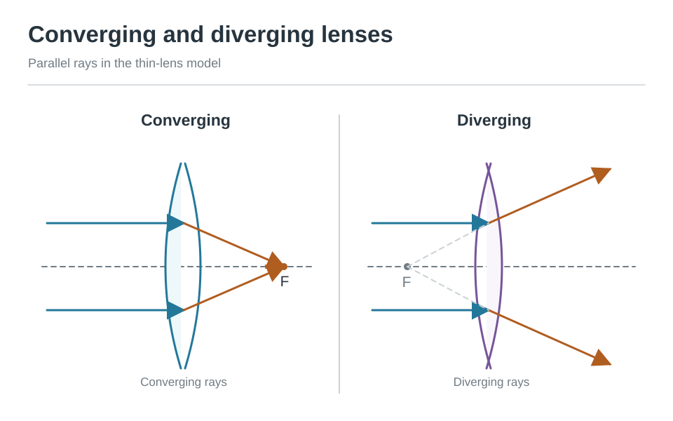

# M2-L4 – Lenses and focal points {#L4}

**Course area:** M2 – Light, shadows and geometrical optics. **Level:** Lower secondary education. **Prior knowledge:** [M2-L3](M2-L3.md). **Learning objective:** Distinguish converging and diverging lenses with parallel rays and identify focal points.

## Introduction {#S1}

A magnifying glass makes small print appear larger. Under different conditions, a lens can form an inverted image on a screen. The type of image depends on the lens and the object's position.

## Converging and diverging lenses {#S2}

A **converging lens** (convex, usually thicker in the middle) brings rays parallel to the optical axis to an ideal **focus** $F$ on the far side. A **diverging lens** (concave, usually thinner in the middle) spreads parallel rays apart; tracing these rays backwards gives a virtual focal point on the incident side. The distance from the lens plane to the focal point is the **focal length** $f$. Here we assign positive $f$ to a converging lens and negative $f$ to a diverging lens.

The **thin-lens approximation** ignores lens thickness and assumes small ray angles to the axis. A parallel ray passes through the image-side focus of a converging lens. A ray through the centre is treated as undeviated. Two construction rays can locate an image point.

**Original teaching diagram:** Parallel rays converge after a converging lens and diverge after a diverging lens; dashed backwards extensions reveal the virtual focus.

*Converging lenses focus parallel rays; diverging lenses spread them apart.*

## Optional worked calculation {#S3}

For a thin converging lens in air, object distance $g=30\,\mathrm{cm}$ and focal length $f=10\,\mathrm{cm}$, our sign convention gives:

$$\frac1f=\frac1g+\frac1b\quad\Rightarrow\quad\frac1b=\frac1{10\,\mathrm{cm}}-\frac1{30\,\mathrm{cm}}=\frac1{15\,\mathrm{cm}}.$$

The real inverted image forms at $b=15\,\mathrm{cm}$ behind the lens. Signed lateral magnification is $B/G=-b/g=-0.5$: half-size and inverted. This is an **optional calculation**, beyond the basic qualitative ray sketch.

## Safe investigation {#S4}

Use a school converging lens to view an ordinary, non-dazzling illuminated object. A teacher may capture its image on a screen and move the screen to find focus. **Never focus sunlight using a magnifier or lens:** this creates eye and fire hazards.

## Check your understanding {#S5}

### Questions

1. Which lens converges rays parallel to the axis?
2. Why is the focus of a diverging lens virtual?
3. Distinguish focal length $f$ and image distance $b$.
4. Extension: find $b$ when $f=12\,\mathrm{cm}$ and $g=24\,\mathrm{cm}$.

### Answers

1. A converging lens.
2. Outgoing rays do not meet; only their backwards extensions do.
3. $f$ characterises the lens; $b$ also depends on object distance $g$.
4. $1/b=1/12-1/24=1/24\,\mathrm{cm}^{-1}$, so $b=24\,\mathrm{cm}$.

## Limits and next step {#S6}

Real lenses have aberrations such as colour fringing or edge blur. Next we compare image planes in the [eye and a camera](M2-L5.md).

## Sources {#S7}

- [Ministry of Education NRW – Lower secondary physics curriculum (2019)](https://www.schulentwicklung.nrw.de/lehrplaene/lehrplan/208/g9_ph_klp_%203411_2019_06_23.pdf) · Content areas 4/5, reflection, refraction, lenses, eye and instruments · Last accessed: 2026-11-21 · Content verified: 2026-11-21
- [Sichere Schule – Optics: Safety in physics lessons](https://www.sichere-schule.de/physik/praktisches-arbeiten/optik) · Light sources, lasers and optical radiation; precautions · Last accessed: 2026-11-21 · Content verified: 2026-11-21
