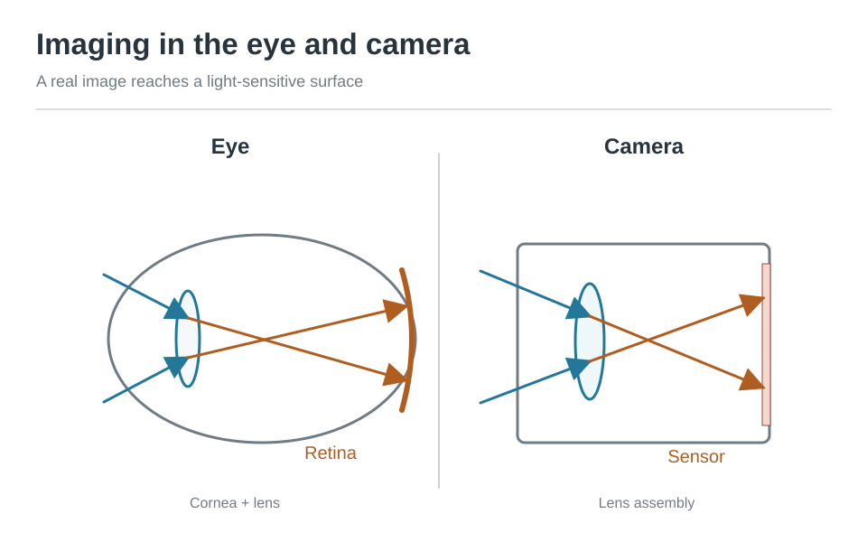

# M2-L5 – Image formation in the eye and camera {#L5}

**Course area:** M2 – Light, shadows and geometrical optics. **Level:** Lower secondary education. **Prior knowledge:** [M2-L4](M2-L4.md). **Learning objective:** Compare real images on the retina and sensor and explain the different focusing mechanisms.

## Introduction {#S1}

A photograph can be sharp or out of focus. The eye must also adjust its optical properties for objects at different distances. Both systems need light, imaging optics and a light-sensitive surface.

## Forming and focusing an image {#S2}

A converging lens can form a **real image** on a receiving surface. In the eye, the cornea and lens refract light, while the **retina** detects it. The eye lens changes its curvature and optical power by **accommodation**. The eyeball's length stays approximately constant during this process.

In a camera, an objective lens – usually made of multiple elements – focuses an image on a **sensor**. Focus may be adjusted by moving lens elements. The **pupil** limits light entering the eye, while the **aperture** has a comparable role in a camera. The actual optical image is inverted in both cases, although we do not perceive our world upside down and camera images can be oriented electronically.

**Original teaching diagram:** Rays cross the axis after a converging optical system and reach a retina or sensor in an inverted arrangement.

*The eye and camera form an image on a light-sensitive surface.*

## Comparison and example {#S3}

| Feature | Eye | Digital camera |
|---|---|---|
| Light-sensitive surface | Retina | Image sensor |
| Focusing | Change in eye-lens curvature | Adjustment of the lens system or its position |
| Light control | Pupil and iris | Aperture, exposure time and electronic processing |

**Thought experiment:** Move an object towards a camera without changing its lens settings. The image plane required for sharp focus shifts. If the sensor position is unchanged, the image is blurred until the camera refocuses. The analogy explains function; a single-lens sketch is not a complete eye model.

## Safe observation {#S4}

Photograph a near and a distant object in ordinary room light. Refocus on each and describe what appears sharp. Never look towards the Sun through camera lenses, binoculars or magnifiers.

## Check your understanding {#S5}

### Questions

1. Name the light-sensitive surfaces in the eye and in a camera.
2. How does a typical eye focus on near objects?
3. What does “real image” mean?
4. Why is the pupil not the same thing as the retina?

### Answers

1. Retina and image sensor.
2. By changing the curvature and optical power of the eye lens.
3. Light rays actually reach the image plane and could form an image on a screen.
4. The pupil is the entrance opening; the retina receives light and converts stimulation into neural signals.

## Model limits and next step {#S6}

Our simplified model omits the cornea, multi-element camera optics, image processing and visual defects. Further possibilities and limits are treated in [Optical instruments](M2-L6.md).

## Sources {#S7}

- [Ministry of Education NRW – Lower secondary physics curriculum (2019)](https://www.schulentwicklung.nrw.de/lehrplaene/lehrplan/208/g9_ph_klp_%203411_2019_06_23.pdf) · Content areas 4/5, reflection, refraction, lenses, eye and instruments · Last accessed: 2026-11-21 · Content verified: 2026-11-21
- [Sichere Schule – Optics: Safety in physics lessons](https://www.sichere-schule.de/physik/praktisches-arbeiten/optik) · Light sources, lasers and optical radiation; precautions · Last accessed: 2026-11-21 · Content verified: 2026-11-21
