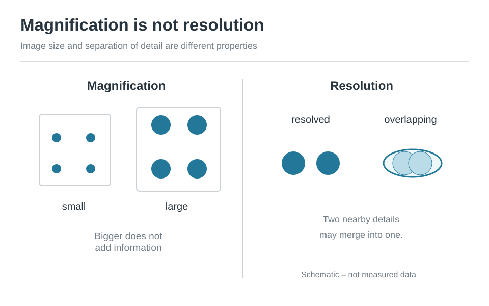

# M2-L6 – Optical instruments and their limits {#L6}

**Course area:** M2 – Light, shadows and geometrical optics. **Level:** Lower secondary education. **Prior knowledge:** [M2-L5](M2-L5.md). **Learning objective:** Compare magnifiers, telescopes and microscopes and distinguish magnification from resolving power.

## Introduction {#S1}

A magnifier makes print look bigger. Yet a blurry printout does not reveal unlimited new detail if it is enlarged further. Optical instruments require two separate concepts: **magnification** and **resolution**.

## Three instruments and two different properties {#S2}

A **magnifying glass** is a converging lens that can produce an upright, virtual enlarged image at a suitable object distance. A **telescope** uses an objective and an eyepiece to make small angular sizes of distant objects easier to observe. A **light microscope** uses multiple lenses to examine tiny nearby structures; its objective usually creates a magnified intermediate image for the eyepiece.

**Magnification** describes the apparent size of an object or image. **Resolution** describes whether two closely spaced details can still be seen as separate. It depends, among other things, on light wavelength, effective aperture and optical defects. Increasing magnification alone does not restore information that was never resolved.

**Original teaching diagram:** A pattern becomes larger, while two nearby details are distinguished in one example but not reliably separated in another. Dots are schematic, not measured optical point-spread functions.

*Magnification and resolution are different properties.*

## Application and interpretation {#S3}

A book illustration is enlarged fourfold on a screen, but the original picture has very few pixels. Existing pixels become larger or new pixels are inferred by software; the original capture does not suddenly hold four times as many **observed** details. In physical optics, diffraction and lens aberrations limit usable detail.

| Instrument | Typical use | Important limitation |
|---|---|---|
| Magnifying glass | Near small print | Focus, field of view and eye distance |
| Telescope | Distant objects | Aperture, atmospheric turbulence and light gathering |
| Light microscope | Small nearby structures | Wavelength, numerical aperture and specimen quality |

## Safe observation {#S4}

Look at a fine newspaper print through an ordinary magnifier, then compare a blurry patch at the same magnification. **Never look directly at the Sun or view it through optical devices; never focus sunlight using lenses.** Laser demonstrations at school require a teacher-led risk assessment.

## Check your understanding {#S5}

### Questions

1. What is the difference between magnification and resolution?
2. Why choose a telescope rather than a magnifying glass for a distant target?
3. Why might a highly magnified image remain blurry?
4. Give two factors limiting fine detail in a real optical device.

### Answers

1. Magnification describes image size; resolution concerns the separation of nearby details.
2. A telescope increases the angular size of distant targets.
3. Enlargement also enlarges existing blur; missing detail does not reappear automatically.
4. Examples include diffraction or wavelength, aperture, lens aberrations and atmospheric turbulence.

## Limits and outlook {#S6}

Geometrical ray optics describes many images, but resolution limits require the wave model of light. We treat this qualitatively here. Further optics topics such as dispersion and colour perception belong to later paths or optional extensions.

**Looking ahead:** The next module begins with [M3-L1 – Sound sources and vibrations](M3-L1.md).

## Sources {#S7}

- [Ministry of Education NRW – Lower secondary physics curriculum (2019)](https://www.schulentwicklung.nrw.de/lehrplaene/lehrplan/208/g9_ph_klp_%203411_2019_06_23.pdf) · Content areas 4/5, reflection, refraction, lenses, eye and instruments · Last accessed: 2026-11-21 · Content verified: 2026-11-21
- [Sichere Schule – Optics: Safety in physics lessons](https://www.sichere-schule.de/physik/praktisches-arbeiten/optik) · Light sources, lasers and optical radiation; precautions · Last accessed: 2026-11-21 · Content verified: 2026-11-21
