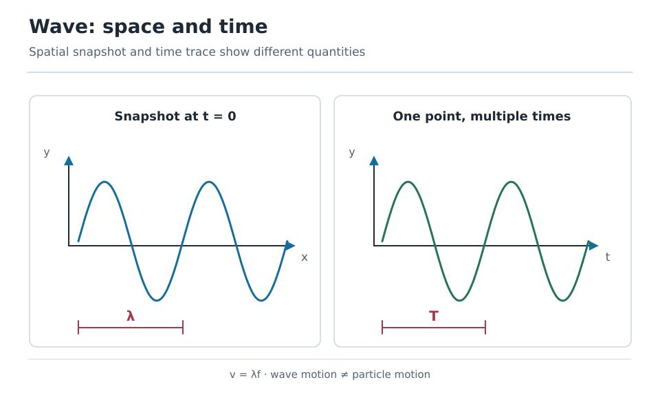

# M20-L1 – Wavelength, Frequency and Propagation {#L1}

**Course area:** M20 – Waves, interference and optics. **Level:** qualification phase; advanced topics marked. **Prerequisite:** [M19-L6](M19-L6.md). **Learning objective:** Relate wavelength, frequency, period and propagation speed using diagrams and numerical data.

## Starting question {#S1}

A tagged point on a string moves up and down, but a crest travels to the right. Which speed describes the traveling pattern?

## Concepts and relationships {#S2}

A **wave** is a traveling disturbance. In a mechanical wave, parts of a medium oscillate about equilibrium while the disturbance carries energy and momentum; the particles need not migrate with the pattern. The spatial separation between points in the same phase, such as adjacent crests, is the **wavelength** $\lambda$ in metres. The time between corresponding phases at one fixed position is the **period** $T$ in seconds; **frequency** is $f=1/T$ in hertz.

In a uniform, nondispersive medium,

$$v=\frac{\lambda}{T}=\lambda f.$$

This follows because a harmonic wave travels one wavelength during one period. An ideal wave traveling right may be written $y(x,t)=A\sin(2\pi x/\lambda-2\pi ft+\varphi_0)$. A **snapshot** plots displacement against position; a **time trace** plots displacement at one position against time. Crucially, $v$ is the speed of the pattern, not the instantaneous speed of an individual string particle. In a dispersive medium phase speed depends on frequency.

*Wavelength measures a spatial interval and period a temporal interval.*

## Worked example {#S3}

Adjacent crests are $1.5\,\mathrm m$ apart and a fixed string segment oscillates $2.0$ times each second. Then $\lambda=1.5\,\mathrm m$, $f=2.0\,\mathrm{Hz}$, $T=0.50\,\mathrm s$ and $v=\lambda f=3.0\,\mathrm{m/s}$. That string segment does not travel steadily rightward at $3.0\,\mathrm{m/s}$.

## Investigation and practice {#S4}

Draw two wave snapshots with the same wavelength but a quarter-wavelength phase offset. Distinguish spatial distance, time interval and propagation direction.

## Check your learning {#S5}

### Questions

1. How do wavelength and period differ?
2. A wave has $\lambda=0.80\,\mathrm m$ and $f=5.0\,\mathrm{Hz}$. Calculate $v$.
3. A source produces 40 cycles per second. Find $T$.
4. Does an ideal traveling string wave carry the string particles permanently toward the receiver?

### Answers

1. Wavelength is a spatial separation; period is a time interval.
2. $v=0.80\times5.0=4.0\,\mathrm{m/s}$.
3. $T=1/40=0.025\,\mathrm s$.
4. No. Particles oscillate about equilibrium as the disturbance travels.

## Model limitations {#S6}

The sinusoidal function assumes a harmonic plane wave. Interfaces, attenuation and dispersion complicate the constant-speed picture.

## Further reading (internal) {#S7}

- [M19-L6](M19-L6.md) · Review prerequisite
- [M20-L2](M20-L2.md) · Next lesson

## Sources (external) {#S8}

- [KMK – Physics standards for Abitur 2020](https://www.kmk.org/fileadmin/Dateien/veroeffentlichungen_beschluesse/2020/2020_06_18-BildungsstandardsAHR_Physik.pdf) · p. 21, §2.6.2: waves, polarisation, double slit, standing waves general/advanced; single slit and interferometer advanced · Last accessed: 2026-11-21
- [LEIFIphysik – Wave quantities](https://www.leifiphysik.de/mechanik/mechanische-wellen/grundwissen/groessen-zur-beschreibung-einer-welle) · Basics: wavelength, period and propagation speed · Last accessed: 2026-11-21

## Evidence {#S9}

