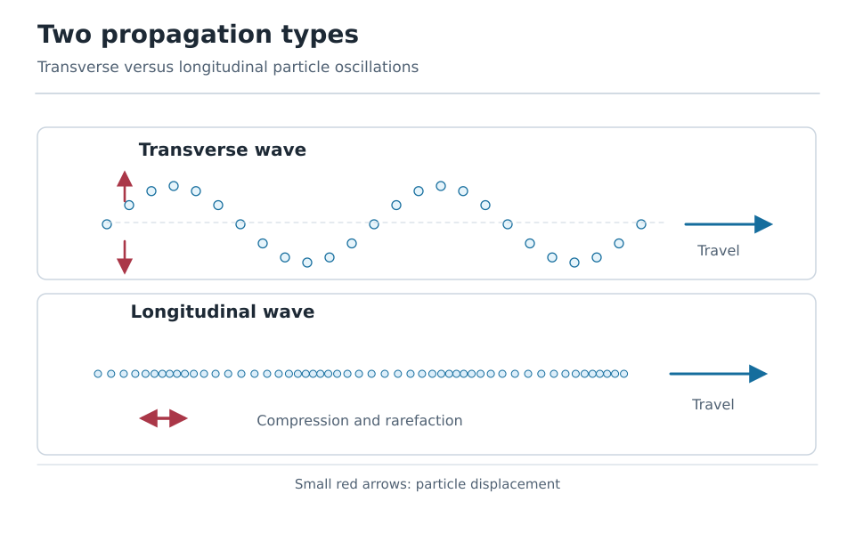

# M20-L2 – Longitudinal and Transverse Waves {#L2}

**Course area:** M20 – Waves, interference and optics. **Level:** qualification phase; advanced topics marked. **Prerequisite:** [M20-L1](M20-L1.md). **Learning objective:** Sketch and distinguish the oscillation direction and propagation direction of a wave.

## Starting question {#S1}

Why is a wave on a string drawn as a wavy line while sound in air is often shown as dense and sparse regions?

## Concepts and relationships {#S2}

To classify a mechanical wave compare the **direction of propagation** of the disturbance with the **direction of particle oscillation**. In a **transverse wave**, motion is perpendicular to propagation, as on a taut string. In a **longitudinal wave**, motion is parallel to propagation; sound in air travels through moving compressions and rarefactions. In either case, particles remain on average near equilibrium within the ideal model.

A sinusoidal graph of acoustic pressure versus position is **not a photograph of air flowing along a zigzag path**. It is a plot of a measured quantity. Solids can support both longitudinal and transverse waves; waves on a water surface often combine multiple directions of motion. One cannot always infer particle paths from the visible shape of the surface alone. Electromagnetic plane waves in a vacuum are transverse: their electric and magnetic fields oscillate perpendicular to propagation.

*The comparison distinguishes particle oscillation from wave propagation.*

## Worked example {#S3}

A longitudinal sound wave with speed $v=340\,\mathrm{m/s}$ and frequency $f=340\,\mathrm{Hz}$ has $\lambda=v/f=1.0\,\mathrm m$. Adjacent pressure maxima are one metre apart in this ideal model; that is not the distance traveled by one air molecule in a cycle.

## Investigation and practice {#S4}

Draw two rows of particle markers. Use small arrows perpendicular to a large propagation arrow for one row, and parallel for the other. Mark two compression zones in the longitudinal row.

## Check your learning {#S5}

### Questions

1. How are particle oscillation and propagation oriented in a longitudinal wave?
2. Can a solid support a transverse wave?
3. Find $\lambda$ for $v=300\,\mathrm{m/s}$ and $f=150\,\mathrm{Hz}$.
4. Why is a sinusoidal pressure plot not a photograph of particle trajectories?

### Answers

1. They are parallel.
2. Yes, for example as a shear wave.
3. $\lambda=300/150=2.0\,\mathrm m$.
4. It displays a measured quantity against time or position, not the actual trajectory.

## Model limitations {#S6}

The distinction refers to ideal wave modes. Surface waves, anisotropic media and coupled modes can have more complicated particle motion.

## Further reading (internal) {#S7}

- [M20-L1](M20-L1.md) · Review prerequisite
- [M20-L3](M20-L3.md) · Next lesson

## Sources (external) {#S8}

- [KMK – Physics standards for Abitur 2020](https://www.kmk.org/fileadmin/Dateien/veroeffentlichungen_beschluesse/2020/2020_06_18-BildungsstandardsAHR_Physik.pdf) · p. 21, §2.6.2: waves, polarisation, double slit, standing waves general/advanced; single slit and interferometer advanced · Last accessed: 2026-11-21
- [LEIFIphysik – Wave quantities](https://www.leifiphysik.de/mechanik/mechanische-wellen/grundwissen/groessen-zur-beschreibung-einer-welle) · Basics: wavelength, period and propagation speed · Last accessed: 2026-11-21

## Evidence {#S9}

