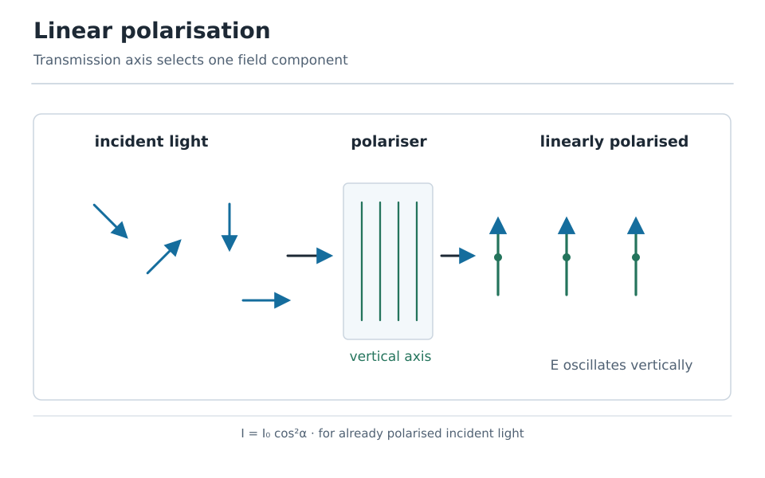

# M20-L3 – Polarisation and Electromagnetic Waves {#L3}

**Course area:** M20 – Waves, interference and optics. **Level:** qualification phase; advanced topics marked. **Prerequisite:** [M20-L2](M20-L2.md). **Learning objective:** Explain linear polarisation as electric-field orientation and predict transmissions through ideal filters.

## Starting question {#S1}

Why does rotating a polarising sheet in front of a display change its brightness?

## Concepts and relationships {#S2}

An electromagnetic plane wave in a vacuum consists of changing electric and magnetic fields. The directions of $\vec E$, $\vec B$ and the propagation vector $\vec k$ are mutually perpendicular. For light, **linear polarisation** means that the electric-field oscillation has a fixed direction transverse to propagation. No material particles are transported along a wavy line.

An ideal linear **polariser** transmits the field component parallel to its transmission axis. For light that is already linearly polarised, **Malus's law** gives

$$I=I_0\cos^2\alpha,$$

where $\alpha$ is the angle from the incident polarisation direction to the filter axis. Parallel axes give maximal ideal transmission; crossed axes give zero. For initially **unpolarised** light, average transmitted intensity after the first ideal polariser is $I_0/2$. Only then may the angle-dependent rule be applied to a second filter. Real filters also absorb and scatter light. Polarisation is characteristic of transverse waves.

*An ideal linear polariser transmits the electric-field component aligned to its axis.*

## Worked example {#S3}

After a first filter, an initially unpolarised beam has ideal intensity $I_1=8.0\,\mathrm{W/m^2}$. A second filter is turned by $60^\circ$. Thus $I_2=I_1\cos^2 60^\circ=8.0\times0.25=2.0\,\mathrm{W/m^2}$. Before the first filter, the initial unpolarised intensity would ideally have been $16\,\mathrm{W/m^2}$.

## Investigation and practice {#S4}

Use two polarising sheets or a documented simulation with an ordinary light source. Turn one sheet and compare parallel, $45^\circ$ and crossed settings. Do not view the Sun or improvise laser experiments.

## Check your learning {#S5}

### Questions

1. Which field component defines the linear polarisation of light?
2. What is the factor $I/I_0$ at $45^\circ$ in Malus\'s model?
3. What ideal intensity passes crossed filters after the first filter?
4. Can one apply a single fixed angle in Malus's law to initially unpolarised light before the first polariser?

### Answers

1. The oscillation direction of the electric field.
2. $\cos^2 45^\circ=1/2$.
3. Zero.
4. No. Average over incident polarisations first; the ideal mean intensity is halved.

## Model limitations {#S6}

Field arrows show the instantaneous orientation rather than material trajectories. Actual polarisers and non-plane waves deviate from the idealisation.

## Further reading (internal) {#S7}

- [M20-L2](M20-L2.md) · Review prerequisite
- [M20-L4](M20-L4.md) · Next lesson

## Sources (external) {#S8}

- [KMK – Physics standards for Abitur 2020](https://www.kmk.org/fileadmin/Dateien/veroeffentlichungen_beschluesse/2020/2020_06_18-BildungsstandardsAHR_Physik.pdf) · p. 21, §2.6.2: waves, polarisation, double slit, standing waves general/advanced; single slit and interferometer advanced · Last accessed: 2026-11-21
- [LEIFIphysik – Introduction to light polarisation](https://www.leifiphysik.de/optik/polarisation/grundwissen/polarisation-von-licht-einfuehrung) · Basics: transverse electric-field orientation and filter axis · Last accessed: 2026-11-21
- [LEIFIphysik – Polarisation of light: continuation](https://www.leifiphysik.de/optik/polarisation/grundwissen/polarisation-von-licht-fortfuehrung) · Basics: intensity after one or two filters · Last accessed: 2026-11-21

## Evidence {#S9}

