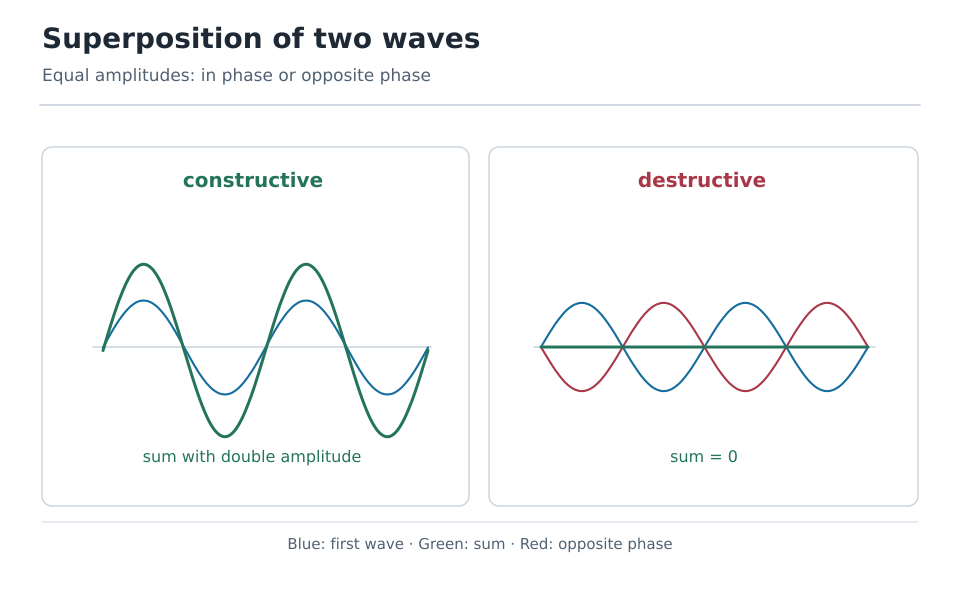

# M20-L4 – Superposition and Interference {#L4}

**Course area:** M20 – Waves, interference and optics. **Level:** qualification phase; advanced topics marked. **Prerequisite:** [M20-L3](M20-L3.md). **Learning objective:** Use phase difference and path difference to explain constructive and destructive interference.

## Starting question {#S1}

Why can two oscillations add to a large response at one location but nearly cancel at another?

## Concepts and relationships {#S2}

The **superposition principle** states that in a linear system displacements or field amplitudes add point by point: $y_\mathrm{total}=y_1+y_2$. Two coherent waves of equal frequency and fixed phase relationship can form a stable interference pattern. **Path difference** $\Delta s$ is the difference between path lengths. For sources initially in phase, the related phase difference is $\Delta\varphi=2\pi\Delta s/\lambda$.

For $\Delta s=m\lambda$ (integer $m$), wave contributions arrive in phase: **constructive interference**. For $\Delta s=(m+\tfrac12)\lambda$, they arrive opposite in phase: **destructive interference**. Complete cancellation at a point requires equal amplitudes, appropriate polarisation and coherence. For light, electric-field amplitudes add, while measured intensity is proportional to the time average of the *square* of the summed field. Therefore coherent intensities cannot simply be added: two identical fields yield four times one beam's intensity at a constructive maximum. With incoherent sources, stable cross terms average out.

*In-phase waves reinforce; equal opposite-phase amplitudes cancel.*

## Worked example {#S3}

Two coherent water waves initially in phase have $\lambda=0.40\,\mathrm m$ and a path difference of $\Delta s=0.60\,\mathrm m=1.5\lambda$. The phase difference is $3\pi$ (equivalent to $\pi$ modulo $2\pi$). Equal amplitudes produce an ideal minimum at that point.

## Investigation and practice {#S4}

Use a spreadsheet to add two sine curves of the same frequency: first in phase, then shifted by $\pi$. Compare the total amplitudes and explain why adding intensities is a different operation.

## Check your learning {#S5}

### Questions

1. What is added under linear superposition?
2. What phase difference corresponds to $\Delta s=\lambda/4$?
3. Does $\Delta s=2\lambda$ give a maximum or minimum for initially in-phase sources?
4. What additional condition permits complete cancellation?

### Answers

1. Displacements or field amplitudes, not their intensities directly.
2. $\Delta\varphi=\pi/2$.
3. A maximum.
4. Equal amplitudes and suitable polarisation/coherence.

## Model limitations {#S6}

An initial phase offset alters the conditions; strongly nonlinear waves do not obey simple amplitude superposition.

## Further reading (internal) {#S7}

- [M20-L3](M20-L3.md) · Review prerequisite
- [M20-L5](M20-L5.md) · Next lesson

## Sources (external) {#S8}

- [KMK – Physics standards for Abitur 2020](https://www.kmk.org/fileadmin/Dateien/veroeffentlichungen_beschluesse/2020/2020_06_18-BildungsstandardsAHR_Physik.pdf) · p. 21, §2.6.2: waves, polarisation, double slit, standing waves general/advanced; single slit and interferometer advanced · Last accessed: 2026-11-21
- [LEIFIphysik – Interference of mechanical waves](https://www.leifiphysik.de/mechanik/mechanische-wellen/grundwissen/interferenz) · Basics: path difference, maxima and minima · Last accessed: 2026-11-21

## Evidence {#S9}

