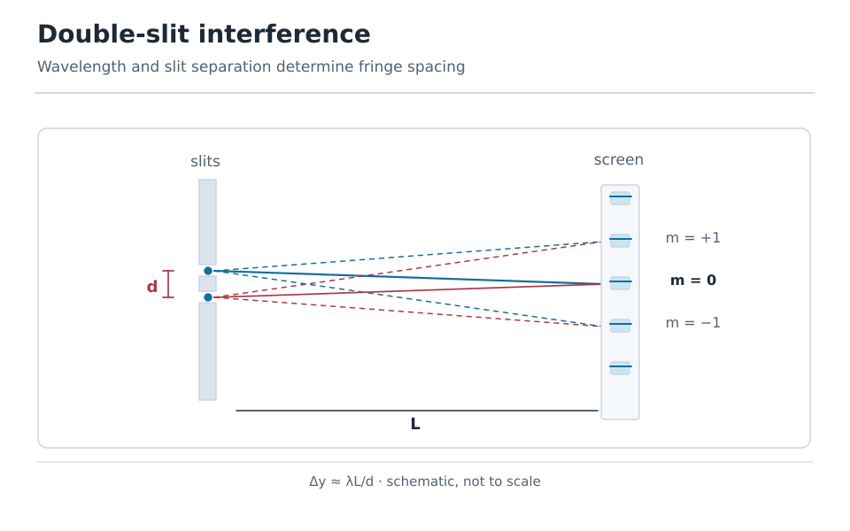

# M20-L5 – Double-Slit Interference Patterns {#L5}

**Course area:** M20 – Waves, interference and optics. **Level:** qualification phase; advanced topics marked. **Prerequisite:** [M20-L4](M20-L4.md). **Learning objective:** Predict interference maxima in a double slit and explain effects of wavelength and mixed colours.

## Starting question {#S1}

A double slit forms alternating bright and dark bands. Why does their spacing depend on the colour of light?

## Concepts and relationships {#S2}

In a **double-slit** arrangement, light from two narrow, coherently illuminated openings overlaps. Let $d$ be the separation between slit centres, $L$ the screen distance and $y$ the transverse screen coordinate. For approximately parallel paths, the path difference toward direction $\theta$ is $\Delta s=d\sin\theta$. Bright fringes of order $m=0,\pm1,\pm2,\ldots$ occur when

$$d\sin\theta=m\lambda.$$

For small angles with $|y|\ll L$, $\sin\theta\approx\tan\theta\approx y/L$, giving

$$y_m\approx\frac{m\lambda L}{d},\qquad \Delta y\approx\frac{\lambda L}{d}.$$

Longer wavelengths place the same order farther from the central maximum. With **polychromatic light**, patterns for several wavelengths overlap: their central bright fringes coincide approximately, while side fringes may spread into colours. Real slits have finite width; their diffraction envelope limits fringe brightness, so the ideal formula does not predict every intensity. Insufficient temporal or spatial coherence also reduces contrast.

*Wavelength, screen distance and slit spacing determine fringe separation.*

## Worked example {#S3}

For $d=0.30\,\mathrm{mm}=3.0\times10^{-4}\,\mathrm m$, $L=2.0\,\mathrm m$ and $\lambda=600\,\mathrm{nm}=6.0\times10^{-7}\,\mathrm m$, the fringe spacing is $\Delta y\approx\lambda L/d=0.0040\,\mathrm m=4.0\,\mathrm{mm}$. First-order maxima lie approximately four millimetres either side of the centre.

## Investigation and practice {#S4}

Use a simulation with adjustable slit separation and wavelength. Double $d$, then restore it and increase wavelength. Record how fringe spacing changes. Perform real laser experiments only with approved school equipment and expert supervision.

## Check your learning {#S5}

### Questions

1. What condition describes a bright interference fringe?
2. How does $\Delta y$ change when $d$ is doubled?
3. Find $\Delta y$ in the example for $\lambda=450\,\mathrm{nm}$.
4. What is special about the centre with polychromatic illumination?

### Answers

1. $d\sin\theta=m\lambda$ for integer $m$.
2. Fringe spacing is halved in the approximation.
3. $\Delta y\approx3.0\,\mathrm{mm}$.
4. The zero-order maximum approximately coincides for all wavelengths.

## Model limitations {#S6}

The derivation assumes small angles, adequate coherence and sufficiently narrow slits. Real intensities also follow a single-slit diffraction envelope.

## Further reading (internal) {#S7}

- [M20-L4](M20-L4.md) · Review prerequisite
- [M20-L6](M20-L6.md) · Next lesson

## Sources (external) {#S8}

- [KMK – Physics standards for Abitur 2020](https://www.kmk.org/fileadmin/Dateien/veroeffentlichungen_beschluesse/2020/2020_06_18-BildungsstandardsAHR_Physik.pdf) · p. 21, §2.6.2: waves, polarisation, double slit, standing waves general/advanced; single slit and interferometer advanced · Last accessed: 2026-11-21
- [LEIFIphysik – Double slit](https://www.leifiphysik.de/optik/beugung-und-interferenz/grundwissen/doppelspalt) · Basics: fringe locations and slit separation · Last accessed: 2026-11-21
- [OpenStax – University Physics 3, §3.1 Young’s Double-Slit Interference](https://openstax.org/books/university-physics-volume-3/pages/3-1-youngs-double-slit-interference) · §3.1: double slit and small-angle approximation · Last accessed: 2026-11-21

## Evidence {#S9}

