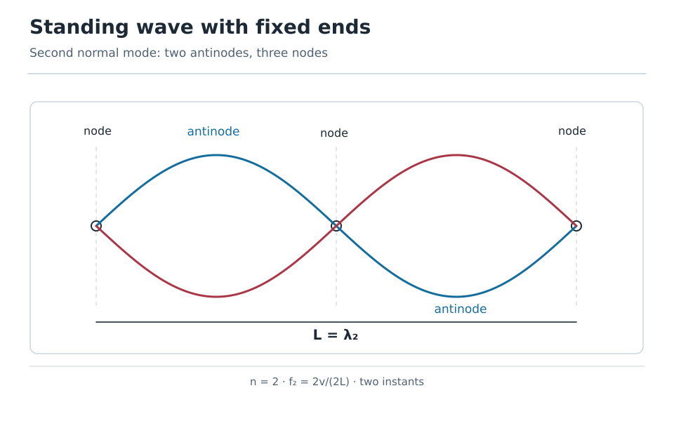

# M20-L6 – Standing Waves: Nodes and Antinodes {#L6}

**Course area:** M20 – Waves, interference and optics. **Level:** qualification phase; advanced topics marked. **Prerequisite:** [M20-L5](M20-L5.md). **Learning objective:** Calculate nodes, antinodes and harmonic frequencies for an ideal string fixed at both ends.

## Starting question {#S1}

Why can some places on a taut string remain nearly still while others oscillate strongly?

## Concepts and relationships {#S2}

Two counter-propagating waves of the same frequency and appropriate amplitude can superpose to form a **standing wave**. At a **node**, displacement remains zero; at an **antinode**, the maximum magnitude of displacement is largest. For an ideal string fixed at both ends, both ends must be nodes. The allowed standing modes satisfy an integer number of half-wavelengths fitting into length $L$:

$$L=n\frac{\lambda_n}{2},\quad \lambda_n=\frac{2L}{n},\quad f_n=\frac{nv}{2L}\quad(n=1,2,3,\ldots).$$

The fundamental mode, $n=1$, has one antinode. Mode $n=2$ adds a node at the midpoint and has two antinodes: it is the first overtone. Mode $n$ has $n+1$ nodes including endpoints and $n$ antinodes. An ideal standing-wave displacement is $y(x,t)=2A\sin(n\pi x/L)\cos(2\pi f_nt)$. Adjacent antinodes oscillate in opposite directions. A standing wave does not display a traveling wave shape and, in the ideal lossless case, transports no time-averaged net energy along the string.

*The second mode of a fixed string has three nodes and two antinodes.*

## Worked example {#S3}

For length $L=1.20\,\mathrm m$ and wave speed $v=120\,\mathrm{m/s}$, the fundamental frequency is $f_1=v/(2L)=50\,\mathrm{Hz}$. For $n=2$, $f_2=100\,\mathrm{Hz}$ and $\lambda_2=2L/2=1.20\,\mathrm m$. Three nodes occur at $x=0$, $0.60$ and $1.20\,\mathrm m$.

## Investigation and practice {#S4}

Draw the first three modes of a string fixed at both ends. Mark nodes and antinodes; label the number of half-wavelengths in each mode. Prefer a simulation.

## Check your learning {#S5}

### Questions

1. How many antinodes does the third normal mode have?
2. Find $f_3$ when $f_1=50\,\mathrm{Hz}$.
3. Find $\lambda_1$ for $L=1.20\,\mathrm m$.
4. Why is an antinode not a crest traveling steadily rightward?

### Answers

1. Three.
2. $f_3=3f_1=150\,\mathrm{Hz}$.
3. $\lambda_1=2L=2.40\,\mathrm m$.
4. Its location is fixed; only its displacement changes with time.

## Model limitations {#S6}

These formulas assume a uniform ideal string with fixed ends and constant wave speed. Open-ended air columns have different boundary conditions.

## Further reading (internal) {#S7}

- [M20-L5](M20-L5.md) · Review prerequisite
- [M20-L7](M20-L7.md) · Next lesson

## Sources (external) {#S8}

- [KMK – Physics standards for Abitur 2020](https://www.kmk.org/fileadmin/Dateien/veroeffentlichungen_beschluesse/2020/2020_06_18-BildungsstandardsAHR_Physik.pdf) · p. 21, §2.6.2: waves, polarisation, double slit, standing waves general/advanced; single slit and interferometer advanced · Last accessed: 2026-11-21
- [LEIFIphysik – Standing waves: boundary conditions](https://www.leifiphysik.de/mechanik/mechanische-wellen/grundwissen/stehende-wellen-bedingungen) · Basics: nodes, antinodes, normal-mode frequencies with fixed ends · Last accessed: 2026-11-21

## Evidence {#S9}

