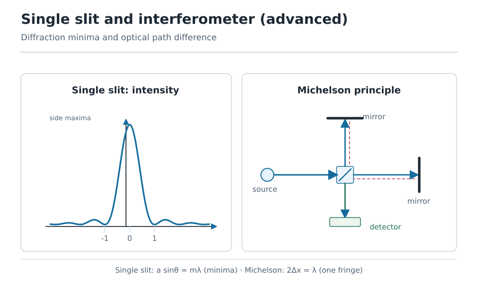

# M20-L7 – Advanced Level: Single Slit and Interferometer {#L7}

**Course area:** M20 – Waves, interference and optics. **Level:** qualification phase; advanced topics marked. **Prerequisite:** [M20-L6](M20-L6.md). **Learning objective:** Calculate single-slit minima and explain Michelson interferometry (advanced level).

## Starting question {#S1}

Even one narrow slit makes light and dark zones. How can a similar interference effect reveal tiny mirror motions?

## Concepts and relationships {#S2}

**Advanced-level extension (eA):** A **single slit** of width $a$ diffracts light because many secondary waves inside the aperture interfere. For monochromatic incident light and ideal far-field (Fraunhofer) geometry, intensity minima obey

$$a\sin\theta_m=m\lambda,\qquad m=\pm1,\pm2,\ldots.$$

The central bright region is roughly twice as wide as the spacing between adjacent minima on one side. For small angles, the first minimum lies at $y_1\approx L\lambda/a$ from the centre. Unlike the simplified double slit, the single-slit pattern shows a broad central maximum and much weaker side maxima.

A **Michelson interferometer** uses a beam splitter to separate coherent light into two perpendicular arms. After reflection from two mirrors, the beams are recombined. Moving one mirror by $\Delta x$ changes its beam's round-trip optical path by $2\Delta x$. One full fringe-period shift is produced approximately when $2\Delta x=\lambda$ for vacuum light and an otherwise fixed arrangement. An interferometer can therefore detect tiny changes in optical path. High-precision work requires stable optics, well-defined coherence and accounting for phase changes at optical interfaces.

*Single-slit diffraction has a broad central maximum; the interferometer turns optical-path changes into fringe shifts.*

## Worked example {#S3}

A single slit of width $a=0.20\,\mathrm{mm}$ is illuminated at $\lambda=500\,\mathrm{nm}$; screen distance is $L=2.0\,\mathrm m$. Then $\sin\theta_1=\lambda/a=0.0025$ and $y_1\approx L\lambda/a=5.0\,\mathrm{mm}$. The central region extends ideally from $-5.0$ to $+5.0\,\mathrm{mm}$, a width near $10\,\mathrm{mm}$. At $\lambda=500\,\mathrm{nm}$, a Michelson mirror displacement of $250\,\mathrm{nm}$ would move the pattern by one fringe period.

## Investigation and practice {#S4}

Use a simulation to compare single-slit patterns at two slit widths. Explain why narrowing a slit broadens the main maximum. Examine interferometers only with a paper diagram or simulation, not an improvised exposed-laser setup.

## Check your learning {#S5}

### Questions

1. Which condition defines single-slit intensity minima?
2. What happens to $y_1$ when slit width is halved?
3. How far must a Michelson mirror move for one fringe period at $\lambda=600\,\mathrm{nm}$?
4. Why is the double-slit condition for maxima not interchangeable with the single-slit minima formula?

### Answers

1. $a\sin\theta_m=m\lambda$ for nonzero integer $m$.
2. Distance to the first minimum doubles in the approximation.
3. $\Delta x=\lambda/2=300\,\mathrm{nm}$.
4. A single slit involves many secondary waves within one opening; the conditions are different.

## Model limitations {#S6}

The minima relation assumes monochromatic light, an ideal slit and far-field conditions. Real interferometers require careful optical-path and phase accounting.

## Further reading (internal) {#S7}

- [M20-L6](M20-L6.md) · Review prerequisite
**Looking ahead:** The next module begins with [M21-L1 – Photon Energy and the External Photoelectric Effect](M21-L1.md).

## Sources (external) {#S8}

- [KMK – Physics standards for Abitur 2020](https://www.kmk.org/fileadmin/Dateien/veroeffentlichungen_beschluesse/2020/2020_06_18-BildungsstandardsAHR_Physik.pdf) · p. 21, §2.6.2: waves, polarisation, double slit, standing waves general/advanced; single slit and interferometer advanced · Last accessed: 2026-11-21
- [OpenStax – University Physics 3, §4.1 Single-Slit Diffraction](https://openstax.org/books/university-physics-volume-3/pages/4-1-single-slit-diffraction) · §4.1: single-slit minima and broad central maximum · Last accessed: 2026-11-21
- [OpenStax – University Physics 3, §3.5 Michelson Interferometer](https://openstax.org/books/university-physics-volume-3/pages/3-5-the-michelson-interferometer) · §3.5: round-trip path length and mirror displacement · Last accessed: 2026-11-21

## Evidence {#S9}

