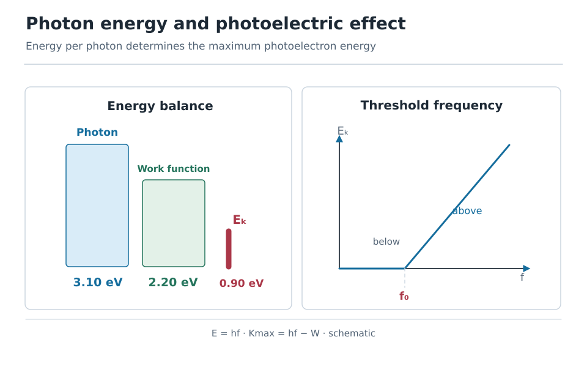

# M21-L1 – Photon Energy and the External Photoelectric Effect {#L1}

**Course area:** M21 – Quantum objects and photoelectric effect. **Level:** qualification phase; advanced topics marked. **Prerequisite:** [M20-L7](M20-L7.md). **Learning objective:** Calculate photon energy from frequency or wavelength and explain the threshold frequency in the external photoelectric effect.

## Starting question {#S1}

Why might intense red light fail to eject electrons from a particular metal, while weaker violet light succeeds?

## Concepts and relationships {#S2}

Electromagnetic radiation exchanges energy in individual quanta. A **photon** of frequency $f$ carries energy $E_\mathrm{ph}=hf=hc/\lambda$. Here $h=6.62607015\times10^{-34}\,\mathrm{J\,s}$ is Planck’s constant (defined exactly) and $c=299\,792\,458\,\mathrm{m/s}$ is the speed of light in vacuum. The conversion is $1\,\mathrm{eV}=1.602176634\times10^{-19}\,\mathrm J$. Higher frequency means more energy **per photon**; greater intensity at fixed frequency means more photons per unit time and area.

In the **external photoelectric effect**, a material surface absorbs a photon and may emit an electron. The photon must supply at least the **work function** $W$ of that material and surface. In the simplified model, the maximum kinetic energy obeys Einstein’s equation:

$$K_{\mathrm{max}}=hf-W\quad\text{when }hf\ge W.$$

Below the **threshold frequency** $f_0=W/h$, no photoelectrons appear, regardless of intensity in the usual one-photon regime. Above threshold, greater intensity can increase the number of emitted electrons but not their maximum kinetic energy. With the **stopping-potential method**, the magnitude of the stopping voltage $V_s$ satisfies $K_{\mathrm{max}}=eV_s$, with $e$ the positive elementary-charge magnitude. A graph of $V_s$ against $f$ has slope $h/e$. This provides evidence for photons; the national KMK core specifies relationships among energy, momentum, frequency and wavelength rather than requiring one particular photoelectric experimental setup.

*In the one-photon model photoemission requires light above a threshold frequency.*

## Worked example {#S3}

A $400\,\mathrm{nm}$ photon has approximately $E_\mathrm{ph}=1240\,\mathrm{eV\,nm}/400\,\mathrm{nm}=3.10\,\mathrm{eV}$. If the surface work function is $W=2.20\,\mathrm{eV}$, the maximum electron kinetic energy is $0.90\,\mathrm{eV}$, corresponding to a stopping-voltage magnitude of $0.90\,\mathrm V$. At $620\,\mathrm{nm}$, the photon has only $2.00\,\mathrm{eV}$, so this idealised one-photon model predicts no emission.

## Investigation and practice {#S4}

Use a photoelectric-effect simulation. Keep frequency above threshold and change intensity. Then hold intensity constant and change frequency. Record photocurrent and stopping voltage separately. Avoid unshielded ultraviolet sources and exposed high voltages.

## Check your learning {#S5}

### Questions

1. What happens to the energy of a photon when its frequency doubles?
2. Find $E_\mathrm{ph}$ in eV for $\lambda=500\,\mathrm{nm}$.
3. Find maximum kinetic energy for $E_\mathrm{ph}=3.20\,\mathrm{eV}$ and $W=2.50\,\mathrm{eV}$.
4. Why cannot high intensity replace a threshold frequency in this model?

### Answers

1. It doubles.
2. $E_\mathrm{ph}\approx1240/500=2.48\,\mathrm{eV}$.
3. $K_{\mathrm{max}}=0.70\,\mathrm{eV}$; $V_s=0.70\,\mathrm V$.
4. Each single photon must supply enough energy to overcome the work function.

## Model limitations {#S6}

This relation applies in the ordinary linear one-photon regime and uses a simplified surface model. Real surfaces, contact potentials and other material effects may affect measurements. Multiphoton effects from extremely intense lasers are excluded.

## Further reading (internal) {#S7}

- [M20-L7](M20-L7.md) · Review prerequisite
- [M21-L2](M21-L2.md) · Next lesson

## Sources (external) {#S8}

- [KMK – Physics standards for Abitur 2020](https://www.kmk.org/fileadmin/Dateien/veroeffentlichungen_beschluesse/2020/2020_06_18-BildungsstandardsAHR_Physik.pdf) · p. 21, §2.6.3: quantum objects; common and additional advanced topics · Last accessed: 2026-11-21
- [OpenStax – University Physics 3, §6.2 Photoelectric Effect](https://openstax.org/books/university-physics-volume-3/pages/6-2-photoelectric-effect) · §6.2: threshold frequency, energy and stopping potential · Last accessed: 2026-11-21
- [LEIFIphysik – Einstein’s photon model](https://www.leifiphysik.de/quantenphysik/quantenobjekt-photon/grundwissen/einsteins-theorie-des-lichts) · Basics: photon energy, momentum and Einstein equation · Last accessed: 2026-11-21

## Evidence {#S9}

