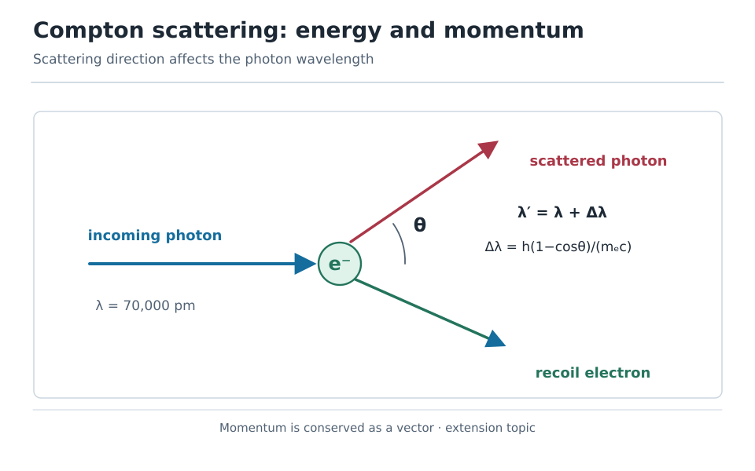

# M21-L2 – Extension: Compton Scattering and Photon Momentum {#L2}

**Course area:** M21 – Quantum objects and photoelectric effect. **Level:** qualification phase; advanced topics marked. **Prerequisite:** [M21-L1](M21-L1.md). **Learning objective:** Calculate photon momentum and explain Compton scattering as an optional, non-mandatory national-core application.

## Starting question {#S1}

A scattered X-ray photon leaves a collision with a slightly longer wavelength. Where did some of its initial energy go?

## Concepts and relationships {#S2}

**Extension/example, not an explicitly named mandatory national core topic:** Besides energy $E=hf$, photons carry directed **momentum** with magnitude $p=E/c=h/\lambda$. Photons can transfer momentum to matter despite having no rest mass. In **Compton scattering**, a high-energy photon interacts with an electron; after scattering, the photon may have a longer wavelength and less energy. Total energy and vector momentum are conserved; some energy becomes electron kinetic energy.

For an initially approximately free electron at rest, relativistic conservation leads to

$$\Delta\lambda=\lambda'-\lambda=\frac{h}{m_ec}(1-\cos\theta).$$

Here $\theta$ is the photon's scattering angle and $m_e$ the electron mass. The quantity $h/(m_ec)=2.426\,\mathrm{pm}$ is the **electron Compton wavelength**. At $0^\circ$ the shift is zero; at $90^\circ$ it is $2.426\,\mathrm{pm}$; at $180^\circ$ it is twice this value. The result highlights why an energy balance alone is not enough: momentum is a vector, so scattering direction matters. Compton scattering is a useful supplement illustrating the KMK core relationships between energy, momentum and wavelength; the named experiment itself is not compulsory in the national table.

*Compton scattering transfers photon energy and vector momentum to an electron.*

## Worked example {#S3}

An incident photon has $\lambda=70.000\,\mathrm{pm}$. At a scattering angle of $90^\circ$, $\Delta\lambda=2.426\,\mathrm{pm}$, so $\lambda'=72.426\,\mathrm{pm}$. The outgoing photon's momentum is smaller. One cannot simply subtract the scalar magnitudes to obtain the recoil electron's momentum; the vector directions matter.

## Investigation and practice {#S4}

On paper draw the incident photon momentum to the right, the scattered photon momentum upward through $90^\circ$, and the resulting recoil electron momentum. Use a mathematical model only; no X-ray source.

## Check your learning {#S5}

### Questions

1. Calculate $p$ for $\lambda=500\,\mathrm{nm}$ with $h=6.626\times10^{-34}\,\mathrm{J\,s}$.
2. Find $\Delta\lambda$ at $\theta=0^\circ$.
3. Find $\Delta\lambda$ at $\theta=180^\circ$.
4. Why is the Compton effect more than a change in the number of photons?

### Answers

1. $p=h/\lambda\approx1.33\times10^{-27}\,\mathrm{kg\,m/s}$.
2. $\Delta\lambda=0$.
3. $\Delta\lambda=2\times2.426=4.852\,\mathrm{pm}$.
4. The wavelength, hence the energy and momentum of individual photons, changes depending on angle.

## Model limitations {#S6}

The formula assumes a free electron initially at rest. Binding effects, scattering from other particles and multiple scattering are excluded. The vector sketch is schematic, not to scale.

## Further reading (internal) {#S7}

- [M21-L1](M21-L1.md) · Review prerequisite
- [M21-L3](M21-L3.md) · Next lesson

## Sources (external) {#S8}

- [KMK – Physics standards for Abitur 2020](https://www.kmk.org/fileadmin/Dateien/veroeffentlichungen_beschluesse/2020/2020_06_18-BildungsstandardsAHR_Physik.pdf) · p. 21, §2.6.3: quantum objects; common and additional advanced topics · Last accessed: 2026-11-21
- [OpenStax – University Physics 3, §6.3 The Compton Effect](https://openstax.org/books/university-physics-volume-3/pages/6-3-the-compton-effect) · §6.3: Compton shift and relativistic scattering · Last accessed: 2026-11-21

## Evidence {#S9}

