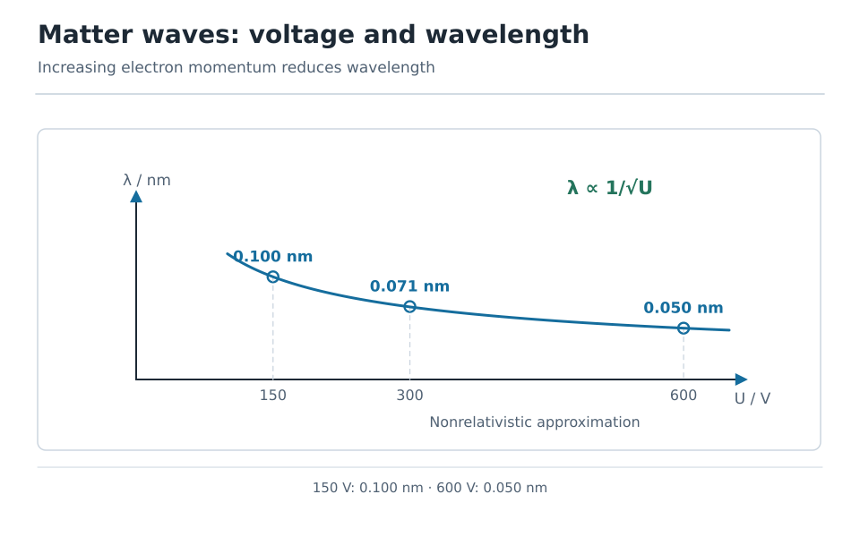

# M21-L3 – De Broglie Wavelength and Matter Waves {#L3}

**Course area:** M21 – Quantum objects and photoelectric effect. **Level:** qualification phase; advanced topics marked. **Prerequisite:** [M21-L2](M21-L2.md). **Learning objective:** Calculate free-particle wavelengths from momentum and state the limits of nonrelativistic approximations.

## Starting question {#S1}

Why can an electron beam produce a diffraction pattern from crystals even though electrons have rest mass?

## Concepts and relationships {#S2}

The **de Broglie hypothesis** assigns a wavelength to a free particle with momentum magnitude $p$:

$$\lambda_\mathrm{dB}=\frac{h}{p}.$$

For a slow particle $p\approx mv$. An electron accelerated from rest through a potential difference of magnitude $U$ gains kinetic energy $K=eU=p^2/(2m_e)$ in the ideal nonrelativistic approximation. Therefore

$$\lambda_\mathrm{dB}=\frac{h}{\sqrt{2m_e eU}}.$$

This wavelength is not the physical diameter of the electron, nor does it imply that a material string is waving. The quantum description predicts observable diffraction and interference probabilities. A larger momentum gives a shorter wavelength. Electron diffraction by crystals supports the model because atomic lattice spacings can be comparable to the electron wavelength. For an ordinary macroscopic object, $h/p$ is far too small to reveal interference in everyday conditions. At sufficiently high accelerating voltage one must replace the nonrelativistic momentum by its relativistic expression. The de Broglie relation belongs to the KMK core relationships used to describe quantum objects.

*Electron matter wavelength decreases with the square root of voltage in the nonrelativistic approximation.*

## Worked example {#S3}

An electron is accelerated from rest by $U=150\,\mathrm V$. Using $m_e=9.109\times10^{-31}\,\mathrm{kg}$ and $e=1.602\times10^{-19}\,\mathrm C$ gives $\lambda_\mathrm{dB}=h/\sqrt{2m_e eU}\approx1.00\times10^{-10}\,\mathrm m=0.100\,\mathrm{nm}$. At $600\,\mathrm V$, the wavelength is half as large because $\lambda\propto U^{-1/2}$.

## Investigation and practice {#S4}

Make a table of $\lambda_\mathrm{dB}$ for $U=150$, $300$ and $600\,\mathrm V$. Relate these scales to atomic lattice spacing and use a simulation instead of an electron-beam apparatus.

## Check your learning {#S5}

### Questions

1. What goes in the denominator of $\lambda=h/p$?
2. What is the electron wavelength at $600\,\mathrm V$ if it is $0.100\,\mathrm{nm}$ at $150\,\mathrm V$?
3. Why does an ordinary ball not show obvious de Broglie interference?
4. What is misleading about describing an electron as a vibrating material thread?

### Answers

1. Momentum magnitude $p$.
2. $0.100/\sqrt4=0.050\,\mathrm{nm}$.
3. Its momentum is large enough to make the wavelength extremely small; practical interference conditions are unavailable.
4. The matter wave is a quantum description, not a classical material string.

## Model limitations {#S6}

The formula assumes acceleration from rest, a simple potential difference, negligible losses and nonrelativistic speeds. Real electron scattering depends on crystal structure and interactions.

## Further reading (internal) {#S7}

- [M21-L2](M21-L2.md) · Review prerequisite
- [M21-L4](M21-L4.md) · Next lesson

## Sources (external) {#S8}

- [KMK – Physics standards for Abitur 2020](https://www.kmk.org/fileadmin/Dateien/veroeffentlichungen_beschluesse/2020/2020_06_18-BildungsstandardsAHR_Physik.pdf) · p. 21, §2.6.3: quantum objects; common and additional advanced topics · Last accessed: 2026-11-21
- [LEIFIphysik – de Broglie wavelength](https://www.leifiphysik.de/quantenphysik/quantenobjekt-elektron/grundwissen/de-broglie-wellenlaenge) · Basics: λ = h/p and electrons · Last accessed: 2026-11-21
- [OpenStax – University Physics 3, §6.5 De Broglie’s Matter Waves](https://openstax.org/books/university-physics-volume-3/pages/6-5-de-broglies-matter-waves) · §6.5: matter waves and momentum · Last accessed: 2026-11-21

## Evidence {#S9}

