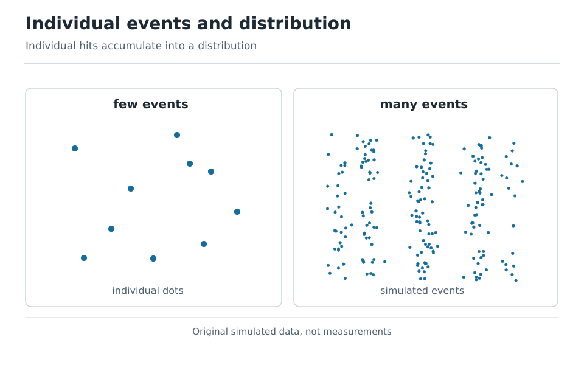

# M21-L4 – The Double Slit with Individual Quantum Objects {#L4}

**Course area:** M21 – Quantum objects and photoelectric effect. **Level:** qualification phase; advanced topics marked. **Prerequisite:** [M21-L3](M21-L3.md). **Learning objective:** Distinguish single detection events from their statistical distribution and interpret the resulting interference pattern.

## Starting question {#S1}

Electrons hit a detector as isolated points. Why does a stripe-like pattern emerge after many repetitions?

## Concepts and relationships {#S2}

In a **low-intensity double-slit experiment**, the source is adjusted so that, ideally, just one electron or photon occupies the apparatus at a time. Each screen detection is a single, spatially localised event. After many identically prepared runs, a reproducible **frequency distribution** with bright and dark regions appears. The next individual hit cannot be predicted exactly; the probability of a hit within a range can be calculated.

When no distinguishable path information exists, both alternatives contribute coherently to the interference pattern. Mathematically one adds **probability amplitudes**, not the separate probabilities first. In the idealised arrangement the detection density is proportional to $|\psi_1+\psi_2|^2$, not generally $|\psi_1|^2+|\psi_2|^2$. The cross term produces interference. With many events the observed histogram approaches the predicted distribution. A point-like hit is not a photograph of a definite classical trajectory through a particular slit. Nor does an electron form two ordinary classical pieces of charged matter that later reconnect. If a demonstration uses synthetic events, those data must be identified as simulated rather than measured.

*The comparison shows how a statistical pattern emerges from individual simulated detections.*

## Worked example {#S3}

Suppose a toy detector model assigns probabilities $P(A)=0.50$, $P(B)=0.30$ and $P(C)=0.20$ to three regions. For $N=200$ independent, identically prepared events, the **expected** counts are $100$, $60$ and $40$. Actual observed counts will fluctuate. Expected counts are not guaranteed measurement results.

## Investigation and practice {#S4}

Simulate 200 individual detections and build a histogram. Clearly label the events as simulated. Compare a single dot, twenty events and the full distribution.

## Check your learning {#S5}

### Questions

1. What can be predicted with certainty about the next individual screen position?
2. How does a point-like detection differ from an interference distribution?
3. What expected count corresponds to $P=0.30$ and $N=200$?
4. Why are separate single-slit probabilities insufficient when two coherent alternatives are available?

### Answers

1. The exact position cannot generally be predicted; only probabilities can be assigned.
2. One point is one event; the distribution is built from many repetitions.
3. $N\cdot P=60$ expected events.
4. The amplitudes interfere; the cross terms generally do not vanish.

## Model limitations {#S6}

The numerical probabilities in the example are invented teaching values for a counting model, not measured double-slit data. Real patterns depend on preparation, aperture widths, coherence and detection geometry.

## Further reading (internal) {#S7}

- [M21-L3](M21-L3.md) · Review prerequisite
- [M21-L5](M21-L5.md) · Next lesson

## Sources (external) {#S8}

- [KMK – Physics standards for Abitur 2020](https://www.kmk.org/fileadmin/Dateien/veroeffentlichungen_beschluesse/2020/2020_06_18-BildungsstandardsAHR_Physik.pdf) · p. 21, §2.6.3: quantum objects; common and additional advanced topics · Last accessed: 2026-11-21
- [LEIFIphysik – Double-slit simulations](https://www.leifiphysik.de/quantenphysik/quantenobjekt-elektron/versuche/simulationen-zum-doppelspalt) · Experiments: individual events, interference and path information · Last accessed: 2026-11-21
- [LEIFIphysik – Ability to interfere](https://www.leifiphysik.de/quantenphysik/wesenszuege-quantenphysik/grundwissen/wesenszug-2-faehigkeit-zur-interferenz) · Basics: single events and statistical pattern · Last accessed: 2026-11-21

## Evidence {#S9}

