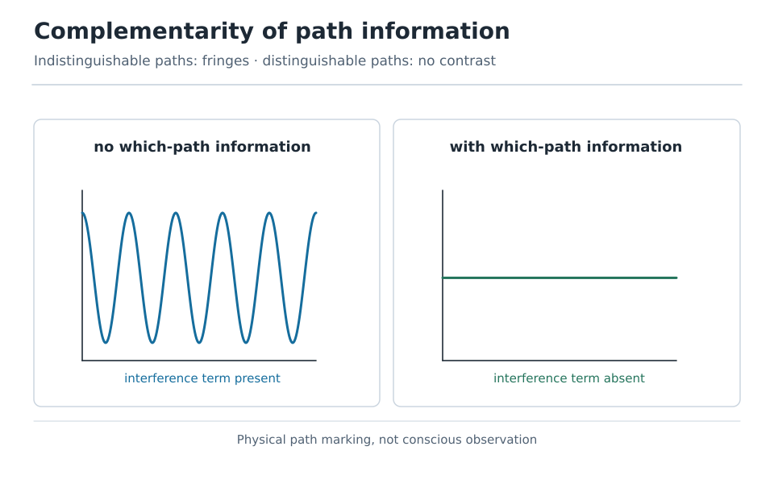

# M21-L5 – Probability, Superposition and Complementarity {#L5}

**Course area:** M21 – Quantum objects and photoelectric effect. **Level:** qualification phase; advanced topics marked. **Prerequisite:** [M21-L4](M21-L4.md). **Learning objective:** Explain coherent superposition and complementarity using the double slit, distinguishing coherent paths from distinguishable alternatives.

## Starting question {#S1}

Why does interference disappear when a detector reliably identifies the slit traversed by a quantum object?

## Concepts and relationships {#S2}

**Superposition** means that, when a quantum object has coherently prepared alternatives, its state is described by their combined probability amplitudes. For two paths we may write $\psi=\psi_1+\psi_2$. The probability density is then $|\psi|^2=|\psi_1|^2+|\psi_2|^2+2\operatorname{Re}(\psi_1^*\psi_2)$. The last quantity is the **interference term**: it may be positive or negative. Interference is not just the arithmetic sum of two independent detection intensities.

**Complementarity of path information and interference** means that, when path alternatives are reliably physically distinguishable, the screen pattern obtained without conditioning on the path loses the coherent cross terms. Nobody must consciously look at a result. The relevant process is interaction or entanglement with a path detector or environment. If paths remain indistinguishable, interference visibility can be high. Partial distinguishability may leave reduced fringes. An approximate diagnostic is fringe visibility $V=(I_{\max}-I_{\min})/(I_{\max}+I_{\min})$. A quantum experiment can thus have a **predictable statistical distribution** even though individual outcomes are stochastic. These are compatible statements.

*Physically available which-path information suppresses unconditioned interference.*

## Worked example {#S3}

In a model intensity profile, let $I_{\max}=90$ and $I_{\min}=10$ counts per interval. Then $V=(90-10)/(90+10)=0.80$. If coupling to a path marker yields equal maxima and minima of $50$ each, the visibility is $V=0$. These numbers are **illustrative**, not real experimental measurements.

## Investigation and practice {#S4}

Prepare two schematic experimental conditions on paper: no path detector and physically distinguishable paths. State which information is available in each case and which histogram is expected. Do not invoke human awareness as the mechanism.

## Check your learning {#S5}

### Questions

1. What quantities are added in coherent quantum superposition?
2. Find $V$ for $I_{\max}=80$ and $I_{\min}=20$.
3. Is it sufficient for a person to consciously watch the apparatus to erase fringes?
4. Can partially distinguishable paths cause partly reduced visibility?

### Answers

1. Probability amplitudes.
2. $V=(80-20)/(80+20)=0.60$.
3. No. A physical interaction making path information available is relevant.
4. Yes. Visibility can lie between zero and one.

## Model limitations {#S6}

The visibility expression assumes properly defined maximum and minimum in one comparable intensity profile. Real path-marker interactions require a more complete quantum treatment.

## Further reading (internal) {#S7}

- [M21-L4](M21-L4.md) · Review prerequisite
- [M21-L6](M21-L6.md) · Next lesson

## Sources (external) {#S8}

- [KMK – Physics standards for Abitur 2020](https://www.kmk.org/fileadmin/Dateien/veroeffentlichungen_beschluesse/2020/2020_06_18-BildungsstandardsAHR_Physik.pdf) · p. 21, §2.6.3: quantum objects; common and additional advanced topics · Last accessed: 2026-11-21
- [LEIFIphysik – Complementarity](https://www.leifiphysik.de/quantenphysik/wesenszuege-quantenphysik/grundwissen/wesenszug-4-komplementaritaet) · Basics: distinguishable paths and loss of interference · Last accessed: 2026-11-21
- [LEIFIphysik – Ability to interfere](https://www.leifiphysik.de/quantenphysik/wesenszuege-quantenphysik/grundwissen/wesenszug-2-faehigkeit-zur-interferenz) · Basics: single events and statistical pattern · Last accessed: 2026-11-21

## Evidence {#S9}

