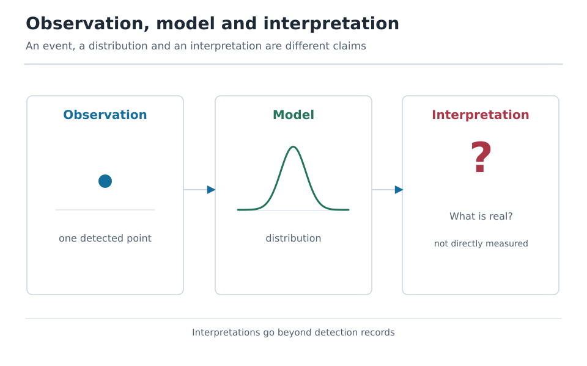

# M21-L6 – Quantum Models and the Limits of Classical Pictures {#L6}

**Course area:** M21 – Quantum objects and photoelectric effect. **Level:** qualification phase; advanced topics marked. **Prerequisite:** [M21-L5](M21-L5.md). **Learning objective:** Assess classical trajectories against detection events, model predictions and concepts of determinism and causality.

## Starting question {#S1}

Does a single dot on a detection screen prove that the electron followed a definite classical path beforehand?

## Concepts and relationships {#S2}

**Classical models** work well when continuously defined quantities under appropriate conditions describe predictable trajectories. In the double-slit experiment, however, simple trajectory pictures do not jointly explain localised single events and the statistical interference distribution when path information is unavailable. A **quantum model** assigns a state to a specified preparation and predicts probabilities for possible measurement outcomes. The **distribution** can be predictable with high precision while a single detection position remains stochastic.

Four terms need distinction: **reality** concerns the relation between physical states and observations; **locality** concerns influences or correlations between spatially separated systems; **causality** concerns cause–effect explanations and models; and **determinism** asks whether a state uniquely fixes individual future outcomes. Quantum experiments constrain naive classical assumptions but do not automatically select a unique philosophical interpretation. In particular, the inability to predict single hits does **not** mean that experiments are arbitrary or that physics lacks causal structure. Probabilities depend on reproducible preparation and apparatus geometry.

Saying “the electron is literally two tiny balls at once” misrepresents superposition. Nor does a single hit retrospectively certify an unobserved classical path. Scientific models are assessed by predictive power, testability and limits of validity, not only by how easy they are to visualise.

*An observed event, a predictive model and a philosophical interpretation are distinct levels.*

## Worked example {#S3}

Assume a model predicts $P=0.40$ for one detector region. For $N=500$ identically prepared events, the expected count is $NP=200$. Observing 194 or 209 hits does not by itself falsify the model: statistical fluctuations are predicted. For independent binomial trials the expected standard deviation is $\sigma=\sqrt{NP(1-P)}=\sqrt{120}\approx11$ counts.

## Investigation and practice {#S4}

Critically discuss three statements: “A screen dot shows a path”, “Individual events are unpredictable but distributions are not”, and “Only conscious observation produces measurement outcomes”. Classify each as observation, model claim or unsupported interpretation.

## Check your learning {#S5}

### Questions

1. Why does a single detector dot not reconstruct a unique trajectory?
2. For $P=0.40$ and $N=500$, find the expected count.
3. How do stochastic individual outcomes differ from arbitrary model parameters?
4. Does observed interference select only one interpretation of quantum mechanics?

### Answers

1. It gives one detection location, not the unobserved path beforehand.
2. 200 expected hits.
3. Outcomes may be stochastic while distributions are determined by the specified preparation and experiment.
4. No. Several interpretations share experimentally confirmed predictions.

## Model limitations {#S6}

Worldview concepts are subtle and interpretation-dependent. One double-slit experiment does not establish broad claims about every form of locality or causality. Quantitative predictions apply only to specified preparations.

## Further reading (internal) {#S7}

- [M21-L5](M21-L5.md) · Review prerequisite
- [M21-L7](M21-L7.md) · Next lesson

## Sources (external) {#S8}

- [KMK – Physics standards for Abitur 2020](https://www.kmk.org/fileadmin/Dateien/veroeffentlichungen_beschluesse/2020/2020_06_18-BildungsstandardsAHR_Physik.pdf) · p. 21, §2.6.3: quantum objects; common and additional advanced topics · Last accessed: 2026-11-21
- [LEIFIphysik – Quantum objects](https://www.leifiphysik.de/quantenphysik/wesenszuege-quantenphysik/grundwissen/quantenobjekte) · Basics: statistics and quantum-object concepts · Last accessed: 2026-11-21
- [LEIFIphysik – Complementarity](https://www.leifiphysik.de/quantenphysik/wesenszuege-quantenphysik/grundwissen/wesenszug-4-komplementaritaet) · Basics: distinguishable paths and loss of interference · Last accessed: 2026-11-21

## Evidence {#S9}

