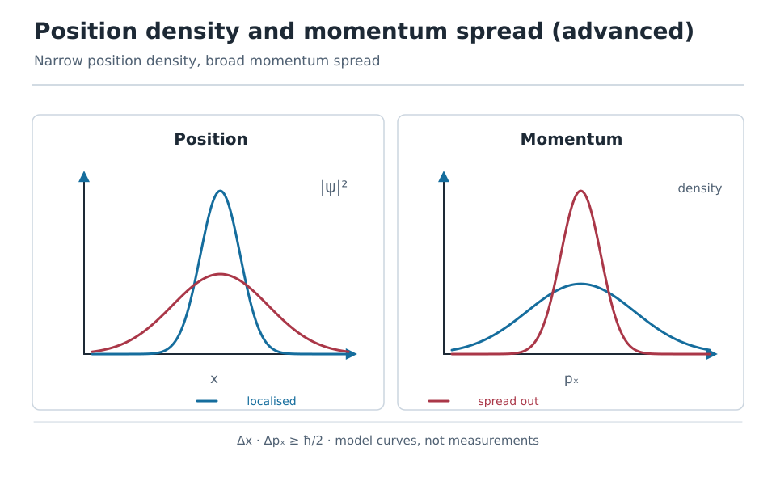

# M21-L7 – Advanced Level: Wave Functions and Position–Momentum Uncertainty {#L7}

**Course area:** M21 – Quantum objects and photoelectric effect. **Level:** qualification phase; advanced topics marked. **Prerequisite:** [M21-L6](M21-L6.md). **Learning objective:** Interpret $|\psi|^2$ as detection probability density and apply position–momentum uncertainty qualitatively and in simple calculations.

## Starting question {#S1}

Why does a sharply localised electron wave packet require a broader spread of possible momentum values?

## Concepts and relationships {#S2}

**Additional advanced-level content (eA):** The **wave function** $\psi(x,t)$ is generally complex-valued. Its squared magnitude $|\psi(x,t)|^2$ represents a **probability density** for position in one dimension. The probability for an interval $[a,b]$ is

$$P(a\le x\le b)=\int_a^b |\psi(x,t)|^2\,\mathrm{d}x.$$

For a normalised state the integral over all space is one. A high curve value at one point is **not** a probability exceeding one: density has units, and the integrated area over an interval represents probability. The **position–momentum uncertainty relation** for standard deviations on the same axis is

$$\Delta x\,\Delta p_x\ge\frac{\hbar}{2},\qquad \hbar=\frac{h}{2\pi}.$$

It gives a fundamental limit on how sharply a quantum state can specify position and momentum together, not merely how good the instruments are. A strongly localised packet requires many momentum components; a nearly pure momentum state spreads broadly in space. An important precision: this inequality concerns the **standard deviations** of the respective observables, not arbitrary measurement-error bars. It does not replace a full dynamical calculation. Both the qualitative wave-function interpretation and the position–momentum relation are identified by the KMK as additional advanced-level topics.

*A more localised wave packet must have a broader momentum distribution.*

## Worked example {#S3}

For an electron with position standard deviation $\Delta x=1.0\,\mathrm{nm}$, using $\hbar\approx1.055\times10^{-34}\,\mathrm{J\,s}$ yields $\Delta p_x\ge\hbar/(2\Delta x)=5.27\times10^{-26}\,\mathrm{kg\,m/s}$. The actual momentum spread may be larger. For a normalised illustrative box model with constant density $|\psi|^2=0.20\,\mathrm{nm}^{-1}$ over a length of $5.0\,\mathrm{nm}$, total probability is $0.20\times5.0=1$.

## Investigation and practice {#S4}

Draw two normalised schematic position densities: one narrow and one broad. Sketch the associated momentum distributions qualitatively. Use wave-packet and Fourier reasoning, not a presumed classical particle path.

## Check your learning {#S5}

### Questions

1. What does $|\psi(x,t)|^2$ mean in one spatial dimension?
2. Find the lower bound for $\Delta p_x$ when $\Delta x=2.0\,\mathrm{nm}$.
3. Why is a large probability-density value not itself a probability?
4. Why is $\Delta x$ not automatically identical to a ruler’s measurement error?

### Answers

1. Probability density per unit length.
2. $\Delta p_x\ge2.64\times10^{-26}\,\mathrm{kg\,m/s}$.
3. Probabilities are integrals over intervals; the density itself may exceed one.
4. It is a state-related standard deviation, not simply instrumental imprecision.

## Model limitations {#S6}

The uniform-box example illustrates normalisation only, not a complete solution of a physical potential. The given uncertainty inequality uses standard deviations; different uncertainty measures require separate mathematical results.

## Further reading (internal) {#S7}

- [M21-L6](M21-L6.md) · Review prerequisite
**Looking ahead:** The next module begins with [M22-L1 – Historical Atomic Models: Observations and Explanations](M22-L1.md).

## Sources (external) {#S8}

- [KMK – Physics standards for Abitur 2020](https://www.kmk.org/fileadmin/Dateien/veroeffentlichungen_beschluesse/2020/2020_06_18-BildungsstandardsAHR_Physik.pdf) · p. 21, §2.6.3: quantum objects; common and additional advanced topics · Last accessed: 2026-11-21
- [OpenStax – University Physics 3, §7.1 Wave Functions](https://openstax.org/books/university-physics-volume-3/pages/7-1-wave-functions) · §7.1: normalisation and Born probability interpretation · Last accessed: 2026-11-21
- [OpenStax – University Physics 3, §7.2 Heisenberg Uncertainty Principle](https://openstax.org/books/university-physics-volume-3/pages/7-2-the-heisenberg-uncertainty-principle) · §7.2: position–momentum uncertainty · Last accessed: 2026-11-21

## Evidence {#S9}

