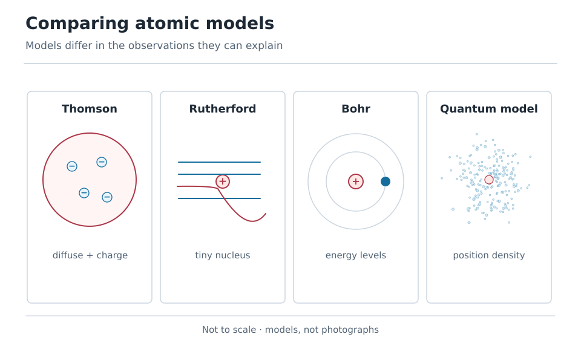

# M22-L1 – Historical Atomic Models: Observations and Explanations {#L1}

**Course area:** M22 – Atomic models, energy levels and spectra. **Level:** qualification phase; advanced topics marked. **Prerequisite:** [M21-L6](M21-L6.md). **Learning objective:** Compare Thomson, Rutherford, Bohr and quantum atomic models by their evidence and limitations.

## Starting question {#S1}

Why did most alpha particles cross a thin gold foil nearly undeflected while a few scattered through large angles?

## Concepts and relationships {#S2}

An **atomic model** is a testable representation, not a photograph of an atom. **Thomson’s** model (around 1904) placed electrons within an extended distribution of positive charge. It accommodated negatively charged constituents but could not account for the large deflections of some alpha particles in thin-foil experiments. Geiger and Marsden’s scattering results, interpreted by **Rutherford** (1911), indicated that positive charge and nearly all atomic mass are concentrated in a tiny nucleus; the nucleus occupies only a small part of the atom’s volume. Rare large-angle scattering conflicts with a diffuse positive-charge model.

**Bohr’s model** (1913) linked discrete electron energies to lines in hydrogen’s spectrum. However, its pictorial circular orbits are not a general quantum description of electrons. The **quantum model** uses states and spatial probability distributions, not predetermined paths. A later model is not better merely because it is newer: it should account for more evidence through testable assumptions. The national German Abitur core covers qualitative quantum atomic models; the historical comparison is a teaching route towards that objective.

*Atomic models are explanations, not photographs.*

## Worked example {#S3}

In a **schematic** sample, 9,900 of 10,000 alpha particles reach a detector almost straight ahead, 99 are deflected noticeably and one is backscattered strongly. The fractions are 99%, 0.99% and 0.01%. These invented teaching counts illustrate frequency differences; they are not historical Rutherford data and cannot determine nuclear radius.

## Investigation and practice {#S4}

Compare four original model sketches, identifying one observation each model accounts for and one question it leaves open. Use a simulation or supplied data, not radioactive sources.

## Check your learning {#S5}

### Questions

1. Which observation challenges a diffuse positive-charge model?
2. What is highly concentrated in Rutherford’s nuclear model?
3. What hydrogen observation did discrete Bohr energy states explain?
4. Why is an electron cloud not a photographic electron trajectory?

### Answers

1. The rare large-angle deflections of alpha particles.
2. Positive charge and almost all of the mass.
3. Discrete spectral lines and their energy differences.
4. It illustrates a quantum position probability distribution, not a recorded classical path.

## Model limitations {#S6}

Each model has a limited domain. Bohr’s model does not generally explain many-electron atoms; Rutherford alone does not explain stable discrete energies.

## Further reading (internal) {#S7}

- [M21-L6](M21-L6.md) · Review prerequisite
- [M22-L2](M22-L2.md) · Next lesson

## Sources (external) {#S8}

- [KMK – Physics standards for Abitur 2020](https://www.kmk.org/fileadmin/Dateien/veroeffentlichungen_beschluesse/2020/2020_06_18-BildungsstandardsAHR_Physik.pdf) · p. 22, §2.6.3: atomic models; common core and advanced addition · Last accessed: 2026-11-21
- [OpenStax – University Physics 3, §6.4 Bohr’s Model](https://openstax.org/books/university-physics-volume-3/pages/6-4-bohrs-model-of-the-hydrogen-atom) · §6.4: hydrogen energies, model history and spectral series · Last accessed: 2026-11-21
- [OpenStax – University Physics 3, §8.1 Hydrogen Atom](https://openstax.org/books/university-physics-volume-3/pages/8-1-the-hydrogen-atom) · §8.1: hydrogen quantum states and orbitals · Last accessed: 2026-11-21

## Evidence {#S9}

