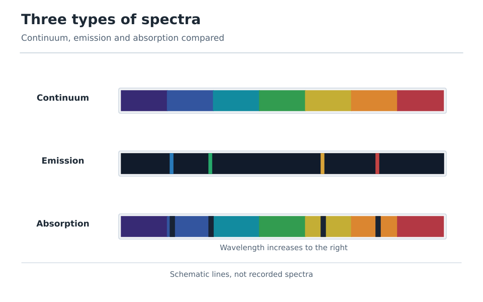

# M22-L2 – Emission and Absorption Spectra {#L2}

**Course area:** M22 – Atomic models, energy levels and spectra. **Level:** qualification phase; advanced topics marked. **Prerequisite:** [M22-L1](M22-L1.md). **Learning objective:** Distinguish continuous, emission and absorption spectra and relate spectral lines to atomic transitions.

## Starting question {#S1}

Why does a hot solid often emit a broad spectrum whereas a thin excited gas shows narrow colour lines?

## Concepts and relationships {#S2}

A **spectrum** displays light according to wavelength or frequency. A dense hot emitter may produce an approximately **continuous spectrum**. An excited dilute atomic gas can produce **emission lines** when atoms release photons of selected energies. When broad-spectrum light crosses a suitable cooler gas, **absorption lines** may appear at transition frequencies in the transmitted light. Their visibility also depends on temperature, level populations, gas column density and detector resolution.

Each line satisfies $\Delta E=hf=hc/\lambda$. The same pair of energy levels can produce absorption or emission, depending on the transition direction. Spectrometers do not show infinitely narrow lines: instrumental resolution, line broadening and overlap matter. Hydrogen’s Balmer $H_\alpha$ line in air is near $656.3\,\mathrm{nm}$ and appears red. A material is better identified through a **pattern of multiple lines** rather than a single matching colour.

*Emission and absorption lines relate to discrete atomic transitions.*

## Worked example {#S3}

For a red line at $\lambda=656\,\mathrm{nm}$, $E_{\mathrm{ph}}\approx1240\,\mathrm{eV\,nm}/656\,\mathrm{nm}=1.89\,\mathrm{eV}$. Absorption in the reverse transition would use the same photon energy; actual linewidths and transition probabilities are ignored here.

## Investigation and practice {#S4}

Draw three original schematic spectra and match them to a broadband emitter, an excited atomic gas, and broadband light passing through an absorbing gas. Use supplied spectral data or a supervised enclosed low-voltage classroom instrument.

## Check your learning {#S5}

### Questions

1. What distinguishes an emission line spectrum?
2. Why might absorption occur at an emission line wavelength?
3. What photon energy approximately corresponds to 620 nm?
4. Why is a single red line often insufficient to identify an element?

### Answers

1. Bright discrete lines on a darker background.
2. The same energy gap is involved, but absorption is the upward transition.
3. $1240/620\approx2.00\,\mathrm{eV}$.
4. Several materials or measurement situations may produce similar lines; the complete pattern is more informative.

## Model limitations {#S6}

A schematic dark line does not mean complete removal of all photons at that wavelength. Gas conditions, optical depth and instrumental resolution determine its appearance.

## Further reading (internal) {#S7}

- [M22-L1](M22-L1.md) · Review prerequisite
- [M22-L3](M22-L3.md) · Next lesson

## Sources (external) {#S8}

- [KMK – Physics standards for Abitur 2020](https://www.kmk.org/fileadmin/Dateien/veroeffentlichungen_beschluesse/2020/2020_06_18-BildungsstandardsAHR_Physik.pdf) · p. 22, §2.6.3: atomic models; common core and advanced addition · Last accessed: 2026-11-21
- [OpenStax – University Physics 3, §8.5 Atomic Spectra](https://openstax.org/books/university-physics-volume-3/pages/8-5-atomic-spectra-and-x-rays) · §8.5: lines, spectral analysis and energy levels · Last accessed: 2026-11-21
- [NIST – Atomic Spectra Database](https://www.nist.gov/pml/atomic-spectra-database) · Reference database: atomic line wavelengths and energy levels · Last accessed: 2026-11-21

## Evidence {#S9}

