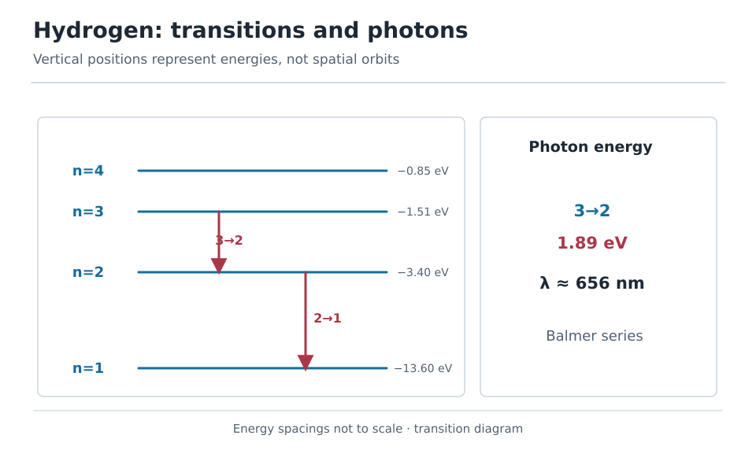

# M22-L3 – Hydrogen Energy Levels and Spectral Lines {#L3}

**Course area:** M22 – Atomic models, energy levels and spectra. **Level:** qualification phase; advanced topics marked. **Prerequisite:** [M22-L2](M22-L2.md). **Learning objective:** Calculate discrete hydrogen energies and photon energies during transitions and interpret an energy-level diagram.

## Starting question {#S1}

How can a transition between two unseen electronic states produce an observable red spectral line?

## Concepts and relationships {#S2}

An isolated **hydrogen atom** has discrete bound states. In a simplified nonrelativistic model, $E_n=-13.6\,\mathrm{eV}/n^2$ with $n=1,2,\ldots$ and energy zero corresponding to an ionized atom with a distant electron at rest. The ground state lies at $-13.6\,\mathrm{eV}$; higher levels approach $0\,\mathrm{eV}$.

During a transition from a higher to a lower state, $E_{\mathrm{photon}}=E_{\mathrm{upper}}-E_{\mathrm{lower}}>0$. **Absorption** requires a photon with the corresponding energy. The wavelength follows from $\lambda=hc/E_{\mathrm{photon}}$. The **Balmer series** terminates at $n=2$ and the **Lyman series** at $n=1$; these occur in different spectral ranges. Energy levels are not physical heights above the nucleus: the vertical axis denotes energy. Fine structure, the Lamb shift and air-versus-vacuum wavelength conversion are neglected in this school model.

*Transitions release specific photon energies; energy spacings schematic.*

## Worked example {#S3}

For $n=3\to2$, $E_3=-13.6/9=-1.511\,\mathrm{eV}$ and $E_2=-3.40\,\mathrm{eV}$. Thus $\Delta E=1.889\,\mathrm{eV}$ and $\lambda\approx1240/1.889\approx656.4\,\mathrm{nm}$. The simplified calculation approximately explains the red $H_\alpha$ line; high-precision spectroscopy requires corrections.

## Investigation and practice {#S4}

Plot $n=1,2,3,4$ against a true energy scale. Mark three transitions and determine which releases the most photon energy. Check the arithmetic in a spreadsheet.

## Check your learning {#S5}

### Questions

1. What is the ground-state ionization energy in this model?
2. Find the photon energy for $n=2\to1$.
3. Is $n=2\to3$ emission or absorption?
4. Why is an energy-level diagram not a scaled electron orbit drawing?

### Answers

1. $13.6\,\mathrm{eV}$ to the continuum at $E=0$.
2. $(-3.40)-(-13.6)=10.2\,\mathrm{eV}$, approximately $121.6\,\mathrm{nm}$.
3. Absorption of $E_3-E_2\approx1.889\,\mathrm{eV}$.
4. The spacings represent energies rather than geometric electron distances.

## Model limitations {#S6}

The formula describes an idealised one-electron hydrogen model (and hydrogen-like ions with suitable adjustments), not arbitrary neutral many-electron atoms.

## Further reading (internal) {#S7}

- [M22-L2](M22-L2.md) · Review prerequisite
- [M22-L4](M22-L4.md) · Next lesson

## Sources (external) {#S8}

- [KMK – Physics standards for Abitur 2020](https://www.kmk.org/fileadmin/Dateien/veroeffentlichungen_beschluesse/2020/2020_06_18-BildungsstandardsAHR_Physik.pdf) · p. 22, §2.6.3: atomic models; common core and advanced addition · Last accessed: 2026-11-21
- [OpenStax – University Physics 3, §6.4 Bohr’s Model](https://openstax.org/books/university-physics-volume-3/pages/6-4-bohrs-model-of-the-hydrogen-atom) · §6.4: hydrogen energies, model history and spectral series · Last accessed: 2026-11-21
- [NIST – Atomic Spectra Database](https://www.nist.gov/pml/atomic-spectra-database) · Reference database: atomic line wavelengths and energy levels · Last accessed: 2026-11-21

## Evidence {#S9}

