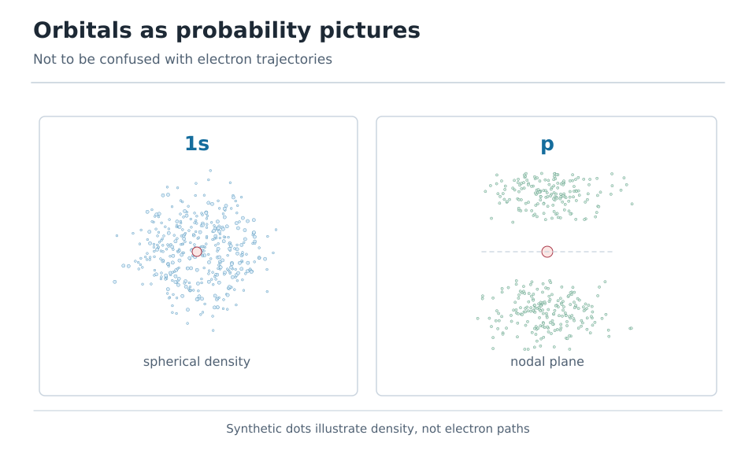

# M22-L4 – Quantum Atomic Model and Orbitals {#L4}

**Course area:** M22 – Atomic models, energy levels and spectra. **Level:** qualification phase; advanced topics marked. **Prerequisite:** [M22-L3](M22-L3.md). **Learning objective:** Interpret orbitals as probability distributions and distinguish wavefunction, density and probability in a region.

## Starting question {#S1}

Why can electrons in atoms not be pictured as planets following fixed tracks?

## Concepts and relationships {#S2}

In the **quantum atomic model**, an electron is described by a quantum state. The **wavefunction** $\psi(\mathbf r)$ may be complex; its squared magnitude $|\psi(\mathbf r)|^2$ is a **spatial probability density**. Integrating over a volume yields a probability: $P(V)=\int_V|\psi|^2\,\mathrm dV$. Normalization over all space gives one.

An **orbital** represents a spatial one-electron state, not the path travelled by an electron. The $1s$ orbital has spherical density symmetry; suitable $p$ orbitals have two preferred spatial lobes and a nodal plane. Coloured orbital surfaces usually depict chosen **density isosurfaces**, not physical walls. The probability is not uniform within the pictured outline. The KMK common Abitur core requires a **qualitative** quantum atomic model, not full multidimensional Schrödinger solutions.

*Dot clouds indicate probability densities, not classical electron tracks.*

## Worked example {#S3}

In an artificial **one-dimensional** probability example, let the position density be a constant $0.25\,\mathrm{nm}^{-1}$ over an interval $2.0\,\mathrm{nm}$ long. Then $P=0.25\,\mathrm{nm}^{-1}\times2.0\,\mathrm{nm}=0.50$ or $50\%$. This is **not** a real hydrogen orbital and does not represent three-dimensional atomic density.

## Investigation and practice {#S4}

Sketch a spherical density and a directional orbital as simplified contours. Label what each outline represents and what it does not represent. Contrast them with a circular-orbit drawing.

## Check your learning {#S5}

### Questions

1. What does $|\psi|^2$ mean in three-dimensional space?
2. Why must density be integrated over a region to obtain probability?
3. What characterizes a $1s$ orbital?
4. What does the outer contour of an orbital graphic usually mean?

### Answers

1. Probability density per unit volume.
2. A density is not yet a dimensionless probability.
3. Spherical symmetry of the spatial density.
4. A selected density threshold or probability region, not a hard atomic boundary.

## Model limitations {#S6}

These sketches simplify one-electron states. Many-electron states, interactions and electron spin require additional concepts.

## Further reading (internal) {#S7}

- [M22-L3](M22-L3.md) · Review prerequisite
- [M22-L5](M22-L5.md) · Next lesson

## Sources (external) {#S8}

- [KMK – Physics standards for Abitur 2020](https://www.kmk.org/fileadmin/Dateien/veroeffentlichungen_beschluesse/2020/2020_06_18-BildungsstandardsAHR_Physik.pdf) · p. 22, §2.6.3: atomic models; common core and advanced addition · Last accessed: 2026-11-21
- [OpenStax – University Physics 3, §8.1 Hydrogen Atom](https://openstax.org/books/university-physics-volume-3/pages/8-1-the-hydrogen-atom) · §8.1: hydrogen quantum states and orbitals · Last accessed: 2026-11-21
- [OpenStax – University Physics 3, §7.1 Wave Functions](https://openstax.org/books/university-physics-volume-3/pages/7-1-wave-functions) · §7.1: probability density and normalization · Last accessed: 2026-11-21

## Evidence {#S9}

