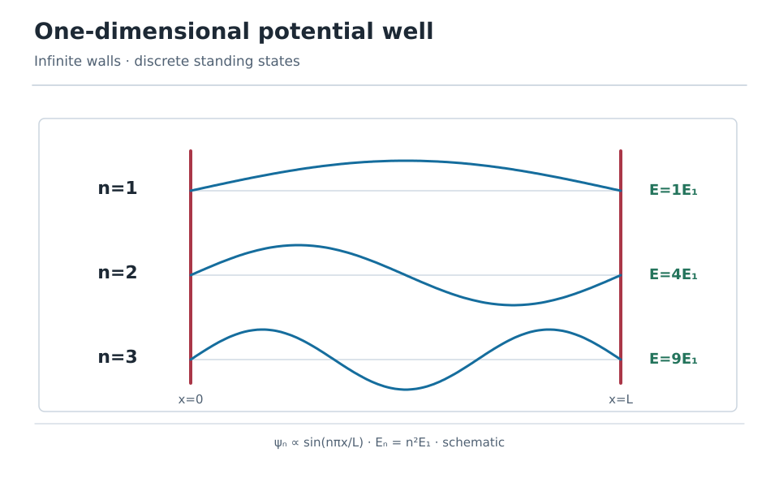

# M22-L5 – Advanced Level: One-Dimensional Potential Well {#L5}

**Course area:** M22 – Atomic models, energy levels and spectra. **Level:** qualification phase; advanced topics marked. **Prerequisite:** [M22-L4](M22-L4.md). **Learning objective:** Derive discrete energies for the one-dimensional infinite potential well and explain its modelling limits.

## Starting question {#S1}

Can an electron confined to a region of finite width have any arbitrarily small energy?

## Concepts and relationships {#S2}

The **one-dimensional infinite potential well** is an ideal model: $U(x)=0$ for $0<x<L$, and the potential is infinite outside. The wavefunction vanishes at the walls: $\psi(0)=\psi(L)=0$. Inside the well, stationary states obey the time-independent Schrödinger equation $-(\hbar^2/2m)\psi''=E\psi$. The boundary conditions permit only standing sine waves with $k_n=n\pi/L$, $n=1,2,\dots$.

The normalized functions are $\psi_n(x)=\sqrt{2/L}\,\sin(n\pi x/L)$ and the **discrete energies** are $E_n=n^2\pi^2\hbar^2/(2mL^2)=n^2h^2/(8mL^2)$. In particular, $E_1>0$: the ground-state energy cannot vanish because a confined normalized state cannot be spatially constant and zero at both walls. State $n$ has $n-1$ interior nodes. In the German national KMK standards, this is explicitly an **additional advanced-level topic**.

*Boundary conditions quantize the allowed states and energies.*

## Worked example {#S3}

For an electron of mass $m_e=9.109\times10^{-31}\,\mathrm{kg}$ in a width $L=1.00\,\mathrm{nm}$, $E_1\approx0.376\,\mathrm{eV}$. Hence $E_2=4E_1\approx1.504\,\mathrm{eV}$, and $E_2-E_1\approx1.128\,\mathrm{eV}$. Doubling $L$ reduces each energy at fixed quantum number by a factor of four.

## Investigation and practice {#S4}

Draw the stationary sine functions for $n=1,2,3$ with zeros at both walls. Sketch $|\psi_n|^2$ and avoid treating the waves as classical particles rebounding from walls.

## Check your learning {#S5}

### Questions

1. How do the boundary conditions select discrete $k_n$?
2. What is $E_3/E_1$?
3. What happens to $E_1$ if $L$ doubles?
4. Why is the box not a complete real atomic model?

### Answers

1. Only integer numbers of half-wavelengths fit: $k_n=n\pi/L$.
2. $E_3/E_1=9$.
3. It falls to $E_1/4$, here approximately $0.094\,\mathrm{eV}$.
4. It is one-dimensional and assumes infinitely high boundaries rather than a real Coulomb potential.

## Model limitations {#S6}

Infinite walls are a mathematical idealisation; actual quantum systems may tunnel through finite barriers. A box is not the Coulomb field of an atom.

## Further reading (internal) {#S7}

- [M22-L4](M22-L4.md) · Review prerequisite
- [M22-L6](M22-L6.md) · Next lesson

## Sources (external) {#S8}

- [KMK – Physics standards for Abitur 2020](https://www.kmk.org/fileadmin/Dateien/veroeffentlichungen_beschluesse/2020/2020_06_18-BildungsstandardsAHR_Physik.pdf) · p. 22, §2.6.3: atomic models; common core and advanced addition · Last accessed: 2026-11-21
- [OpenStax – University Physics 3, §7.4 Particle in a Box](https://openstax.org/books/university-physics-volume-3/pages/7-4-the-quantum-particle-in-a-box) · §7.4: stationary states and discrete box energies · Last accessed: 2026-11-21
- [OpenStax – University Physics 3, §7.1 Wave Functions](https://openstax.org/books/university-physics-volume-3/pages/7-1-wave-functions) · §7.1: probability density and normalization · Last accessed: 2026-11-21

## Evidence {#S9}

