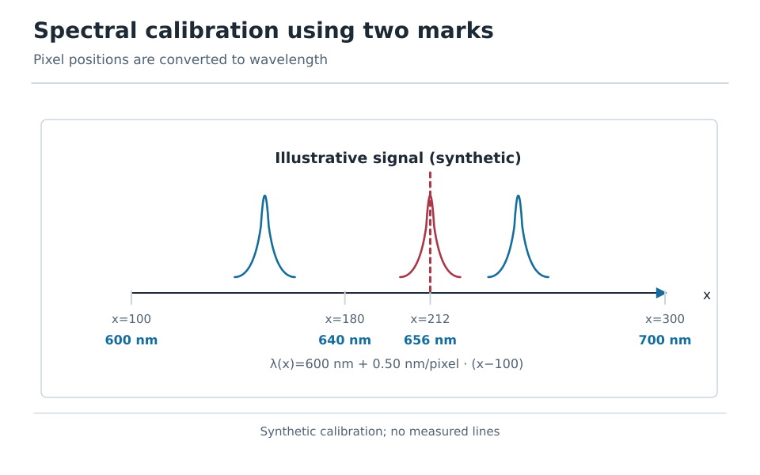

# M22-L6 – Atomic Physics in Research and Technology: Spectral Analysis {#L6}

**Course area:** M22 – Atomic models, energy levels and spectra. **Level:** qualification phase; advanced topics marked. **Prerequisite:** [M22-L5](M22-L5.md). **Learning objective:** Explain spectroscopy from calibration and line assignment to the limits of interpretation.

## Starting question {#S1}

How can a spectrum help identify an unknown gas without directly examining it?

## Concepts and relationships {#S2}

**Atomic spectroscopy** links measured wavelengths to transitions between atomic states. A basic spectrometer disperses light through a grating or prism and records an intensity profile $I(\lambda)$. Converting detector pixels into physical wavelengths requires **calibration points** or an instrument wavelength calibration. Only then can line centres, uncertainties and instrumental resolution be compared with reference data. Reliable **identification** normally uses multiple compatible lines and checks for interference.

Astronomical spectra also require assumptions about light propagation, temperature and ionization state before drawing compositional conclusions. **NIST** provides critically evaluated line and energy-level datasets; consulting such a database is not the same as producing a gas discharge spectrum in a laboratory. Other applications include materials inspection and gas analysis. In the KMK common core, this is an application context for emission, absorption and energy levels, not a separate nationally compulsory procedure.

*A measured position needs calibration before physical interpretation.*

## Worked example {#S3}

In an invented **linear** teaching calibration, $600\,\mathrm{nm}$ corresponds to pixel $x=100$ and $700\,\mathrm{nm}$ to $x=300$. Thus $\lambda(x)=600\,\mathrm{nm}+0.50\,\mathrm{nm/pixel}\,(x-100)$. A line centre at $x=212$ gives $\lambda=656\,\mathrm{nm}$. This is close to the hydrogen $H_\alpha$ line but one line alone is not conclusive evidence of composition.

## Investigation and practice {#S4}

Analyse a supplied example intensity profile. Find two line centres, calculate wavelengths and mark uncertainty intervals. Compare with an NIST reference and record possible alternative assignments. Do not build or operate unshielded discharge or UV sources.

## Check your learning {#S5}

### Questions

1. Why must a pixel spectrum be calibrated?
2. What wavelength does the example give at $x=180$?
3. Why is it useful to compare several spectral lines?
4. What must be checked when two lines overlap strongly?

### Answers

1. Calibration supplies the physical wavelength scale.
2. $600+0.50\times(180-100)=640\,\mathrm{nm}$.
3. It reduces the chance of false identification.
4. Resolution, linewidth, blending and possible alternative models.

## Model limitations {#S6}

This pixel calibration is artificial and linear; real instruments may show nonlinear dispersion, drift and stray light. The diagram does not contain measurements.

## Further reading (internal) {#S7}

- [M22-L5](M22-L5.md) · Review prerequisite
**Looking ahead:** The next module begins with [M23-L1 – Astrophysics: Stars and the Hertzsprung–Russell Diagram](M23-L1.md).

## Sources (external) {#S8}

- [KMK – Physics standards for Abitur 2020](https://www.kmk.org/fileadmin/Dateien/veroeffentlichungen_beschluesse/2020/2020_06_18-BildungsstandardsAHR_Physik.pdf) · p. 22, §2.6.3: atomic models; common core and advanced addition · Last accessed: 2026-11-21
- [OpenStax – University Physics 3, §8.5 Atomic Spectra](https://openstax.org/books/university-physics-volume-3/pages/8-5-atomic-spectra-and-x-rays) · §8.5: lines, spectral analysis and energy levels · Last accessed: 2026-11-21
- [NIST – Atomic Spectra Database](https://www.nist.gov/pml/atomic-spectra-database) · Reference database: atomic line wavelengths and energy levels · Last accessed: 2026-11-21

## Evidence {#S9}

