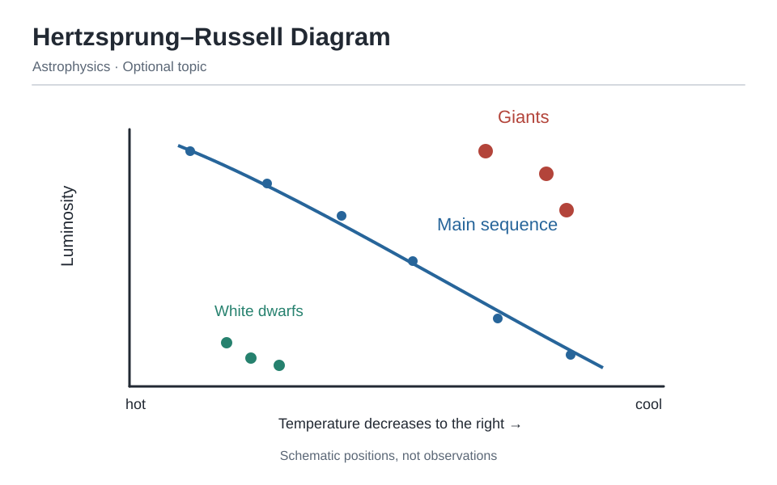

# M23-L1 – Astrophysics: Stars and the Hertzsprung–Russell Diagram {#L1}

**Course area:** M23 – Optional and Advanced Topics. **Level:** optional enrichment, not nationally compulsory as a separate lesson. **Prerequisite:** [M22-L6](M22-L6.md). **Learning objective:** Classify stars using surface temperature, luminosity and radius in a schematic Hertzsprung–Russell diagram.

## Starting question {#S1}

Why can two stars have the same surface temperature but emit very different amounts of light?

## Concepts and relationships {#S2}

The **Hertzsprung–Russell diagram (HRD)** places stars according to **luminosity** $L$ (total radiated power, not apparent brightness in the sky) and effective surface temperature $T$. Conventionally, temperature on the horizontal axis **decreases to the right**; luminosity increases upwards, often logarithmically. In a schematic HRD, the **main sequence** extends from hot and luminous (upper left) to cool and faint (lower right). Other regions contain red giants and hot but comparatively faint white dwarfs. A stellar class does not uniquely determine age: stars of different initial masses evolve along different pathways.

For an approximate thermal emitter, $L=4\pi R^2\sigma T^4$, where $\sigma$ is the Stefan–Boltzmann constant. At fixed surface temperature, a larger radius implies greater luminosity. This helps explain the location of giants compared with main-sequence stars. Inferring actual luminosities requires distance measurements and corrections such as extinction; apparent brightness alone is insufficient. The plotted points are **invented teaching examples**, not observed stars. Astrophysics is an **optional profile**, not a stand-alone nationally required German Abitur topic.

*Schematic stellar populations on an HRD; temperature decreases to the right; points are not measurements.*

## Worked example {#S3}

Two idealised stars share the same surface temperature. Star B has three times the radius of star A: $L_B/L_A=(R_B/R_A)^2=3^2=9$. In the model star B emits nine times the power, although their apparent ranking in the sky could be reversed by different distances.

## Investigation and practice {#S4}

Draw HRD axes with temperature decreasing to the right. Mark a schematic main sequence, giants and white dwarfs. Explain which measurements and assumptions would be needed to classify a real star.

## Check your learning {#S5}

### Questions

1. What is plotted on the vertical HRD axis?
2. Which direction corresponds to higher temperature in the conventional HRD?
3. How does $L$ change at fixed $T$ if $R$ doubles?
4. Why is luminosity different from apparent brightness?

### Answers

1. Total radiated power, or luminosity $L$.
2. Towards the left.
3. It becomes four times larger.
4. Apparent brightness also depends on distance and attenuation along the line of sight.

## Model limitations {#S6}

Ideal thermal radiation leaves out details of real stellar atmospheres. Dust, composition, measurement uncertainty and evolution affect HRD positions; our plot contains no catalogue data.

## Further reading (internal) {#S7}

- [M22-L6](M22-L6.md) · Review prerequisite
- [M23-L2](M23-L2.md) · Next lesson

## Sources (external) {#S8}

- [KMK – Physics standards for Abitur 2020](https://www.kmk.org/fileadmin/Dateien/veroeffentlichungen_beschluesse/2020/2020_06_18-BildungsstandardsAHR_Physik.pdf) · pp. 18 and 20, §§2.4, 2.6: evaluation competence and optional extensions · Last accessed: 2026-11-21
- [OpenStax – Astronomy, §21.2 H–R Diagram](https://openstax.org/books/astronomy/pages/21-2-the-h-r-diagram-and-the-study-of-stellar-evolution) · §21.2: temperature, luminosity, main sequence, stellar evolution · Last accessed: 2026-11-21

## Evidence {#S9}

