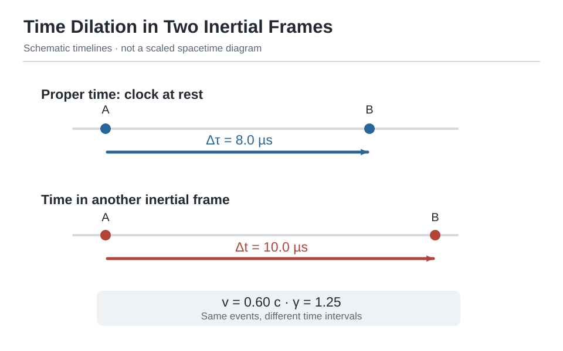

# M23-L2 – Special Relativity: Inertial Frames and Time Dilation {#L2}

**Course area:** M23 – Optional and Advanced Topics. **Level:** optional enrichment, not nationally compulsory as a separate lesson. **Prerequisite:** [M23-L1](M23-L1.md). **Learning objective:** Distinguish proper time from frame-dependent time and calculate time dilation for two inertial frames.

## Starting question {#S1}

How can observers assign different time intervals to the same pair of events involving a moving clock?

## Concepts and relationships {#S2}

Special relativity describes measurements in **inertial frames**, where force-free bodies move uniformly in straight lines. A central principle is that the vacuum speed of light $c$ is identical for inertial observers. Consequently, time intervals and claims of simultaneity can depend on the observer's frame. The interval between two events that occur **at the same position of a clock moving with them** is called **proper time** $\Delta\tau$.

For a clock moving at constant speed $v$ relative to another inertial frame, the appropriate comparison gives **time dilation** $\Delta t=\gamma\Delta\tau$, with $\gamma=1/\sqrt{1-v^2/c^2}$. The clock's rest frame measures $\Delta\tau$; the other frame assigns the greater interval $\Delta t$ to the same events. The formula applies for $0\leq v<c$ in inertial motion. Events, synchronisation and frames must be identified before comparing distant clocks. Under the KMK standards, relativity is a **possible extension**, not a compulsory national stand-alone lesson.

*Time dilation at 0.60 c: two inertial frames assign different intervals to the same event pair.*

## Worked example {#S3}

At $v=0.60c$, $\gamma=1/\sqrt{1-0.36}=1.25$. If the moving clock records $\Delta\tau=8.0\,\mathrm{\mu s}$ between two events, the other inertial frame assigns $\Delta t=10.0\,\mathrm{\mu s}$. The difference is $2.0\,\mathrm{\mu s}$; neither clock is faulty.

## Investigation and practice {#S4}

Draw two event timelines. Label the two shared events, the proper time and the interval in the other frame. Calculate $\gamma$ for $0.2c$, $0.6c$ and $0.8c$; explain why the Newtonian approximation works well at low speed.

## Check your learning {#S5}

### Questions

1. Under what condition is an interval proper time?
2. What is $\gamma$ at $v=0$?
3. Calculate $\gamma$ at $v=0.8c$.
4. Why is time dilation not due to defective clocks?

### Answers

1. The events take place at the same location in the clock’s rest frame.
2. $\gamma=1$.
3. $\gamma=1/\sqrt{1-0.64}=5/3\approx1.667$.
4. It is a reproducible effect of spacetime structure, not a mechanical malfunction.

## Model limitations {#S6}

This treatment assumes uniform inertial motion and ideal frame synchronisation. Accelerated journeys require further reasoning; the schematic figure is not a scaled Minkowski diagram.

## Further reading (internal) {#S7}

- [M23-L1](M23-L1.md) · Review prerequisite
- [M23-L3](M23-L3.md) · Next lesson

## Sources (external) {#S8}

- [KMK – Physics standards for Abitur 2020](https://www.kmk.org/fileadmin/Dateien/veroeffentlichungen_beschluesse/2020/2020_06_18-BildungsstandardsAHR_Physik.pdf) · pp. 18 and 20, §§2.4, 2.6: evaluation competence and optional extensions · Last accessed: 2026-11-21
- [OpenStax – University Physics 3, §5.3 Time Dilation](https://openstax.org/books/university-physics-volume-3/pages/5-3-time-dilation) · §5.3: proper time, Lorentz factor and frame intervals · Last accessed: 2026-11-21

## Evidence {#S9}

