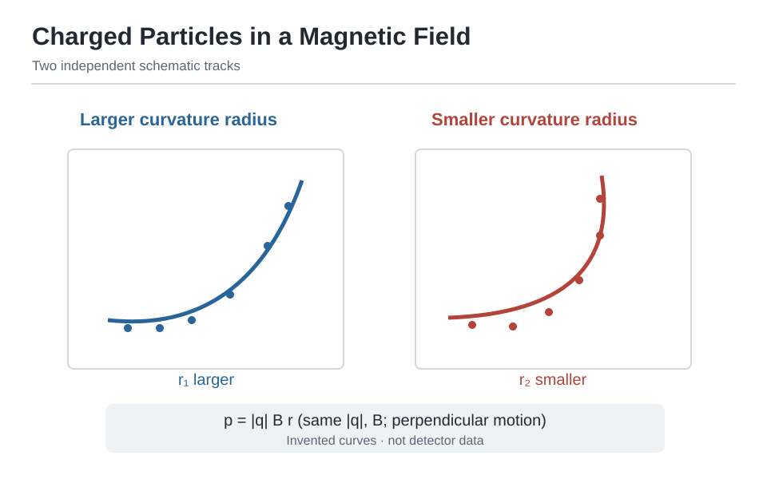

# M23-L3 – Nuclear and Particle Physics: Interactions and Detector Tracks {#L3}

**Course area:** M23 – Optional and Advanced Topics. **Level:** optional enrichment, not nationally compulsory as a separate lesson. **Prerequisite:** [M23-L2](M23-L2.md). **Learning objective:** Interpret tracks as indirect evidence and infer qualitative momentum differences from curvature in magnetic fields.

## Starting question {#S1}

How can a detector reveal a charged particle without photographing the particle itself?

## Concepts and relationships {#S2}

Particle detectors register **interactions** of particles with detector materials, not tiny photographic images of the particles. In a cloud chamber droplets condense along ionisation trails; modern tracking detectors reconstruct trajectories from electronic hits. A magnetic field can curve the path of a charged particle. For motion perpendicular to a uniform magnetic field, the magnitude satisfies $p=|q|Br$, where $p$ is momentum, $|q|$ charge magnitude, $B$ magnetic flux density and $r$ curvature radius. The curvature direction depends on charge sign, direction of travel and magnetic-field direction. Parallel travel causes no magnetic Lorentz force.

An event display presents **reconstructed evidence**. A track by itself does not identify a particle: mass, energy loss, detector hits and complementary information are relevant. A decay may have tracks meeting at a vertex; neutral particles often leave no curved track but can produce charged daughter particles. The branching diagram is an **instructional schematic**, not an actual collision, a Feynman diagram or a calibrated event reconstruction. The KMK names nuclear and particle physics as an **optional extension**.

*Larger radius implies greater transverse momentum at fixed charge magnitude and field.*

## Worked example {#S3}

Two particles with equal $|q|$ travel perpendicular to the same uniform field $B=0.50\,\mathrm T$. For $|q|=1.602\times10^{-19}\,\mathrm C$ and radius $r=0.40\,\mathrm m$, $p=|q|Br=3.204\times10^{-20}\,\mathrm{kg\,m/s}$. Double the radius would imply double the momentum under the same field and charge assumptions. This is a model example, not an identification of a real particle.

## Investigation and practice {#S4}

Compare two invented, labelled curved tracks in a constant field. Identify the larger momentum and explain why the charge magnitude and field value are needed to determine its absolute magnitude. Analyse public CERN educational examples instead of building radioactive or cryogenic detectors.

## Check your learning {#S5}

### Questions

1. What does a detector measure directly?
2. What does a larger radius imply at fixed $B$ and $|q|$?
3. Why may a neutral particle lack an immediately visible curved track?
4. Is curvature alone enough to find the particle mass?

### Answers

1. Signals such as ionisation or electronic hits in detector materials.
2. Greater transverse momentum.
3. Without charge it does not curve magnetically, although charged decay products may be detected.
4. No; complementary measurements are required.

## Model limitations {#S6}

The circular model assumes a uniform magnetic field, small energy loss and a suitable trajectory angle. Real experiments require calibration and complex track reconstruction; our drawing contains no measured event.

## Further reading (internal) {#S7}

- [M23-L2](M23-L2.md) · Review prerequisite
- [M23-L4](M23-L4.md) · Next lesson

## Sources (external) {#S8}

- [KMK – Physics standards for Abitur 2020](https://www.kmk.org/fileadmin/Dateien/veroeffentlichungen_beschluesse/2020/2020_06_18-BildungsstandardsAHR_Physik.pdf) · pp. 18 and 20, §§2.4, 2.6: evaluation competence and optional extensions · Last accessed: 2026-11-21
- [CERN – How a Detector Works](https://home.cern/science/experiments/how-detector-works/) · Detector signals and momentum inferred from track curvature · Last accessed: 2026-11-21

## Evidence {#S9}

