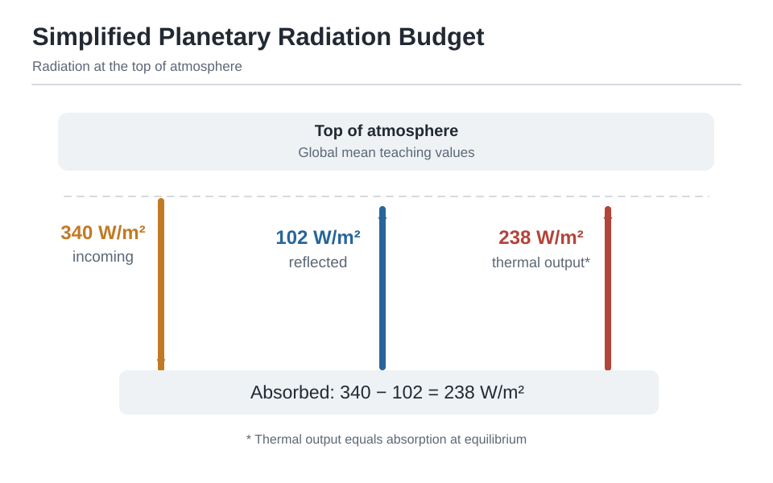

# M23-L4 – Climate Physics: Albedo and Planetary Energy Balance {#L4}

**Course area:** M23 – Optional and Advanced Topics. **Level:** optional enrichment, not nationally compulsory as a separate lesson. **Prerequisite:** [M23-L3](M23-L3.md). **Learning objective:** Construct a simplified radiation budget and calculate the impact of albedo changes.

## Starting question {#S1}

Why does a small change in reflected solar radiation matter for Earth’s energy balance?

## Concepts and relationships {#S2}

The **planetary energy budget** compares incoming shortwave sunlight, reflected radiation and outgoing longwave thermal radiation. At the top of the atmosphere, global and time-averaged incoming solar radiation is approximately $S=340\,\mathrm{W/m^2}$. A fraction described by **albedo** $\alpha$ is reflected. In a simplified stationary model, the absorbed flux is $F_{\mathrm{abs}}=(1-\alpha)S$ and at equilibrium $F_{\mathrm{out}}=F_{\mathrm{abs}}$. At $\alpha\approx0.30$, this yields about $238\,\mathrm{W/m^2}$; NASA cites approximately $240\,\mathrm{W/m^2}$ as the average absorption.

The **greenhouse effect** does not generate energy. Greenhouse gases affect the altitudes and spectral bands at which Earth radiates longwave energy to space, changing the overall energy balance. A single top-of-atmosphere budget with no distinct atmospheric and surface layers does **not** determine surface temperature. Under a blackbody assumption, the effective emission temperature follows $F_{\mathrm{out}}=\sigma T_{\mathrm{eff}}^4$. Actual climate evolution includes spatial patterns, time dependence, spectral behaviour and feedbacks. Climate physics is a possible KMK advanced-course extension.

*Simplified global-mean energy budget, not a surface or regional energy balance.*

## Worked example {#S3}

For $S=340\,\mathrm{W/m^2}$ and $\alpha=0.30$, $F_{\mathrm{abs}}=0.70\times340=238\,\mathrm{W/m^2}$. At $\alpha=0.32$, this becomes $231.2\,\mathrm{W/m^2}$. The difference is $-6.8\,\mathrm{W/m^2}$ **holding $S$ fixed** – an instantaneous model comparison, not a real-world temperature forecast.

## Investigation and practice {#S4}

Create an original flow schematic with 340 W/m² incoming, 102 W/m² reflected and 238 W/m² absorbed solar radiation. Mark these as globally averaged teaching values. Explain why outgoing radiation can temporarily differ from absorption as the climate system warms or cools.

## Check your learning {#S5}

### Questions

1. What does albedo mean?
2. Calculate absorption for $S=340$ and $\alpha=0.25$.
3. Why does a difference between incoming and outgoing radiation matter?
4. Can ground surface temperature be read directly from this simple top-of-atmosphere budget?

### Answers

1. The reflected fraction of incident shortwave radiation.
2. $0.75\times340=255\,\mathrm{W/m^2}$.
3. A non-zero imbalance implies changing energy stored in the Earth system.
4. No; atmosphere, spectral processes and heat transport are also needed.

## Model limitations {#S6}

Values are rounded global annual averages. The illustration concerns only the top-of-atmosphere budget, not local fluxes or a complete surface budget; incoming radiation and albedo vary across time and place.

## Further reading (internal) {#S7}

- [M23-L3](M23-L3.md) · Review prerequisite
- [M23-L5](M23-L5.md) · Next lesson

## Sources (external) {#S8}

- [KMK – Physics standards for Abitur 2020](https://www.kmk.org/fileadmin/Dateien/veroeffentlichungen_beschluesse/2020/2020_06_18-BildungsstandardsAHR_Physik.pdf) · pp. 18 and 20, §§2.4, 2.6: evaluation competence and optional extensions · Last accessed: 2026-11-21
- [NASA – Climate and Earth’s Energy Budget](https://science.nasa.gov/earth/earth-observatory/climate-and-earths-energy-budget/) · Global incoming and absorbed flux, reflection and budget limits · Last accessed: 2026-11-21

## Evidence {#S9}

