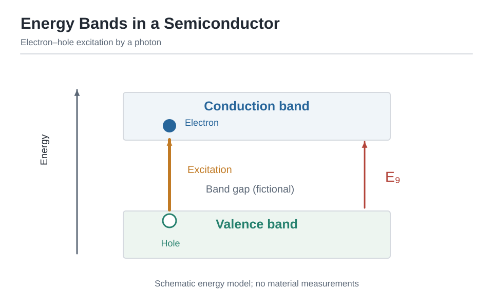

# M23-L5 – Solid-State Physics: Energy Bands and Semiconductors {#L5}

**Course area:** M23 – Optional and Advanced Topics. **Level:** optional enrichment, not nationally compulsory as a separate lesson. **Prerequisite:** [M23-L4](M23-L4.md). **Learning objective:** Distinguish valence band, conduction band and band gap and explain simple semiconductor applications.

## Starting question {#S1}

Why does a semiconductor conduct differently from a metal or an insulator?

## Concepts and relationships {#S2}

In a **solid**, interactions between many atoms create allowed **energy bands** rather than isolated atomic energy levels. In a simplified model a completely filled **valence band** contributes little to transport; mobile electrons in the **conduction band** and missing valence electrons (holes) can carry charge. The energy separation is the **band gap** $E_g$. Metals have accessible states near the Fermi energy; insulators typically have a large band gap, while semiconductors have a smaller one. These are qualitative categories rather than a sharp universal numerical boundary.

Thermal energy or sufficiently energetic photons can excite electrons across the gap, generating electron–hole pairs. For an ideal photon $E=hc/\lambda$, $E\ge E_g$ is a necessary energy condition for interband excitation; transition probabilities and momentum conservation still depend on band structure. **Doping** modifies available charge carriers. A functioning photovoltaic cell additionally needs suitable internal fields and contacts to separate and extract carriers. The diagram shows schematic energy levels, not measured silicon data. Solid-state physics is an optional KMK extension.

*Electronic excitation in an ideal semiconductor; band positions are not to scale.*

## Worked example {#S3}

An ideal direct band gap $E_g=1.50\,\mathrm{eV}$ corresponds to threshold wavelength $\lambda_g\approx1240\,\mathrm{eV\,nm}/1.50\,\mathrm{eV}=827\,\mathrm{nm}$. A $700\,\mathrm{nm}$ photon has about $1.77\,\mathrm{eV}$, energetically above threshold. This does **not** imply that every photon is absorbed or produces useful electric current.

## Investigation and practice {#S4}

Draw separate valence and conduction bands with a gap, an excitation arrow and a hole. Compare two hypothetical materials having $E_g=1.5\,\mathrm{eV}$ and $3.0\,\mathrm{eV}$ and calculate their corresponding limiting wavelengths.

## Check your learning {#S5}

### Questions

1. What is the band model?
2. Name the two main bands shown.
3. Calculate $\lambda_g$ for $E_g=3.0\,\mathrm{eV}$.
4. Why is the band gap alone insufficient to predict solar-cell efficiency?

### Answers

1. A model of allowed electron energies in a crystal.
2. Valence band and conduction band.
3. $\lambda_g\approx1240/3.0=413\,\mathrm{nm}$.
4. Absorption, recombination, contacts, the input spectrum and other losses affect efficiency.

## Model limitations {#S6}

The flat horizontal bands and single excitation arrow simplify real energy–momentum dispersion. Silicon has an indirect gap; the example is a fictional direct-gap model.

## Further reading (internal) {#S7}

- [M23-L4](M23-L4.md) · Review prerequisite
- [M23-L6](M23-L6.md) · Next lesson

## Sources (external) {#S8}

- [KMK – Physics standards for Abitur 2020](https://www.kmk.org/fileadmin/Dateien/veroeffentlichungen_beschluesse/2020/2020_06_18-BildungsstandardsAHR_Physik.pdf) · pp. 18 and 20, §§2.4, 2.6: evaluation competence and optional extensions · Last accessed: 2026-11-21
- [OpenStax – University Physics 3, §9.5 Band Theory of Solids](https://openstax.org/books/university-physics-volume-3/pages/9-5-band-theory-of-solids) · §9.5: valence band, conduction band and band gap · Last accessed: 2026-11-21

## Evidence {#S9}

