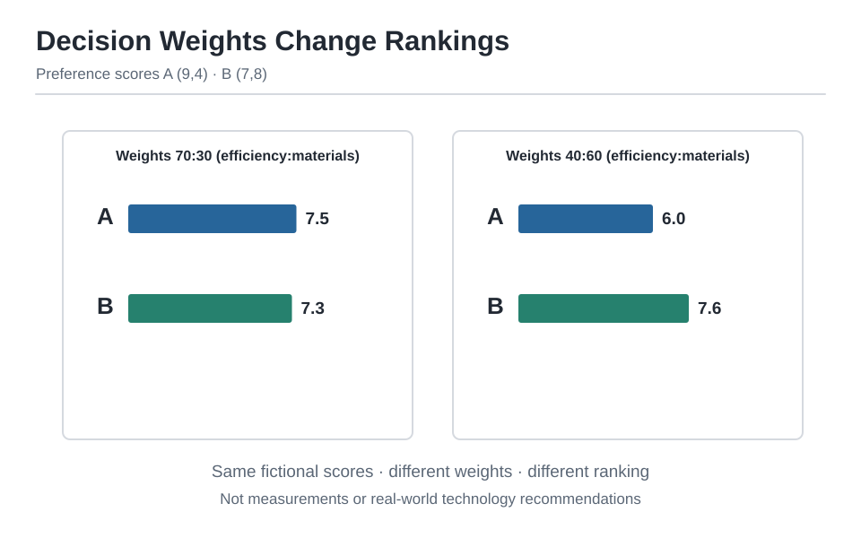

# M23-L6 – Physics and Society: Evidence, Risks and Decisions {#L6}

**Course area:** M23 – Optional and Advanced Topics. **Level:** optional enrichment, not nationally compulsory as a separate lesson. **Prerequisite:** [M23-L5](M23-L5.md). **Learning objective:** Evaluate a physics-related technological decision while separating data, uncertainty and value-based criteria.

## Starting question {#S1}

Is a high efficiency figure alone sufficient to decide which technology best serves society?

## Concepts and relationships {#S2}

A **physical finding** is a testable measurement or model outcome, such as energy efficiency. An **evaluation** also requires criteria such as costs, material requirements, safety, availability, social consequences and time horizon. Selecting the largest number from a table may ignore incompatible system boundaries. A $10\,\%$ loss at device level is not necessarily a $10\,\%$ loss across an entire supply chain. Technical claims therefore need a **quantity and unit, source and date, system boundary and uncertainty**.

A transparent evaluation first defines the decision and options, then separates verifiable numerical evidence from value judgements. **Criterion weights** are declared, sensitivity is tested and missing data are recorded as missing. Weighted scores are decision aids, not physical proofs. Two people can accurately use the same measurements but reach different conclusions because they legitimately prioritize different outcomes. **Evaluation competence** is mandatory in the KMK framework; selecting particular technologies as examples is optional.

*Fictional scoring matrix: changing weights alters the ranking without new measurements.*

## Worked example {#S3}

Two **purely fictional** systems A and B receive 0–10 **scores** (higher = preferred) for efficiency and low material demand: A $(9,4)$, B $(7,8)$. At weights $(0.7,0.3)$, $S_A=0.7\times9+0.3\times4=7.5$ and $S_B=0.7\times7+0.3\times8=7.3$: A is slightly preferred. Changing weights to $(0.4,0.6)$ produces $S_A=6.0$, $S_B=7.6$, reversing the result. These **scores are invented**, not measurements.

## Investigation and practice {#S4}

Create a criteria matrix for an energy-related decision. Find at least two actual dated technical sources and explicitly identify missing data; use the labelled fictional scores for the initial arithmetic. Recalculate with changed weights. Include an evidence-based opposing view and one consequence for affected people.

## Check your learning {#S5}

### Questions

1. What distinguishes a measured finding from a value judgement?
2. What is B’s score for weights $(0.7,0.3)$?
3. What does a reversed ranking under different weights reveal?
4. Name four details needed to compare a technical number fairly.

### Answers

1. Findings can be independently tested; priorities and trade-offs involve normative criteria.
2. $7.3$.
3. The choice depends on priorities and cannot be determined by physics alone.
4. Quantity/unit, system boundary, source/date and uncertainty.

## Model limitations {#S6}

The matrix is not a life-cycle study or a political recommendation. Scales and weights are constructed; real decisions require verified data, side-effect analysis and affected stakeholders.

## Further reading (internal) {#S7}

- [M23-L5](M23-L5.md) · Review prerequisite
**Looking ahead:** The next module begins with [M24-L1 – Demand Levels and Task Operators](M24-L1.md).

## Sources (external) {#S8}

- [KMK – Physics standards for Abitur 2020](https://www.kmk.org/fileadmin/Dateien/veroeffentlichungen_beschluesse/2020/2020_06_18-BildungsstandardsAHR_Physik.pdf) · pp. 18 and 20, §§2.4, 2.6: evaluation competence and optional extensions · Last accessed: 2026-11-21
- [NASA – Climate and Earth’s Energy Budget](https://science.nasa.gov/earth/earth-observatory/climate-and-earths-energy-budget/) · Global incoming and absorbed flux, reflection and budget limits · Last accessed: 2026-11-21
- [OpenStax – University Physics 3, §9.5 Band Theory of Solids](https://openstax.org/books/university-physics-volume-3/pages/9-5-band-theory-of-solids) · §9.5: valence band, conduction band and band gap · Last accessed: 2026-11-21

## Evidence {#S9}

