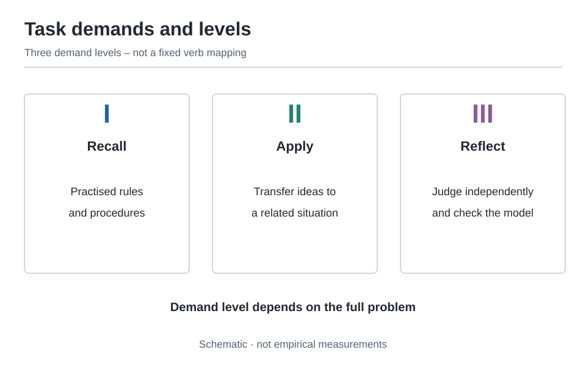

# M24-L1 – Demand Levels and Task Operators {#L1}

**Course area:** M24 – Abitur Practice and Scientific Reasoning. **Level:** Abitur preparation and exam methods. **Prerequisites:** Quantities, units and subject knowledge from the preceding modules. **Learning objective:** Solve physics prompts across demand levels I–III and explain how the task operator works in context.

## Starting question {#S1}

Two questions may use the same instruction verb yet require different levels of reasoning. “Explain” can mean describing a familiar experiment or accounting for an unexpected deviation in a new situation. The **complete question and context** determine what must be demonstrated.

## Concepts and relationships {#S2}

The German KMK framework distinguishes three **demand levels** (Anforderungsbereiche, AFB): **I** – reproduce familiar knowledge and describe practised procedures; **II** – select, connect and transfer knowledge to comparable situations; **III** – solve complex unfamiliar problems independently, justify judgements and reflect on one's methods. The KMK requires a focus on level II in Abitur examinations, with levels I and III also represented. These levels are **not grades**, nor are they fixed labels attached to individual verbs.

**Task operators** specify the requested action. For example, “state” asks for a concise response, “calculate” requires a traceable numerical method, “explain” requires a coherent physical connection, and “evaluate” calls for a justified weighing of evidence or criteria. These are **teaching examples**, not a complete official IQB operator list. For any real exam, consult the IQB and state documents applicable to that exam year, including permitted aids.

A useful reading procedure is: **mark the action verb → separate given quantities from what is sought → select a model → check the required justification**. This links each instruction to physics rather than memorising a verb out of context.

*Schematic guide: demand level depends on the whole task, not solely on the action verb.*

## Worked example {#S3}

A motion problem specifies a constant speed $v=3.0\,\mathrm{m/s}$ and time $t=4.0\,\mathrm{s}$. **Describe**: This is uniform motion, covering equal distances in equal intervals. **Calculate**: $s=v\,t=3.0\,\mathrm{m/s}\times4.0\,\mathrm{s}=12\,\mathrm{m}$. **Evaluate**: Real data would have to show that speed was constant; one average-speed value does not establish this. The third action requires assumptions and evidence limits, not just another calculation.

## Investigation and practice {#S4}

Write three progressively more independent prompts about the same physical situation. For each, specify the expected response: Which quantity, mathematical step and explanation would be enough? Exchange prompts with a peer and compare answers without treating the operator alone as a fixed demand-level rule.

## Check your learning {#S5}

### Questions

1. What particularly distinguishes AFB III from AFB I?
2. Calculate distance for $v=2.5\,\mathrm{m/s}$ and $t=6.0\,\mathrm{s}$.
3. Why does the verb “explain” not determine the demand level on its own?
4. Which two kinds of current official documents matter for actual exam preparation?

### Answers

1. III involves independent treatment and reflection in a complex or unfamiliar situation; I focuses on familiar knowledge and practised procedures.
2. $s=v\,t=15\,\mathrm{m}$.
3. Prior knowledge, novelty, supplied materials and required independence all contribute.
4. The IQB operator reference applicable to the exam year and the relevant state's official exam guidance; approved aids must also be checked.

## Model limitations {#S6}

These three prompts do not reproduce a complete Abitur paper. Operator requirements and task formats may vary by year and state. The classification here is a **study aid**, not an official marking scheme.

## Further reading (internal) {#S7}

- [M23-L6](M23-L6.md) · Distinguishing evidence from evaluation
- [M24-L2](M24-L2.md) · Interpreting questions based on supplied materials

## Sources (external) {#S8}

- [KMK – Physics standards for the German Abitur (2020)](https://www.kmk.org/fileadmin/Dateien/veroeffentlichungen_beschluesse/2020/2020_06_18-BildungsstandardsAHR_Physik.pdf) · §3.1.1, pp. 23–24: demand levels and exam tasks · Last accessed: 2026-11-21
- [IQB – Supporting documents for natural sciences](https://www.iqb.hu-berlin.de/de/schule/sekundarstufe-ii/begleitendedokumente/) · Official task-operator basis and supporting rules; verify the applicable exam year · Last accessed: 2026-11-21

## References {#S9}

